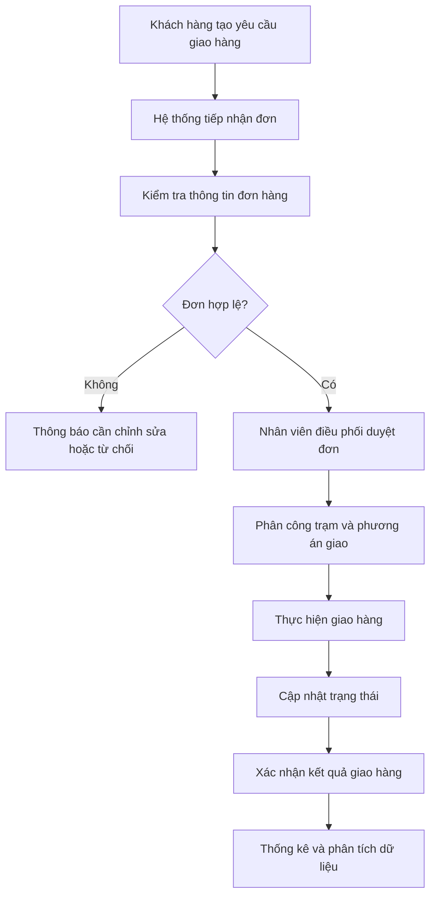

# SMARTDRONEDELIVERY
## Nền tảng quản lý giao hàng bằng Drone tích hợp AI

## 1. Giới thiệu

SmartDroneDelivery là nền tảng hỗ trợ quản lý hoạt động giao hàng bằng Drone, hướng đến việc số hóa quy trình từ tiếp nhận yêu cầu, quản lý đơn hàng, điều phối giao hàng, theo dõi tiến trình đến xác nhận kết quả.

Hệ thống kết hợp ứng dụng Web, Mobile, Backend API, cơ sở dữ liệu và các chức năng hỗ trợ phân tích bằng AI.

## 2. Mục tiêu dự án

- Quản lý tập trung thông tin khách hàng và đơn hàng.
- Quản lý kiện hàng và trạm Drone.
- Hỗ trợ điều phối và xử lý đơn giao hàng.
- Theo dõi trạng thái giao hàng.
- Ghi nhận và xác nhận kết quả giao hàng.
- Hỗ trợ phân tích dữ liệu và dự đoán thời gian giao hàng.

## 3. Đối tượng sử dụng

| Đối tượng | Vai trò |
|---|---|
| Customer | Tạo yêu cầu và theo dõi đơn hàng |
| Dispatcher | Kiểm tra, duyệt và phân công đơn |
| Station Operator | Quản lý hoạt động tại trạm |
| Logistics Manager | Theo dõi và đánh giá vận hành |
| System Administrator | Quản lý tài khoản và cấu hình |

## 4. Các chức năng chính

1. Quản lý tài khoản và phân quyền.
2. Quản lý khách hàng.
3. Quản lý đơn hàng.
4. Quản lý kiện hàng.
5. Quản lý trạm Drone.
6. Điều phối giao hàng.
7. Theo dõi trạng thái giao hàng.
8. Xác nhận giao hàng.
9. Báo cáo và thống kê.
10. Hỗ trợ phân tích bằng AI.

## 5. Công nghệ dự kiến sử dụng

| Thành phần | Công nghệ |
|---|---|
| Web Frontend | ReactJS |
| Mobile | Flutter |
| Backend | ASP.NET Core Web API |
| Database | PostgreSQL |
| Real-time | SignalR |
| AI | Phân tích dữ liệu và dự đoán |
| Quản lý mã nguồn | GitHub |
| Thiết kế giao diện | Figma |
| Quản lý công việc | Jira |
| Tài liệu dự án | Confluence |
| Triển khai | Docker |

## 6. Quy trình hoạt động tổng quát

## 7. Cấu trúc tài liệu

| File | Nội dung |
|---|---|
| 01 | Giới thiệu đề tài |
| 02 | Khảo sát và phân tích nghiệp vụ |
| 03 | Phân tích yêu cầu hệ thống |
| 04 | Thiết kế hệ thống |
| 05 | Công nghệ và công cụ |
| 06 | Xây dựng và triển khai |
| 07 | Kiểm thử và đánh giá |
| 08 | Kết quả đạt được |
| 09 | Kết luận và hướng phát triển |

## 8. Phạm vi tài liệu

Tài liệu mô tả yêu cầu, nghiệp vụ, thiết kế và kế hoạch triển khai SmartDroneDelivery. Nội dung cần được cập nhật theo chức năng thực tế mà nhóm thống nhất và xây dựng.

## 9. Trạng thái dự án

Các chức năng được phân biệt theo trạng thái:
- Đề xuất: Chức năng dự kiến thực hiện.
- Đang phát triển: Chức năng đang được xây dựng.
- Hoàn thành: Đã triển khai và kiểm thử.
- Mô phỏng: Chỉ mô phỏng, chưa tích hợp thiết bị hoặc dịch vụ thực tế.

