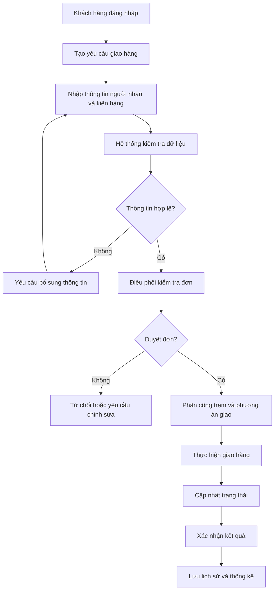

# PHẦN 2. KHẢO SÁT VÀ PHÂN TÍCH NGHIỆP VỤ

## 2.1. Khảo sát hiện trạng

Hoạt động giao nhận hàng hóa hiện nay thường được thực hiện bằng xe máy, ô tô và các phương tiện vận tải khác. Khi số lượng đơn hàng tăng, việc tiếp nhận, phân công và theo dõi đơn có thể trở nên phức tạp.

Một số vấn đề thường gặp:
- Khó quản lý số lượng lớn đơn hàng.
- Thông tin giữa các bộ phận chưa được đồng bộ.
- Khó theo dõi tiến trình giao hàng.
- Việc tổng hợp dữ liệu và lập báo cáo mất thời gian.
- Khó đánh giá hiệu quả hoạt động của từng trạm.

## 2.2. Nhu cầu xây dựng hệ thống

SmartDroneDelivery được đề xuất nhằm:
- Quản lý tập trung thông tin khách hàng và đơn hàng.
- Quản lý thông tin kiện hàng và trạm Drone.
- Hỗ trợ nhân viên điều phối xử lý đơn.
- Theo dõi trạng thái giao hàng.
- Lưu lịch sử xử lý và kết quả giao hàng.
- Hỗ trợ phân tích dữ liệu vận hành.

## 2.3. Các tác nhân tham gia

| STT | Tác nhân | Trách nhiệm |
|---|---|---|
| 1 | Customer | Tạo yêu cầu, theo dõi đơn hàng |
| 2 | Dispatcher | Kiểm tra, duyệt và phân công đơn |
| 3 | Station Operator | Tiếp nhận và cập nhật hoạt động tại trạm |
| 4 | Logistics Manager | Theo dõi và đánh giá vận hành |
| 5 | System Administrator | Quản lý tài khoản và cấu hình |

## 2.4. Quy trình nghiệp vụ tổng quát

## 2.5. Mô tả các bước nghiệp vụ

| Bước | Người thực hiện | Nội dung |
|---|---|---|
| 1 | Customer | Đăng nhập hệ thống |
| 2 | Customer | Tạo yêu cầu giao hàng |
| 3 | Hệ thống | Kiểm tra dữ liệu đầu vào |
| 4 | Dispatcher | Kiểm tra và duyệt đơn |
| 5 | Dispatcher | Phân công trạm và phương án giao |
| 6 | Station Operator | Tiếp nhận và thực hiện |
| 7 | Hệ thống | Cập nhật trạng thái |
| 8 | Người có quyền xác nhận | Ghi nhận kết quả giao hàng |
| 9 | Hệ thống | Lưu lịch sử và thống kê |

## 2.6. Quy trình xử lý đơn hàng

### a. Tiếp nhận đơn hàng
- Khách hàng nhập thông tin người gửi và người nhận.
- Nhập địa chỉ giao hàng.
- Nhập khối lượng và kích thước kiện hàng.
- Gửi yêu cầu đến hệ thống.

### b. Kiểm tra và duyệt đơn
- Nhân viên điều phối kiểm tra thông tin.
- Đánh giá điều kiện vận chuyển.
- Phê duyệt hoặc từ chối đơn.
- Ghi nhận lý do nếu đơn không được duyệt.

### c. Phân công giao hàng
- Xác định trạm phù hợp.
- Phân công phương án giao hàng.
- Cập nhật thông tin phân công.

### d. Theo dõi giao hàng
- Cập nhật trạng thái đơn.
- Hiển thị tiến trình cho khách hàng.
- Ghi nhận vị trí Drone nếu có tích hợp dữ liệu định vị.

### e. Xác nhận kết quả
- Ghi nhận thời gian giao hàng.
- Lưu thông tin xác nhận.
- Ghi nhận lý do nếu giao hàng thất bại.

## 2.7. Các trạng thái đơn hàng đề xuất

| Mã trạng thái | Tên trạng thái | Ý nghĩa |
|---|---|---|
| Pending | Chờ duyệt | Đơn mới được tạo |
| Approved | Đã duyệt | Đơn được chấp nhận |
| Assigned | Đã phân công | Đã có phương án thực hiện |
| InTransit | Đang vận chuyển | Đơn đang được giao |
| Delivered | Đã giao | Giao hàng thành công |
| Failed | Thất bại | Giao hàng không thành công |
| Cancelled | Đã hủy | Đơn hàng bị hủy |

## 2.8. Bảng vấn đề và giải pháp đề xuất

| Vấn đề | Giải pháp |
|---|---|
| Khó quản lý đơn hàng | Xây dựng chức năng quản lý đơn tập trung |
| Khó theo dõi tiến trình | Cập nhật trạng thái giao hàng |
| Khó điều phối | Xây dựng chức năng phân công đơn |
| Khó quản lý trạm | Xây dựng module quản lý trạm |
| Khó tổng hợp số liệu | Xây dựng Dashboard và báo cáo |
| Khó dự đoán thời gian | Nghiên cứu ứng dụng AI |

## 2.9. Kết luận

Qua khảo sát và phân tích, hệ thống cần kết nối khách hàng, nhân viên điều phối, nhân viên trạm và nhà quản lý trên cùng một nền tảng. Quy trình nghiệp vụ là cơ sở để xác định yêu cầu và thiết kế các chức năng của hệ thống.

