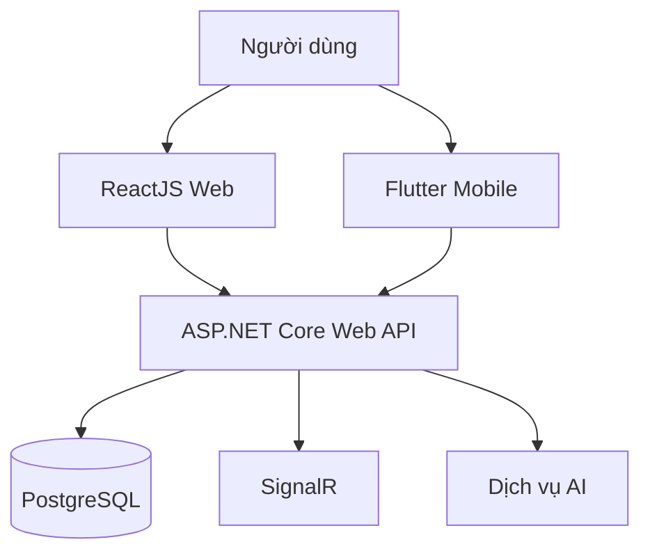
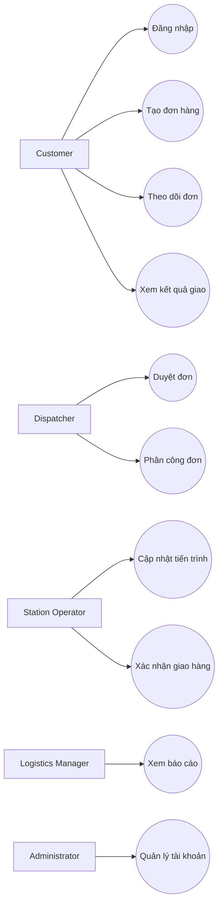
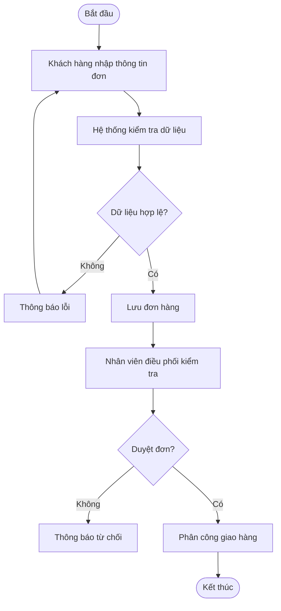
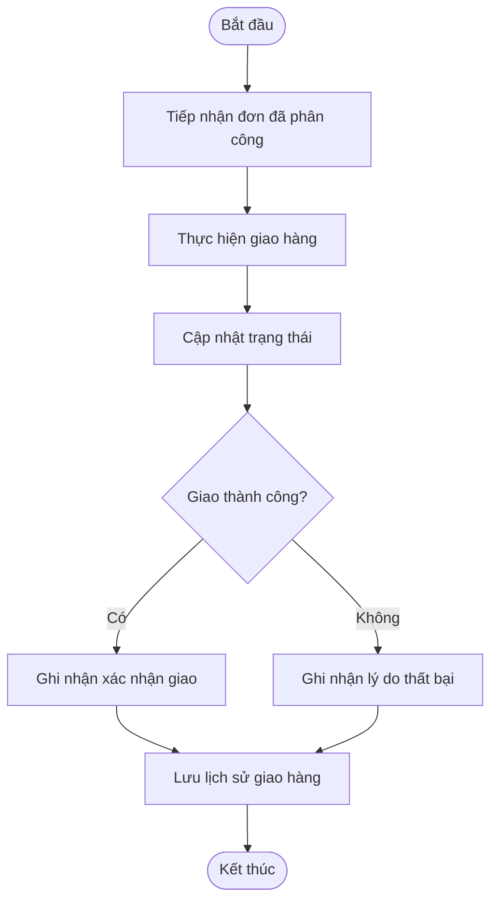
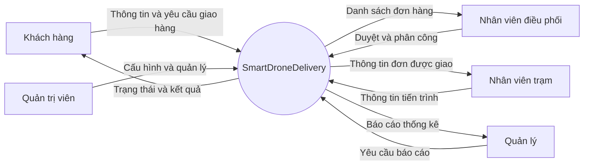
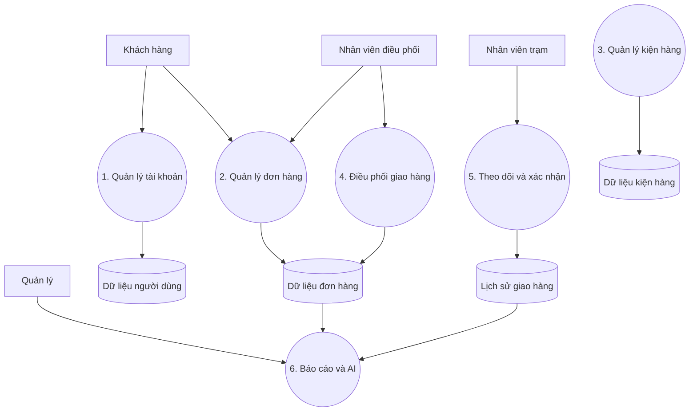
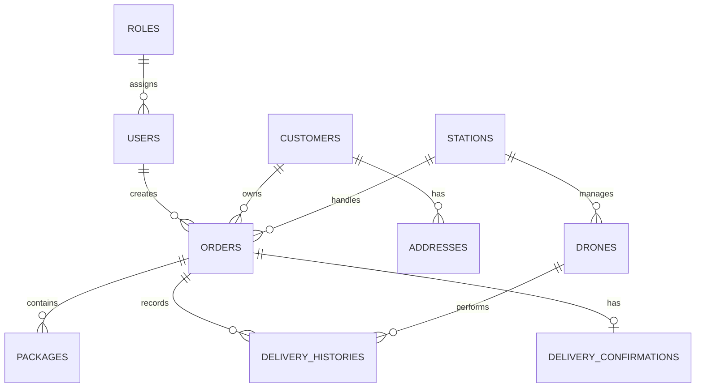

# PHẦN 4. THIẾT KẾ HỆ THỐNG

## 4.1. Kiến trúc tổng thể

SmartDroneDelivery được định hướng theo kiến trúc Client–Server. Web và Mobile gửi yêu cầu đến Backend API. Backend xử lý nghiệp vụ, xác thực, phân quyền và trao đổi dữ liệu với PostgreSQL.

**Hình 4.1. Kiến trúc tổng thể hệ thống**

## 4.2. Thiết kế Use Case

Các tác nhân chính:
- Customer.
- Dispatcher.
- Station Operator.
- Logistics Manager.
- System Administrator.

**Hình 4.2. Sơ đồ Use Case tổng quát**

Lưu ý: Sơ đồ trên mô tả các nhóm chức năng chính. Khi hoàn thiện báo cáo, nhóm có thể tách thành các sơ đồ Use Case chi tiết theo từng tác nhân.

## 4.3. Thiết kế Activity Diagram

### 4.3.1. Quy trình tạo và xử lý đơn hàng

**Hình 4.3. Activity Diagram quy trình xử lý đơn hàng**

### 4.3.2. Quy trình giao hàng

**Hình 4.4. Activity Diagram quy trình giao hàng**

## 4.4. Thiết kế DFD

### 4.4.1. DFD mức ngữ cảnh

**Hình 4.5. DFD mức ngữ cảnh**

### 4.4.2. DFD mức 0

**Hình 4.6. DFD mức 0**

## 4.5. Thiết kế cơ sở dữ liệu

Các thực thể dự kiến:

| STT | Thực thể | Mục đích |
|---|---|---|
| 1 | Users | Lưu thông tin tài khoản |
| 2 | Roles | Lưu vai trò |
| 3 | Customers | Lưu thông tin khách hàng |
| 4 | Addresses | Lưu địa chỉ giao nhận |
| 5 | Orders | Lưu thông tin đơn hàng |
| 6 | Packages | Lưu thông tin kiện hàng |
| 7 | Drones | Lưu thông tin Drone |
| 8 | Stations | Lưu thông tin trạm |
| 9 | DeliveryHistories | Lưu lịch sử giao hàng |
| 10 | DeliveryConfirmations | Lưu xác nhận giao hàng |

### Sơ đồ quan hệ dữ liệu dự kiến

**Hình 4.7. ERD dự kiến**

Lưu ý: Đây là mô hình khái niệm ban đầu. Tên bảng, khóa và quan hệ cần được đối chiếu với schema PostgreSQL thực tế của nhóm trước khi nghiệm thu.

## 4.6. Thiết kế API

| Nhóm API | Chức năng |
|---|---|
| Authentication | Đăng ký, đăng nhập, đăng xuất |
| User | Quản lý người dùng |
| Customer | Quản lý khách hàng |
| Order | Quản lý đơn hàng |
| Package | Quản lý kiện hàng |
| Station | Quản lý trạm |
| Delivery | Theo dõi và xác nhận giao hàng |
| Analytics | Báo cáo và thống kê |
| AI | Hỗ trợ phân tích và dự đoán |

Ví dụ một số endpoint xác thực:

| Phương thức | Endpoint | Chức năng |
|---|---|---|
| POST | `/api/v1/auth/register` | Đăng ký |
| POST | `/api/v1/auth/login` | Đăng nhập |
| GET | `/api/v1/auth/me` | Lấy thông tin người dùng |
| POST | `/api/v1/auth/logout` | Đăng xuất |

## 4.7. Thiết kế giao diện

Các màn hình dự kiến:
- Đăng nhập.
- Đăng ký.
- Dashboard.
- Quản lý đơn hàng.
- Tạo đơn hàng.
- Quản lý kiện hàng.
- Quản lý trạm.
- Theo dõi giao hàng.
- Xác nhận giao hàng.
- Báo cáo và thống kê.

### Hình ảnh giao diện Figma

Sau khi tải ảnh từ Figma lên thư mục `images`, sử dụng các đường dẫn dưới đây:

## 4.8. Thiết kế bảo mật

- Xác thực người dùng.
- Phân quyền theo vai trò.
- Bảo vệ thông tin đăng nhập.
- Kiểm tra dữ liệu đầu vào.
- Sử dụng HTTPS khi triển khai.
- Cấu hình CORS phù hợp.
- Bảo vệ thông tin bí mật bằng biến môi trường.

## 4.9. Kết luận

Thiết kế hệ thống là cơ sở để xây dựng cơ sở dữ liệu, Backend API, giao diện Web và Mobile. Các sơ đồ cần được cập nhật theo kiến trúc và cấu trúc thực tế của nhóm.
