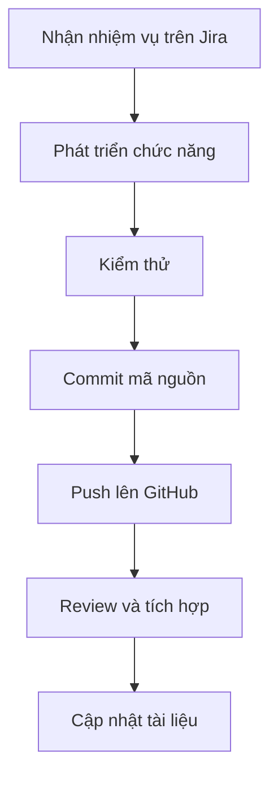

# PHẦN 5. CÔNG NGHỆ VÀ CÔNG CỤ SỬ DỤNG

## 5.1. Tổng quan

Dự án SmartDroneDelivery sử dụng các công nghệ phục vụ phát triển giao diện, xử lý nghiệp vụ, lưu trữ dữ liệu, cập nhật thời gian thực và quản lý dự án.

## 5.2. Công nghệ phát triển

| Công nghệ | Vai trò | Mục đích |
|---|---|---|
| ReactJS | Frontend Web | Xây dựng giao diện quản lý |
| Flutter | Mobile | Phát triển ứng dụng di động |
| ASP.NET Core Web API | Backend | Xử lý nghiệp vụ và cung cấp API |
| C# | Ngôn ngữ | Lập trình Backend |
| PostgreSQL | Database | Lưu trữ dữ liệu |
| SignalR | Real-time | Cập nhật dữ liệu theo thời gian thực |
| Docker | Triển khai | Đóng gói ứng dụng |
| MinIO | Lưu trữ | Lưu trữ tệp nếu được tích hợp |

## 5.3. Công cụ hỗ trợ dự án

| Công cụ | Công việc |
|---|---|
| GitHub | Quản lý mã nguồn và tài liệu |
| Jira | Quản lý nhiệm vụ và tiến độ |
| Confluence | Quản lý tài liệu dự án |
| Figma | Thiết kế giao diện |
| Draw.io | Vẽ sơ đồ hệ thống |
| Visual Studio / VS Code | Phát triển phần mềm |
| Postman | Kiểm thử API |

## 5.4. Vai trò của các thành phần

### Frontend
ReactJS xây dựng giao diện Web, cho phép người dùng thực hiện các nghiệp vụ quản lý và theo dõi giao hàng.

### Mobile
Flutter được sử dụng để xây dựng ứng dụng di động phục vụ các chức năng phù hợp với người dùng trên điện thoại.

### Backend
ASP.NET Core Web API tiếp nhận yêu cầu, xử lý nghiệp vụ, xác thực và cung cấp dữ liệu cho các ứng dụng.

### Database
PostgreSQL lưu trữ thông tin tài khoản, khách hàng, đơn hàng, kiện hàng, trạm và lịch sử giao hàng.

### Real-time
SignalR hỗ trợ cập nhật trạng thái và thông tin giao hàng theo thời gian thực khi hệ thống được tích hợp.

### AI
AI được định hướng sử dụng để phân tích dữ liệu, hỗ trợ dự đoán thời gian và đề xuất phương án giao hàng. Kết quả phụ thuộc vào dữ liệu và mô hình được triển khai.

## 5.5. Quy trình quản lý mã nguồn

## 5.6. Kết luận

Các công nghệ và công cụ được lựa chọn nhằm hỗ trợ xây dựng, quản lý và triển khai SmartDroneDelivery. Việc sử dụng công nghệ cụ thể cần được thống nhất với cấu trúc mã nguồn thực tế của nhóm.
