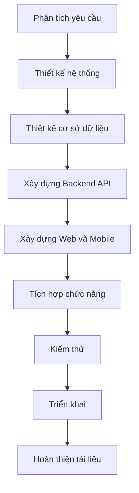

# PHẦN 6. XÂY DỰNG VÀ TRIỂN KHAI HỆ THỐNG

## 6.1. Quy trình xây dựng

Quá trình xây dựng SmartDroneDelivery được chia thành các giai đoạn từ thiết kế cơ sở dữ liệu, phát triển Backend, xây dựng giao diện đến tích hợp và triển khai.

## 6.2. Xây dựng cơ sở dữ liệu

Các công việc:
- Tạo cơ sở dữ liệu PostgreSQL.
- Xây dựng bảng và thuộc tính.
- Thiết lập khóa chính và khóa ngoại.
- Xây dựng quan hệ giữa các bảng.
- Tạo dữ liệu mẫu.
- Kiểm tra tính toàn vẹn dữ liệu.

## 6.3. Xây dựng Backend

Các công việc:
- Xây dựng cấu trúc dự án ASP.NET Core.
- Xây dựng API xác thực.
- Xây dựng API quản lý khách hàng.
- Xây dựng API đơn hàng và kiện hàng.
- Xây dựng API quản lý trạm.
- Xây dựng API theo dõi và xác nhận giao hàng.
- Kết nối PostgreSQL.
- Xử lý lỗi và kiểm tra dữ liệu đầu vào.

## 6.4. Xây dựng giao diện Web

Các công việc:
- Xây dựng trang đăng nhập và đăng ký.
- Xây dựng Dashboard.
- Xây dựng trang quản lý đơn hàng.
- Xây dựng trang quản lý kiện hàng.
- Xây dựng trang quản lý trạm.
- Xây dựng trang theo dõi giao hàng.
- Xây dựng trang báo cáo và thống kê.
- Kết nối giao diện với Backend API.

## 6.5. Xây dựng ứng dụng Mobile

Các công việc:
- Thiết kế cấu trúc ứng dụng Flutter.
- Xây dựng giao diện phù hợp với thiết bị di động.
- Kết nối Backend API.
- Hiển thị thông tin đơn hàng.
- Theo dõi trạng thái giao hàng.
- Kiểm tra khả năng tương thích.

## 6.6. Tích hợp thời gian thực

SignalR được định hướng sử dụng để:
- Cập nhật trạng thái đơn hàng.
- Truyền thông tin tiến trình giao hàng.
- Đồng bộ dữ liệu giữa các giao diện.
- Hỗ trợ theo dõi thông tin khi có dữ liệu thực tế.

Nếu chưa có kết nối Drone thực tế, dữ liệu vị trí chỉ được sử dụng để mô phỏng và cần ghi rõ trong báo cáo.

## 6.7. Tích hợp AI

Các chức năng AI dự kiến:
- Dự đoán thời gian giao hàng.
- Phân tích dữ liệu vận hành.
- Đề xuất phương án giao hàng.
- Hỗ trợ tổng hợp thông tin.

Việc đánh giá AI cần dựa trên dữ liệu đầu vào, phương pháp thực hiện và kết quả kiểm thử.

## 6.8. Triển khai hệ thống

Các công việc:
- Cấu hình môi trường chạy ứng dụng.
- - Thiết lập kết nối cơ sở dữ liệu.
- Cấu hình địa chỉ API.
- Cấu hình biến môi trường và thông tin bảo mật.
- Đóng gói bằng Docker nếu sử dụng.
- Kiểm tra hệ thống sau triển khai.

## 6.9. Phân công công việc đề xuất

| Nhóm công việc | Nội dung |
|---|---|
| Phân tích | Khảo sát và xác định yêu cầu |
| Thiết kế | Use Case, DFD, ERD, Figma |
| Backend | API và xử lý nghiệp vụ |
| Frontend | Giao diện Web |
| Mobile | Ứng dụng Flutter |
| AI | Phân tích và dự đoán |
| Kiểm thử | Test case và đánh giá |
| Tài liệu | Báo cáo và hướng dẫn sử dụng |

## 6.10. Kết luận

Quá trình xây dựng và triển khai cần được thực hiện theo từng giai đoạn, đảm bảo các thành phần có thể kết nối và hoạt động thống nhất.
