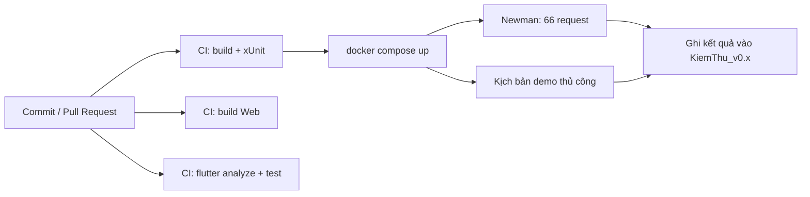

# PHẦN 7. KIỂM THỬ VÀ ĐÁNH GIÁ

## 7.1. Mục tiêu kiểm thử

Kiểm thử nhằm xác nhận hệ thống đáp ứng các yêu cầu FR01–FR12, các quy tắc nghiệp vụ ở Phần 3 và các điều kiện nghiệm thu AC01–AC07. Trọng tâm là Backend API và vòng đời đơn hàng, vì cả Web lẫn Mobile cùng phụ thuộc vào hai phần này.

## 7.2. Các cấp độ kiểm thử

| Cấp độ | Đối tượng | Công cụ | Vị trí trong repo |
|---|---|---|---|
| Unit test | Bảng chuyển trạng thái đơn, luật hồ sơ, % quãng đường đã bay, thống kê theo trạm, nội dung AI tự ghép khi không có LLM | xUnit | `tests/SmartDrone.Tests` (17 hàm test) |
| Unit test Mobile | Đọc JSON đơn hàng, tóm tắt AI, hồ sơ | flutter_test | `mobile/test` |
| Kiểm thử API | Toàn bộ luồng nghiệp vụ, phân quyền, dữ liệu sai | Postman / Newman | `docs/postman/` (66 request có kiểm tra kết quả) |
| Kiểm thử giao diện Web | 9 trang web và các hộp thoại | Playwright, API giả lập | chạy cục bộ, ảnh chụp trong `docs/report/images` |
| Kiểm thử hệ thống | Kịch bản demo trên Web + Mobile + Docker | Thủ công | `docs/report/KiemThu_v0.8.md` → `KiemThu_v0.11.md` |
| Tích hợp liên tục | Build + unit test Backend, build Web, phân tích + test Mobile | GitHub Actions | `.github/workflows` |

**Hình 7.1. Quy trình kiểm thử**

## 7.3. Test case theo nhóm chức năng

Tổng cộng 88 test case, đánh số TC01–TC111 qua 4 đợt (v0.8: 38, v0.9: 18, v0.10: 12, v0.11: 20).

| Nhóm | Ví dụ test case | Kết quả mong đợi |
|---|---|---|
| Tài khoản (FR01, FR02) | Đăng nhập sai mật khẩu; tài khoản bị khóa; gọi API sai vai trò; đổi mật khẩu sai mật khẩu cũ | 401 / 403 / 403 / 400 |
| Khách hàng (FR03, FR04) | Điều phối xem danh sách khách; khách gọi `/customers`; số điện thoại sai định dạng | 200 / 403 / 400 |
| Đơn hàng (FR05, FR06) | Trạm gửi trùng trạm nhận; kiện vượt tải drone; tìm đơn theo mã; sửa đơn đã duyệt | 400 / 400 / có đúng đơn / 409 |
| Trạm (FR07) | Trạm nhận đang bảo trì; trạm nhận đã đầy; xóa trạm đã có đơn | 400 / 409 / 409 |
| Điều phối (FR08) | Gán drone pin dưới 30 %; gán drone không đủ tầm bay; duyệt lại đơn đã duyệt | 400 / 400 / 409 |
| Theo dõi, xác nhận (FR09, FR10) | Drone bay tới trạm; nhập sai OTP 5 lần; giao thất bại rồi giao lại | ArrivedAtStation / khóa OTP / chặng bay mới |
| Báo cáo (FR11) | Thống kê theo khoảng ngày; hiệu quả theo trạm; tải CSV | Số liệu khớp dữ liệu mẫu |
| AI (FR12) | ETA trước khi tạo đơn; tóm tắt chuyến khi không có API key; chatbot khi LLM lỗi | 200 / 200 nguồn `rule` / 503 |
| Truy vết | Admin xem nhật ký sau khi sửa trạm; nhật ký không chứa mã băm | Có giá trị cũ/mới; không có `CodeHash` |

## 7.4. Kết quả kiểm thử

| Hạng mục | Số lượng | Đã chạy | Kết quả |
|---|---|---|---|
| Kiểm thử giao diện Web (API giả lập) | 20 ảnh chụp, 9 trang | Có | Đạt |
| Đối chiếu `openapi.yaml` với controller | 56 endpoint | Có | Khớp 100 % |
| Kiểm tra cú pháp script Postman | 66 request | Có | 66/66 hợp lệ |
| Newman với Backend thật | 66 request | Chưa | Chạy trên máy có Docker |
| xUnit | 17 hàm test | Chưa | Chạy khi CI chạy |
| flutter test | 5 test | Chưa | Chạy khi CI chạy |

Môi trường soạn tài liệu không có .NET SDK và Flutter SDK, nên Backend và Mobile chưa được build tại đây. Các hạng mục "Chưa" phải chạy trên máy của nhóm trước khi nộp và điền kết quả vào bảng này.

## 7.5. Đánh giá theo điều kiện nghiệm thu

| Mã | Tiêu chí | Cách kiểm | Đánh giá |
|---|---|---|---|
| AC01 | Đăng nhập | Postman thư mục 1, test UI trang đăng nhập | Đạt trên test UI; chờ Newman |
| AC02 | Tạo đơn | Postman thư mục 2, app Tạo đơn | Chờ Newman |
| AC03 | Kiểm tra dữ liệu | Các case 400 (trạm trùng, kiện quá tải, số điện thoại sai) | Chờ Newman |
| AC04 | Phân công | Gán drone: chỉ hiện drone rảnh, đủ tải, đủ pin | Đạt trên test UI |
| AC05 | Theo dõi | SignalR + giả lập drone, thanh % đã bay | Đạt trên test UI |
| AC06 | Xác nhận | OTP đúng → Hoàn tất, sai 5 lần → khóa | Đạt trên test UI |
| AC07 | Báo cáo | Thống kê, hiệu quả theo trạm trên dữ liệu kiểm thử | Đạt trên test UI |

## 7.6. Hạn chế của kiểm thử

- Chưa có test tải (k6), nên chưa có số liệu về số người dùng đồng thời.
- Không tự động kiểm được nội dung câu chữ LLM viết; phải đối chiếu bằng tay với dữ liệu đơn.
- Vị trí drone là dữ liệu mô phỏng, không có drone thật.
- Kiểm thử giao diện Web dùng API giả lập, nên không thay được kiểm thử với Backend thật.

## 7.7. Kết luận

Bộ kiểm thử gồm unit test, kiểm thử API, kiểm thử giao diện và kịch bản thủ công phủ đủ 12 nhóm chức năng. Phần đã chạy được đều đạt; phần cần .NET và Flutter phải chạy trên máy nhóm để có kết quả cuối cùng.
