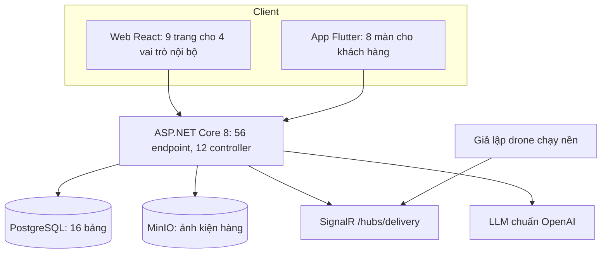

# PHẦN 8. KẾT QUẢ ĐẠT ĐƯỢC

## 8.1. Tổng quan

Đến 16/11/2026 (tuần W6 trong kế hoạch 7 tuần), nhóm hoàn thành hệ thống SmartDroneDelivery gồm Backend API, Web quản lý, ứng dụng Mobile cho khách hàng, cơ sở dữ liệu PostgreSQL, lưu trữ ảnh MinIO, cập nhật thời gian thực bằng SignalR và các chức năng AI. Toàn bộ hệ thống chạy bằng một lệnh `docker compose up -d --build`.

**Hình 8.1. Thành phần hệ thống đã xây dựng**

## 8.2. Kết quả theo yêu cầu chức năng

| Mã | Nhóm chức năng | Kết quả |
|---|---|---|
| FR01 | Tài khoản | Đăng ký, đăng nhập JWT, đăng xuất; sửa họ tên, số điện thoại; đổi mật khẩu |
| FR02 | Phân quyền | 5 vai trò; một tài khoản nội bộ giữ được nhiều vai trò; Admin tạo, khóa, gán vai trò |
| FR03 | Khách hàng | Trang Khách hàng: danh sách, tìm kiếm, số đơn, lịch sử đơn; Manager/Admin sửa thông tin |
| FR04 | Địa chỉ | Sổ địa chỉ trên app (một địa chỉ mặc định); người nhận cho từng đơn |
| FR05 | Đơn hàng | Tạo, xem, sửa khi còn Chờ duyệt, hủy, tìm theo mã, lọc theo trạng thái |
| FR06 | Kiện hàng | Khối lượng, kích thước có giới hạn; chụp ảnh kiện lưu MinIO; chặn kiện vượt tải đội drone |
| FR07 | Trạm Drone | Thêm, sửa, xóa, đổi trạng thái; sức chứa; tải trạm (đơn đang tới + kiện chờ nhận) |
| FR08 | Điều phối | Duyệt, từ chối có lý do; gán drone rảnh, đủ tải, pin ≥ 30 %, đủ tầm bay; trạm nhận còn chỗ |
| FR09 | Theo dõi | 9 trạng thái theo bảng chuyển cố định; timeline; vị trí drone mô phỏng đẩy realtime |
| FR10 | Xác nhận | OTP 6 số (lưu băm, hết hạn 24 giờ, sai 5 lần thì khóa); giao thất bại, giao lại, hủy và hoàn |
| FR11 | Báo cáo | Thống kê theo trạng thái, theo ngày, theo trạm; tỷ lệ thành công; thời gian giao trung bình; lọc khoảng ngày; tải CSV |
| FR12 | AI | ETA theo khoảng cách; trợ lý chat có tra cứu dữ liệu thật; tóm tắt chuyến giao; nhận xét vận hành |

Ngoài 12 nhóm trên, hệ thống có nhật ký thao tác cho Admin (ai sửa gì, giá trị cũ và mới), script sao lưu và khôi phục CSDL, thông báo trong app.

## 8.3. Kết quả về sản phẩm

| Sản phẩm | Số lượng | Vị trí |
|---|---|---|
| Endpoint API | 56 | `docs/openapi.yaml`, Swagger `/swagger` |
| Bảng CSDL | 16 | `docs/schema.sql`, `src/Migrations` |
| Trang Web | 9 (Đăng nhập, Điều phối, Trạm, Khách hàng, Thống kê, Drone & trạm, Tài khoản, Nhật ký, hộp thoại Hồ sơ) | `web/src/pages` |
| Màn hình Mobile | 8 (Đăng nhập, Đơn của tôi, Tạo/Sửa đơn, Chi tiết đơn, Sổ địa chỉ, Thông báo, Trợ lý AI, Hồ sơ) | `mobile/lib/pages` |
| Test | 88 test case, 66 request Postman, 17 hàm xUnit | `docs/report`, `docs/postman/`, `tests/` |
| Tài liệu giải thích code | Mỗi file code có README thư mục hoặc file `.md` cùng tên | toàn repo |
| Báo cáo | Báo cáo chính v1.0 + 5 báo cáo cập nhật v0.7 → v0.11 | `docs/report` |

## 8.4. Kết quả về quy trình

- Quản lý công việc trên Jira (dự án KAN), mỗi việc có mã gắn vào commit và tài liệu.
- Mã nguồn theo Clean Architecture của repo mẫu giảng viên: Api → Services → Domain ← Infrastructure.
- CI GitHub Actions build và test Backend, Web, Mobile trên mỗi Pull Request.
- Mỗi phiên bản có ghi chép thay đổi (`CHANGELOG.md`) và báo cáo cập nhật riêng.

## 8.5. Những điểm chưa đạt

| Nội dung | Lý do | Ảnh hưởng |
|---|---|---|
| API key cho hệ thống ngoài | Ưu tiên luồng nghiệp vụ chính trước | Chưa tích hợp được với hệ thống khác; bảng `api_keys` đã có |
| Gán Station Operator vào từng trạm | Demo chỉ có 1 nhân viên trạm | Nhân viên trạm thao tác được mọi trạm |
| Quản lý tuyến bay | Khoảng cách tính trực tiếp bằng công thức Haversine | Không chặn được tuyến cấm bay |
| Ảnh bằng chứng giao hàng | OTP đã đủ để xác nhận | Không có ảnh khi tranh chấp |
| Lưu lịch sử chat AI | Lịch sử giữ trên app | Đăng nhập máy khác thì mất lịch sử |
| Test tải | Không đủ thời gian | Chưa có số liệu hiệu năng |
| Drone thật | Ngoài phạm vi đồ án | Vị trí là dữ liệu mô phỏng |

## 8.6. Kết luận

Hệ thống đáp ứng đủ 12 nhóm chức năng và 7 quy tắc nghiệp vụ của đề, chạy được trọn luồng từ khách tạo đơn đến khách nhận hàng tại trạm. Các điểm chưa đạt đều là phần mở rộng, được ghi lại để làm tiếp ở Phần 9.
