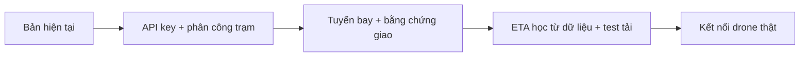

# PHẦN 9. KẾT LUẬN VÀ HƯỚNG PHÁT TRIỂN

## 9.1. Kết luận

SmartDroneDelivery số hóa được toàn bộ quy trình giao hàng bằng drone giữa các trạm: khách tạo đơn trên điện thoại, điều phối viên duyệt và gán drone, hệ thống mô phỏng chuyến bay và báo vị trí theo thời gian thực, nhân viên trạm xác nhận bằng OTP, quản lý xem thống kê và nhận xét do AI viết.

Về kỹ thuật, nhóm áp dụng được:
- Kiến trúc Clean Architecture tách nghiệp vụ khỏi cơ sở dữ liệu và giao diện.
- Một bảng chuyển trạng thái duy nhất cho 9 trạng thái đơn, dùng chung cho mọi API.
- Xác thực JWT và phân quyền theo 5 vai trò ở cả Backend lẫn giao diện.
- Cập nhật thời gian thực bằng SignalR, có cơ chế tự tải lại khi mất kết nối.
- Gọi LLM có kiểm soát: chatbot chỉ trả lời từ dữ liệu tra cứu được; khi LLM lỗi, tóm tắt và nhận xét chuyển sang nội dung tự ghép từ dữ liệu và ghi rõ nguồn.
- Đóng gói bằng Docker Compose và kiểm tra tự động bằng CI.

Về quản lý dự án, nhóm làm theo Scrum với sprint 1 tuần (W1–W7), theo dõi công việc trên Jira, ghi lại thay đổi qua từng phiên bản và giữ tài liệu khớp với mã nguồn.

## 9.2. Bài học rút ra

- Chốt hợp đồng API (`openapi.yaml`) sớm giúp Web và Mobile làm song song với Backend.
- Để một nơi duy nhất quyết định chuyển trạng thái tránh được lỗi mỗi màn hình hiểu một kiểu.
- Tài liệu phải sửa cùng lúc với code; để dồn đến cuối thì báo cáo lệch so với sản phẩm.
- Chức năng AI cần đường lùi khi dịch vụ ngoài lỗi, nếu không một lỗi mạng làm hỏng cả màn hình.

## 9.3. Hướng phát triển

| Ưu tiên | Hướng phát triển | Nội dung |
|---|---|---|
| 1 | Tích hợp hệ thống ngoài | Cấp, thu hồi API key; hệ thống bán hàng tạo và tra cứu đơn qua API (bảng `api_keys` đã có) |
| 2 | Phân công nhân viên trạm | Gán Station Operator vào trạm, mỗi người chỉ thấy và xác nhận đơn của trạm mình (bảng `station_operators` đã có) |
| 3 | Quản lý tuyến bay | Khai báo tuyến được phép bay giữa hai trạm, khoảng cách thực tế, vùng cấm bay (bảng `station_routes` đã có) |
| 4 | Bằng chứng giao hàng | Nhân viên chụp ảnh khi bàn giao, lưu MinIO cùng bản ghi OTP |
| 5 | Lịch sử chat AI | Lưu hội thoại vào bảng `ai_chat_messages`, xem lại trên mọi thiết bị |
| 6 | Dự đoán ETA bằng dữ liệu | Học từ thời gian giao thực tế theo tuyến, giờ, khối lượng thay cho công thức cố định |
| 7 | Hiệu năng | Test tải bằng k6, cache danh sách trạm, phân vùng bảng telemetry |
| 8 | Drone thật | Thay bộ giả lập bằng dữ liệu từ bộ điều khiển bay (MAVLink) qua cùng event SignalR |
| 9 | Ứng dụng nhân viên trạm | Bản Mobile cho Station Operator quét mã QR thay cho nhập OTP |

**Hình 9.1. Lộ trình phát triển đề xuất**

## 9.4. Lời kết

Đồ án giúp nhóm đi trọn một vòng phát triển phần mềm: phân tích yêu cầu, thiết kế, xây dựng, kiểm thử, triển khai và viết tài liệu. Sản phẩm chưa phải hệ thống vận hành thật, nhưng đã đủ nền tảng để mở rộng theo các hướng ở mục 9.3.
