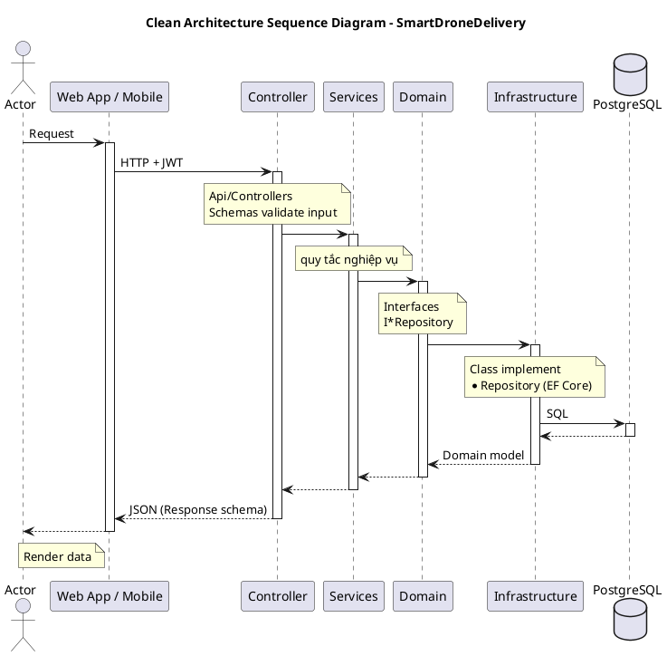

# Clean Architecture trong SmartDroneDelivery

Backend bám cấu trúc repo mẫu [Flask-CleanArchitecture](https://github.com/ChienNguyensrdn/Flask-CleanArchitecture). Ý tưởng giữ nguyên: **tầng trong không biết tầng ngoài**. Domain không biết EF Core, Services không biết PostgreSQL, Controller không chứa nghiệp vụ.

## 1. Bốn tầng

| Tầng | Thư mục | Được phép gọi | Không được gọi |
|---|---|---|---|
| Api | `src/Api` | Services, Domain | Infrastructure (trừ qua DI) |
| Services | `src/Services` | Domain (model + interface) | Api, Infrastructure, `DbContext` |
| Domain | `src/Domain` | không gọi ai | mọi tầng khác |
| Infrastructure | `src/Infrastructure` | Domain (để cài interface) | Api, Services |

Chỗ duy nhất "biết hết" là `src/DependencyContainer.cs`: nó nối interface của Domain với class cài đặt ở Infrastructure.

## 2. Đối chiếu Flask ↔ C#

| Flask (repo mẫu) | SmartDrone (C#) | Vai trò |
|---|---|---|
| `app.py` | `src/Program.cs` | điểm khởi động |
| `create_app.py` | `src/CreateApp.cs` | dựng app: đăng ký service, middleware, route |
| `config.py` (`DevelopmentConfig`, `ProductionConfig`) | `src/Config.cs` + `appsettings.json` / `appsettings.Development.json` | cấu hình theo môi trường |
| `cors.py` | `src/Cors.cs` | cho phép web gọi API |
| `dependency_container.py` | `src/DependencyContainer.cs` | DI container |
| `error_handler.py` | `src/ErrorHandler.cs` | exception → HTTP status |
| `app_logging.py` | `src/AppLogging.cs` | log bằng Serilog |
| `api/controllers/*_controller.py` (Blueprint) | `src/Api/Controllers/*Controller.cs` | nhận request |
| `api/schemas/*.py` (Marshmallow) | `src/Api/Schemas/*Schemas.cs` | validate input, định dạng output |
| `api/middleware.py` | `src/Api/Middleware.cs` | log request, header chung |
| `api/requests.py` | `src/Api/Requests.cs` | đọc thông tin request (user đang đăng nhập) |
| `api/responses.py` | `src/Api/Responses.cs` | format response chung |
| `api/swagger.py` | `src/Api/Swagger.cs` | Swagger UI |
| `domain/constants.py` | `src/Domain/Constants.cs` | hằng số |
| `domain/exceptions.py` | `src/Domain/Exceptions.cs` | lỗi nghiệp vụ |
| `domain/models/todo.py` | `src/Domain/Models/DeliveryOrder.cs`... | model nghiệp vụ |
| `domain/models/itodo_repository.py` | `src/Domain/Models/IOrderRepository.cs`... | interface repository |
| `services/todo_service.py` | `src/Services/OrderService.cs`... | nghiệp vụ |
| `infrastructure/databases/` | `src/Infrastructure/Databases/` | kết nối + khởi tạo CSDL |
| `infrastructure/models/` (SQLAlchemy) | `src/Infrastructure/Models/` (EF Core Fluent API) | ánh xạ class ↔ bảng |
| `infrastructure/repositories/` | `src/Infrastructure/Repositories/` | cài đặt interface repository |
| `infrastructure/services/` | `src/Infrastructure/Services/` | JWT, LLM API |
| `migrations/` | `src/Migrations/` | lịch sử thay đổi schema |
| `api/routes.py` | không cần | ASP.NET tự quét `[Route]` trên controller (`app.MapControllers()`) |

## 3. Khác nhau duy nhất đáng nói: Models ở Infrastructure

Bên Flask có hai bộ class: `domain/models/todo.py` (class thuần) và `infrastructure/models/todo_model.py` (class SQLAlchemy), repository copy qua lại giữa hai bộ.

EF Core ánh xạ được class thuần bằng **Fluent API** mà không cần class đó kế thừa gì hay gắn attribute gì. Vì vậy:
- `src/Domain/Models/DeliveryOrder.cs` là class thuần, không `using` EF Core.
- `src/Infrastructure/Models/DeliveryOrderConfiguration.cs` mô tả bảng `delivery_orders`: tên cột, kiểu, khóa ngoại, check constraint, index. Đây chính là "ORM model" của tầng Infrastructure.

Kết quả giống hệt mục đích của mẫu (Domain sạch, chi tiết CSDL nằm ở Infrastructure) mà không phải viết 15 class trùng lặp.

Riêng tài khoản thì có ánh xạ tay đúng kiểu mẫu: `AppUser` (Infrastructure, kế thừa `IdentityUser` của ASP.NET Identity) ↔ `User` (Domain, class thuần). `UserRepository` chuyển qua lại giữa hai class.

## 4. Sequence diagram

## 5. Ví dụ: khách tạo đơn hàng

`POST /api/v1/orders`

1. **Controller** – `OrdersController.Create` nhận `OrderRequest`. `[ApiController]` tự kiểm tra attribute (`[Range(0.01, 50)]` cho cân nặng...), sai thì trả 400, chưa vào tới service.
2. **Schema** – `request.ToOrder()` và `request.ToPackage()` đổi JSON thành model Domain.
3. **Requests** – `User.UserId()` lấy id khách từ claim `sub` của JWT.
4. **Service** – `OrderService.CreateAsync` kiểm tra: hai trạm khác nhau, trạm tồn tại (`IStationRepository`), địa chỉ thuộc khách (`ICustomerAddressRepository`), có drone chở nổi (`IDroneRepository`). Sai thì ném `ValidationException`.
5. Service tạo `DeliveryOrder` trạng thái `Pending` + một dòng `OrderStatusHistory`, gọi `IOrderRepository.AddAsync`.
6. **Infrastructure** – `OrderRepository.AddAsync` thêm package, order, history vào `AppDbContext` và `SaveChangesAsync` một lần (một transaction).
7. Controller trả `201 Created` + `OrderResponse`.
8. Nếu bước 4 ném exception, `ErrorHandler` đổi thành `400 ProblemDetails` có `detail` là câu báo lỗi tiếng Việt; web/mobile hiện câu đó cho người dùng.

## 6. Thêm một chức năng mới (làm theo thứ tự)

1. `Domain/Models`: thêm model (nếu có) và hàm cần thiết vào interface repository.
2. `Infrastructure/Models`: thêm `XxxConfiguration` nếu có bảng mới.
3. `Infrastructure/Repositories`: cài hàm vừa thêm vào interface.
4. `Services`: viết nghiệp vụ, ném exception trong `Domain/Exceptions.cs` khi sai luật.
5. `Api/Schemas`: request/response.
6. `Api/Controllers`: endpoint, gắn `[Authorize(Roles = ...)]`.
7. `DependencyContainer.cs`: đăng ký repository/service mới.
8. Có bảng mới thì `dotnet ef migrations add <Ten> --project src -o Migrations`.
9. Cập nhật `README.md` của các thư mục vừa sửa.
