# Báo cáo đồ án SmartDroneDelivery

Bản v0.6 · cập nhật 05/11/2026 · Tiến

## Mục lục

- Thông tin chung
  - Thuật ngữ và viết tắt
- I. Giới thiệu dự án
  - 1. Tổng quan
  - 2. Bối cảnh sản phẩm
  - 3. Hệ thống hiện có
  - 4. Cơ hội
  - 5. Tầm nhìn sản phẩm
  - 6. Phạm vi và giới hạn
- II. Kế hoạch quản lý dự án
  - 1. Tổng quan
  - 2. Phương pháp quản lý
  - 3. Sản phẩm bàn giao
  - 4. Phân công trách nhiệm
  - 5. Giao tiếp dự án
  - 6. Quản lý cấu hình
- III. Đặc tả yêu cầu phần mềm (SRS)
  - 1. Tổng quan sản phẩm
  - 2. Yêu cầu người dùng
  - 3. Yêu cầu chức năng
  - 4. Yêu cầu phi chức năng
  - 5. Phụ lục yêu cầu
- IV. Mô tả thiết kế phần mềm (SDD)
  - 1. Thiết kế hệ thống
  - 2. Thiết kế cơ sở dữ liệu
  - 3. Thiết kế chi tiết
- V. Tài liệu kiểm thử
  - 1. Phạm vi kiểm thử
  - 2. Chiến lược kiểm thử
  - 3. Kế hoạch kiểm thử
  - 4. Test case chính
  - 5. Báo cáo kiểm thử
- VI. Gói bàn giao và hướng dẫn
  - 1. Gói bàn giao
  - 2. Hướng dẫn cài đặt
  - 3. Hướng dẫn sử dụng
- Lịch sử phiên bản
- Checklist tiến độ
- Nguồn tham khảo

## Thông tin chung

Đây là bản v0.6 của báo cáo: đủ khung 6 phần theo mẫu SPMP/SRS/SDD/Test/Release, nội dung bám đề và hiện trạng repo ngày 05/11/2026. Những chỗ ghi **\[Cập nhật\]** sẽ điền ở các phiên bản sau khi code xong.

| Mục | Nội dung |
| --- | --- |
| Tên đề tài | AI-powered Drone Delivery Management Platform (Nền tảng quản lý giao hàng bằng drone tích hợp AI) |
| Tên sản phẩm | SmartDroneDelivery |
| Trường | Đại học Giao thông vận tải TP.HCM (UTH) |
| Giảng viên hướng dẫn | Nguyễn Văn Chiến |
| Nhóm | Nguyễn Ngọc Trần Hoàng Tiến (trưởng nhóm), Nguyễn Thiện Vinh, Nguyễn Mậu Huỳnh, Lê Công Anh Đức, Lê Công Anh Tài |
| Thời gian | 12/10/2026 – 29/11/2026, 7 tuần (ngày bảo vệ cần xác nhận) |
| Mã nguồn | github.com/nguyenmauhuynh/CNPM-group |
| Quản lý công việc | Jira, project KAN (cnpm-group.atlassian.net) |

### Thuật ngữ và viết tắt

| Viết tắt | Đầy đủ | Ý nghĩa trong báo cáo |
| --- | --- | --- |
| API | Application Programming Interface | Giao diện để web, app và hệ thống ngoài gọi vào backend |
| BR | Business Rule | Quy tắc nghiệp vụ, đánh số BR-xx |
| DTO | Data Transfer Object | Đối tượng dữ liệu trao đổi qua API |
| ERD | Entity Relationship Diagram | Sơ đồ quan hệ thực thể của cơ sở dữ liệu |
| ETA | Estimated Time of Arrival | Thời gian giao dự kiến |
| JWT | JSON Web Token | Token xác thực người dùng |
| LLM | Large Language Model | Mô hình ngôn ngữ lớn dùng cho tóm tắt và trợ lý AI |
| OTP | One-Time Password | Mã 6 số khách dùng để nhận hàng tại trạm |
| RBAC | Role-Based Access Control | Phân quyền theo vai trò |
| SDD | Software Design Description | Tài liệu thiết kế phần mềm (phần IV) |
| SPMP | Software Project Management Plan | Kế hoạch quản lý dự án (phần II) |
| SRS | Software Requirement Specification | Đặc tả yêu cầu phần mềm (phần III) |
| UC | Use Case | Ca sử dụng, đánh số UC-xx |
| UAT | User Acceptance Test | Kiểm thử chấp nhận với người dùng |

## I. Giới thiệu dự án

SmartDroneDelivery là nền tảng quản lý nghiệp vụ giao hàng bằng drone: quản lý đơn, gói hàng, trạm hạ cánh, theo dõi và xác nhận giao, không phải phần mềm điều khiển drone.

### 1. Tổng quan

#### 1.1 Thông tin dự án

- Tên dự án: AI-powered Drone Delivery Management Platform
- Tên sản phẩm: SmartDroneDelivery
- Loại phần mềm: Web App + Mobile App + RESTful API
- Mã project Jira: KAN

#### 1.2 Nhóm dự án

| Họ tên | Vai trò | Phụ trách chính |
| --- | --- | --- |
| Nguyễn Văn Chiến | Giảng viên hướng dẫn |  |
| Nguyễn Ngọc Trần Hoàng Tiến | Trưởng nhóm | Kiến trúc, API spec, state machine, Docker, quản lý dự án |
| Nguyễn Thiện Vinh | Thành viên | Backend, cơ sở dữ liệu, SignalR |
| Nguyễn Mậu Huỳnh | Thành viên | Web React |
| Lê Công Anh Đức | Thành viên | Mobile Flutter |
| Lê Công Anh Tài | Thành viên | Dịch vụ AI, kiểm thử |

### 2. Bối cảnh sản phẩm

Thương mại điện tử và logistics thông minh làm tăng nhu cầu giao hàng chặng cuối nhanh và tự động. Drone phù hợp với gói nhẹ trong khuôn viên trường, khu công nghiệp, khu dân cư và vùng xa.

Vận hành giao hàng bằng drone cần nhiều hơn việc bay: phải quản lý khách hàng, yêu cầu giao, thông tin gói hàng, trạm hạ cánh, theo dõi và xác nhận giao. Các hệ thống logistics hiện có thiếu luồng nghiệp vụ riêng cho drone nên khó điều phối và giám sát.

### 3. Hệ thống hiện có

#### 3.1 Zipline

- Mô tả: công ty giao hàng bằng drone lớn nhất; tháng 01/2026 công bố đã vượt 2 triệu lượt giao thương mại và gọi thêm hơn 600 triệu USD ([Zipline](https://www.zipline.com/newsroom/zipline-surpasses-2-million-deliveries-raises-more-than-600m-to-power-next-phase-of-growth-and-expands-operations-to-houston-and-phoenix)).
- Chức năng: khách đặt qua app Zipline; giao đồ ăn, hàng bán lẻ, hàng y tế tới nhà; thời gian bay trung vị 3 phút.
- Ưu điểm: quy mô lớn, giao nhanh, dịch vụ hoàn chỉnh.
- Hạn chế với bài toán của nhóm: hệ thống đóng, gắn với drone và hạ tầng riêng; không cung cấp nền tảng quản lý để đơn vị khác tự vận hành.

#### 3.2 Wing (Alphabet)

- Mô tả: đầu năm 2026 cùng Walmart mở rộng giao hàng bằng drone thêm 150 cửa hàng tại Mỹ, kế hoạch hơn 270 điểm vào năm 2027 ([Axios](https://www.axios.com/2026/01/11/walmart-drone-delivery-wing-los-angeles-miami)).
- Chức năng: đặt qua app Wing; hàng được nạp lên drone tại khu vực rào riêng ở bãi xe cửa hàng; drone bay tự động, phi công giám sát từ trung tâm điều hành.
- Ưu điểm: tách rõ điểm xuất phát cố định và trung tâm giám sát, gần với mô hình trạm + Dispatcher của nhóm.
- Hạn chế: gắn chặt với đối tác bán lẻ, không mở cho mục đích học tập hay tùy biến quy trình.

#### 3.3 Matternet

- Mô tả: giải pháp giao hàng y tế giữa các cơ sở bệnh viện gồm drone M2, trạm Matternet Station và nền tảng đám mây ([New Atlas](https://newatlas.com/drones/matternet-station-drone-delivery-hub-medical)).
- Chức năng: nhân viên lên lịch giao và gửi gói tại trạm; trạm nhận chứa tối đa 4 gói; người nhận được báo và quét mã nhân viên để lấy gói; điều hành viên theo dõi chuyến và tình trạng drone từ xa.
- Ưu điểm: mô hình trạm + xác thực người nhận rất giống luồng trạm hạ cánh + OTP của đề.
- Hạn chế: chuyên cho y tế, thuê bao theo năm, không có trợ lý AI cho khách.

### 4. Cơ hội

Các giải pháp trên đều là hệ thống đóng của doanh nghiệp vận hành drone. Một nền tảng quản lý nghiệp vụ độc lập với loại drone, có trạm hạ cánh, xác nhận nhận hàng và dịch vụ AI hỗ trợ điều phối phù hợp cho khuôn viên trường, khu công nghiệp hoặc doanh nghiệp logistics nhỏ muốn thử nghiệm giao hàng bằng drone.

### 5. Tầm nhìn sản phẩm

Dành cho đơn vị muốn vận hành giao hàng bằng drone trong một khu vực có trạm cố định, SmartDroneDelivery là nền tảng web + mobile quản lý trọn vòng đời đơn từ yêu cầu đến xác nhận nhận hàng. Khác với các hệ thống đóng, sản phẩm không phụ thuộc loại drone, có API mở cho tích hợp và có dịch vụ AI ước tính ETA, tóm tắt chuyến, trợ lý khách hàng và phân tích vận hành.

### 6. Phạm vi và giới hạn

#### 6.1 Tính năng chính

- FE01. Xác thực và phân quyền: đăng ký, đăng nhập JWT, 5 vai trò, quản lý tài khoản.
- FE02. Khách hàng và đơn giao: địa chỉ giao, tạo, sửa, hủy, tra cứu đơn.
- FE03. Gói hàng: khối lượng, kích thước, ảnh gói lưu MinIO, kiểm tra tải trọng.
- FE04. Quy trình giao: duyệt, từ chối, lên lịch, gán drone, bắt đầu chuyến, xử lý giao thất bại.
- FE05. Trạm hạ cánh: quản lý trạm, sức chứa, tình trạng, xác nhận gói tới trạm.
- FE06. Theo dõi và xác nhận giao: vị trí drone realtime, OTP nhận hàng, ảnh bằng chứng.
- FE07. Dashboard và báo cáo: thống kê đơn, tỷ lệ thành công, thời gian giao, xuất CSV.
- FE08. Dịch vụ AI: ước tính ETA, tóm tắt chuyến, trợ lý AI cho khách, phân tích vận hành.
- FE09. Quản trị hệ thống: audit log, API key cho hệ thống ngoài, sao lưu, giám sát.

#### 6.2 Giới hạn và loại trừ

- LI-01: Không điều khiển drone thật; vị trí, pin, tốc độ do bộ giả lập trên server phát ra.
- LI-02: Drone bay đường thẳng giữa hai trạm; không tính vùng cấm bay, thời tiết, không phận thật.
- LI-03: Không có thanh toán trực tuyến.
- LI-04: Mỗi đơn chứa một gói hàng.
- LI-05: Chất lượng tóm tắt và trợ lý AI phụ thuộc dịch vụ LLM bên ngoài; khi LLM lỗi hệ thống trả nội dung dựng từ mẫu.
- LI-06: ETA dựa trên khoảng cách và vận tốc; độ chính xác dự báo bằng dữ liệu lịch sử còn thấp khi chưa có đủ dữ liệu.
- LI-07: Giao diện chỉ có tiếng Việt; demo chạy trên một máy bằng Docker Compose.

## II. Kế hoạch quản lý dự án

Tổng khối lượng ước tính khoảng 96 man-day cho 5 người trong 7 tuần (12/10–29/11), làm theo Scrum với sprint 1 tuần và demo nội bộ mỗi Chủ nhật.

### 1. Tổng quan

#### 1.1 Phạm vi và ước lượng (WBS)

| STT | Hạng mục | Độ phức tạp | Ước lượng (man-day) |
| --- | --- | --- | --- |
| 1 | **FE01. Xác thực và phân quyền** |  | **8** |
| 1.1 | Đăng ký, đăng nhập JWT | Simple | 3 |
| 1.2 | RBAC 5 vai trò, Admin gán role | Medium | 3 |
| 1.3 | Hồ sơ, đổi mật khẩu | Simple | 2 |
| 2 | **FE02. Khách hàng và đơn giao** |  | **12** |
| 2.1 | Địa chỉ giao hàng | Simple | 3 |
| 2.2 | Tạo, sửa, hủy đơn, kiểm tra tải trọng | Medium | 5 |
| 2.3 | Danh sách, lọc, chi tiết, lịch sử trạng thái | Medium | 4 |
| 3 | **FE03. Gói hàng** (thông tin + ảnh MinIO) | Medium | **4** |
| 4 | **FE04. Quy trình giao** |  | **13** |
| 4.1 | State machine đơn + lịch sử trạng thái | Complex | 5 |
| 4.2 | Duyệt, từ chối, gán drone, lên lịch | Medium | 5 |
| 4.3 | Xử lý giao thất bại | Medium | 3 |
| 5 | **FE05. Trạm hạ cánh** |  | **6** |
| 5.1 | CRUD trạm, drone | Simple | 3 |
| 5.2 | Tình trạng trạm, sức chứa, xác nhận gói tới | Medium | 3 |
| 6 | **FE06. Theo dõi và xác nhận giao** |  | **14** |
| 6.1 | SignalR + bộ giả lập drone | Complex | 6 |
| 6.2 | OTP nhận hàng + ảnh bằng chứng | Medium | 4 |
| 6.3 | Bản đồ realtime trên web và app | Medium | 4 |
| 7 | **FE07. Dashboard và báo cáo** |  | **6** |
| 7.1 | API thống kê + xuất CSV | Medium | 3 |
| 7.2 | Màn dashboard | Medium | 3 |
| 8 | **FE08. Dịch vụ AI** |  | **10** |
| 8.1 | Ước tính ETA | Simple | 2 |
| 8.2 | Tóm tắt chuyến giao | Medium | 3 |
| 8.3 | Trợ lý AI cho khách | Complex | 5 |
| 9 | **FE09. Quản trị hệ thống** (audit log, backup, health check, Docker) | Medium | **5** |
| 10 | **Phân tích, thiết kế, tài liệu** (SRS, BPMN, ERD, API spec, báo cáo) | Medium | **10** |
| 11 | **Kiểm thử và triển khai** | Medium | **8** |
|  | **TỔNG** |  | **96** |

#### 1.2 Mục tiêu chất lượng

| # | Giai đoạn kiểm thử | Độ bao phủ | Số lỗi cho phép | Ghi chú |
| --- | --- | --- | --- | --- |
| 1 | Review | 100% tài liệu và PR được review | – | Review chéo qua Pull Request |
| 2 | Unit test | Service nghiệp vụ và state machine | 0 critical | xUnit |
| 3 | Integration test | ≥ 80% endpoint trong openapi.yaml | 0 critical, ≤ 10 minor | Postman/Newman |
| 4 | System test | 100% kịch bản demo | 0 critical, ≤ 5 minor | Chạy trên Docker Compose |
| 5 | Acceptance test | 100% luồng chính của 5 vai trò | 0 critical/blocker | Demo với giảng viên |

#### 1.3 Rủi ro dự án

| # | Rủi ro | Ảnh hưởng | Khả năng | Xử lý |
| --- | --- | --- | --- | --- |
| 1 | Thành viên trễ việc hoặc vắng | Cao | Cao | Task kẹt quá 2 ngày thì chia lại; có người hỗ trợ cho từng mảng |
| 2 | Web, mobile và backend lệch API | Cao | Trung bình | openapi.yaml là hợp đồng chung; đổi API phải sửa file này trước |
| 3 | Ghép hệ thống dồn về cuối | Cao | Trung bình | Demo end-to-end mỗi Chủ nhật |
| 4 | Dịch vụ LLM lỗi, hết hạn mức, chậm | Trung bình | Trung bình | Timeout + nội dung dự phòng từ mẫu; cache tóm tắt |
| 5 | SignalR không ổn định trên mobile | Trung bình | Trung bình | Tự kết nối lại; dự phòng gọi API 5 giây/lần |
| 6 | Phạm vi phình ra | Trung bình | Cao | Đóng băng tính năng ngày 22/11 |
| 7 | Xung đột code, mất dữ liệu | Cao | Trung bình | Khóa nhánh main, bắt buộc PR có review |

### 2. Phương pháp quản lý

#### 2.1 Quy trình dự án

- Scrum với sprint 1 tuần, tổng 7 sprint (W1–W7).
- W1–W2: phân tích yêu cầu, thiết kế kiến trúc, CSDL, API, dữ liệu lõi.
- W3 (26/10–01/11): dọn repo, khung web React, state machine đơn, xác thực JWT, BPMN và ERD.
- W4 (02/11–08/11): lõi đơn hàng chạy thật trên web và app (FE01–FE04); mốc MVP 08/11.
- W5 (09/11–15/11): thực thi chuyến, tracking, xác nhận giao (FE05–FE06); mốc luồng giao trọn vẹn 15/11.
- W6 (16/11–22/11): dashboard, AI, hoàn thiện (FE07–FE09); đóng băng tính năng 22/11.
- W7 (23/11–29/11): kiểm thử hệ thống, triển khai, báo cáo, demo; kết thúc 29/11.
- Nghi thức: họp ngắn 15 phút thứ Hai, Tư, Sáu; lập kế hoạch và demo mỗi Chủ nhật.
- Công cụ: backlog và task trên Jira KAN, label tuần W1–W7, mỗi task có due date và tiêu chí "Xong khi".

#### 2.2 Quản lý chất lượng

- Phòng lỗi: quy ước trong docs/CONVENTIONS.md; ràng buộc CHECK, khóa ngoại, index trong CSDL; validate đầu vào ở API.
- Review: mọi thay đổi vào main qua Pull Request, ít nhất 1 người duyệt; CI build backend và web phải xanh.
- Unit test: xUnit cho service nghiệp vụ và OrderStateMachine.
- Integration test: Postman/Newman chạy toàn luồng API.
- System test: chạy kịch bản demo trên Docker Compose; test tải bằng k6.
- Acceptance: demo với giảng viên theo kịch bản 7 bước ở phần V.

#### 2.3 Kế hoạch đào tạo

| Nội dung | Người học | Thời điểm | Điều kiện miễn |
| --- | --- | --- | --- |
| ASP.NET Core Web API, EF Core | Vinh, Tiến | W1, 2 buổi | Đã làm project .NET |
| ReactJS + Vite | Huỳnh | W1, 2 buổi | Đã làm project React |
| Flutter + Dio | Đức | W1, 2 buổi | Đã làm app Flutter |
| Git, Pull Request, review code | Cả nhóm | W3, 1 buổi | Dùng Git thành thạo |
| Docker Compose | Cả nhóm | W1, 1 buổi | Đã dùng Docker |
| SignalR | Vinh, Huỳnh, Đức | W5, 1 buổi | – |
| Gọi LLM API, prompt, function calling | Tài | W2, 1 buổi | – |

### 3. Sản phẩm bàn giao

| # | Sản phẩm | Hạn | Ghi chú |
| --- | --- | --- | --- |
| 1 | Kế hoạch dự án, phân công | 18/10 | Đã có |
| 2 | SRS, use case, BPMN | 01/11 | Phần III |
| 3 | Kiến trúc, ERD, API spec | 01/11 | Phần IV, docs/openapi.yaml |
| 4 | Wireframe web và mobile | 18/10 | Figma, đã có |
| 5 | MVP: tạo đơn trên app, duyệt trên web | 08/11 | Mốc W4 |
| 6 | Luồng giao trọn vẹn có tracking realtime | 15/11 | Mốc W5 |
| 7 | Dashboard, AI, đóng băng tính năng | 22/11 | Mốc W6 |
| 8 | Báo cáo kiểm thử | 26/11 | Phần V |
| 9 | Gói Docker, hướng dẫn cài đặt và sử dụng, mã nguồn | 29/11 | Phần VI, mốc W7 |

### 4. Phân công trách nhiệm

D = thực hiện chính, R = review, S = hỗ trợ, I = được thông báo.

| Công việc | Tiến | Vinh | Huỳnh | Đức | Tài |
| --- | --- | --- | --- | --- | --- |
| Lập và theo dõi kế hoạch | D | I | I | I | I |
| Phân tích yêu cầu, SRS | D | S | S | S | R |
| Use case, khung báo cáo | R | I | I | I | D |
| Kiến trúc, API spec | D | R | I | I | I |
| CSDL, migration, seed | R | D | I | I | I |
| API nghiệp vụ backend | D | D | I | S | I |
| Web React | R | I | D | S | I |
| App Flutter | R | I | S | D | I |
| Dịch vụ AI | R | S | I | I | D |
| Kiểm thử | S | S | S | S | D |
| Docker, triển khai | D | S | I | I | R |
| Báo cáo cuối kỳ, demo | D | S | S | S | S |

### 5. Giao tiếp dự án

| Hoạt động | Người tham gia | Mục đích | Tần suất | Công cụ |
| --- | --- | --- | --- | --- |
| Họp ngắn | Cả nhóm | Làm gì xong, làm gì tiếp, kẹt ở đâu | Thứ Hai, Tư, Sáu, 15 phút | Google Meet / Zalo |
| Lập kế hoạch và demo sprint | Cả nhóm | Demo phần đã xong, chốt task tuần sau | Chủ nhật | Google Meet, Jira |
| Review code | Người viết + người duyệt | Kiểm tra logic, quy ước | Mỗi PR | GitHub Pull Request |
| Xử lý lỗi gấp | Người liên quan | Gỡ vướng ngay | Khi cần | Zalo |
| Báo cáo giảng viên | Trưởng nhóm | Cập nhật tiến độ, xin góp ý | Theo lịch của thầy | Email / gặp trực tiếp |
| Tập dượt demo | Cả nhóm | Canh giờ, chuẩn bị hỏi đáp | 2 lần trong W7 | Trực tiếp |

### 6. Quản lý cấu hình

#### 6.1 Tài liệu

- Tài liệu kỹ thuật (openapi.yaml, schema.sql, quy ước) nằm trong thư mục docs/ của repo, sửa qua PR.
- Báo cáo này đánh số phiên bản v0.1, v0.2…; mỗi lần cập nhật ghi vào mục Lịch sử phiên bản cuối báo cáo.

#### 6.2 Mã nguồn

- GitHub, repo CNPM-group. Nhánh `main` chỉ chứa code đã duyệt; nhánh làm việc đặt tên `feature/KAN-<số>-<mô-tả>`.
- Commit theo dạng `feat:`, `fix:`, `docs:`, kèm mã KAN.
- CI (GitHub Actions) build backend và web trên mỗi PR.

#### 6.3 Công cụ và hạ tầng

| Nhóm | Công cụ |
| --- | --- |
| Backend | ASP.NET Core 8 Web API, EF Core, ASP.NET Identity, SignalR |
| Web | ReactJS, Vite, Tailwind CSS |
| Mobile | Flutter, Dio, flutter\_secure\_storage |
| Cơ sở dữ liệu, lưu trữ | PostgreSQL 16, MinIO |
| Triển khai | Docker, Docker Compose |
| Quản lý dự án | Jira (KAN), GitHub |
| Thiết kế | Figma, draw.io, dbdiagram.io |
| Kiểm thử | Swagger, Postman/Newman, xUnit, k6 |

## III. Đặc tả yêu cầu phần mềm (SRS)

Hệ thống có 5 tác nhân người và 1 tác nhân hệ thống ngoài, dùng 31 use case chia thành 6 module.

### 1. Tổng quan sản phẩm

- Môi trường: web portal chạy trên Chrome, Edge, Safari; app Android/iOS viết bằng Flutter; cần kết nối Internet, không có chế độ offline.
- Hạ tầng: ASP.NET Core Web API, PostgreSQL, MinIO, chạy bằng Docker Compose.
- Người dùng nội bộ: Dispatcher, Station Operator, Logistics Manager, System Administrator. Người dùng ngoài: Customer.
- Ràng buộc: giao diện tiếng Việt; dữ liệu bay do bộ giả lập phát ra; AI chỉ hỗ trợ quyết định, không tự đổi trạng thái đơn.
- Phụ thuộc: dịch vụ LLM bên ngoài cho tóm tắt và trợ lý AI.

#### 1.1 Sơ đồ ngữ cảnh (Context Diagram)

Toàn bộ hệ thống là một tiến trình duy nhất (0); 5 tác nhân người và 2 hệ thống bên ngoài chỉ trao đổi dữ liệu với nó qua các luồng dưới đây.

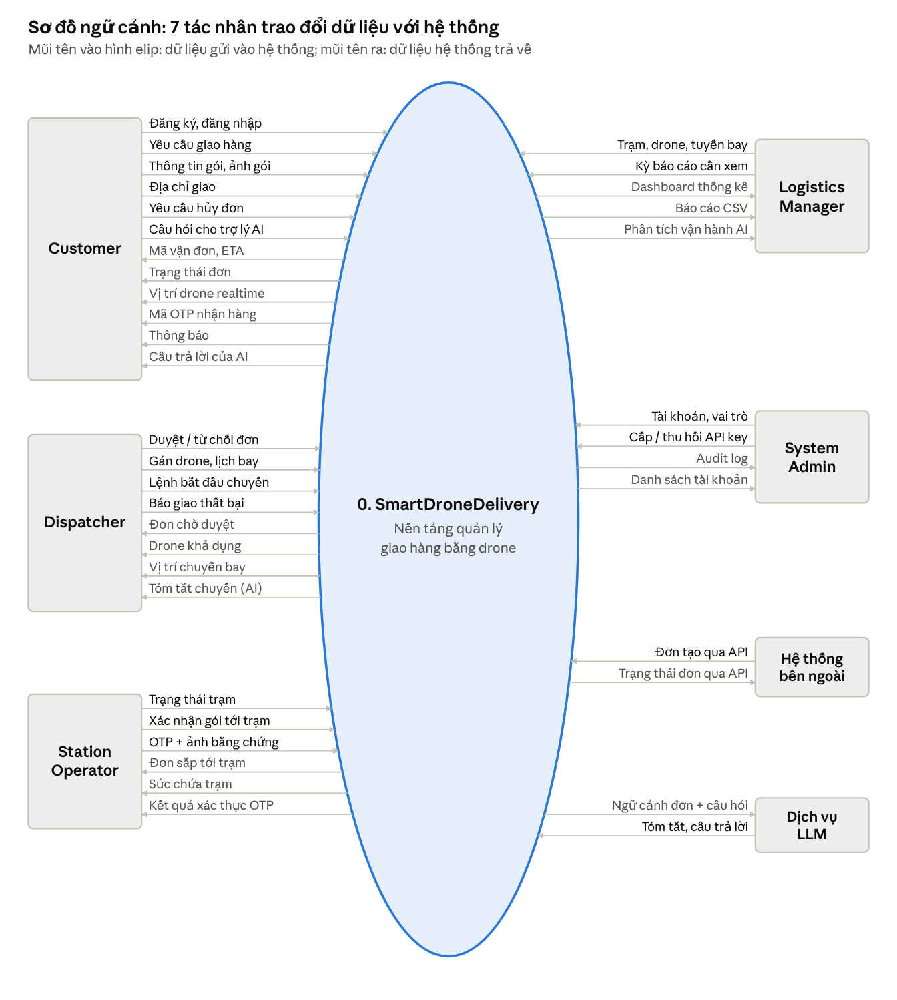

*Hình: context diagram (DFD mức 0) · 7 tác nhân, 39 luồng dữ liệu*

Chữ đậm màu là luồng đi vào hệ thống, chữ nhạt màu là luồng hệ thống trả ra. Bộ giả lập drone, PostgreSQL và MinIO nằm bên trong hệ thống nên không vẽ ở mức này.

### 2. Yêu cầu người dùng

#### 2.1 Tác nhân

| # | Tác nhân | Mô tả | Nền tảng |
| --- | --- | --- | --- |
| 1 | Customer | Tạo yêu cầu giao, quản lý địa chỉ, theo dõi đơn, nhận hàng bằng OTP, hỏi trợ lý AI | App |
| 2 | Dispatcher | Duyệt đơn, gán drone, lên lịch, bắt đầu chuyến, theo dõi chuyến, xử lý giao thất bại | Web |
| 3 | Station Operator | Quản lý tình trạng trạm mình phụ trách, xác nhận gói tới trạm, xác nhận khách lấy hàng | Web + App |
| 4 | Logistics Manager | Quản lý trạm, drone, tuyến; xem dashboard, báo cáo, phân tích AI | Web |
| 5 | System Administrator | Quản lý tài khoản, vai trò, API key, xem audit log | Web |
| 6 | Hệ thống ngoài | Gọi RESTful API bằng API key để tạo và tra cứu đơn | API |

Trong code, vai trò lưu dạng chuỗi theo Roles.cs: Customer, Dispatcher, StationOperator, Manager, Admin.

#### 2.2 Sơ đồ và danh sách use case

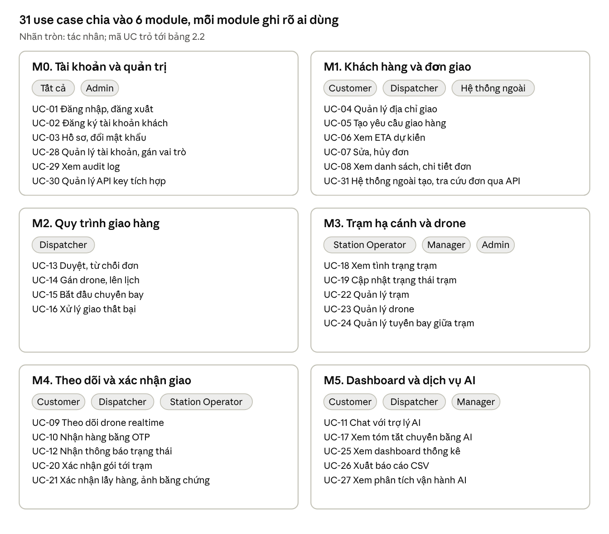

*Hình: sơ đồ use case tổng quát · 6 module, 31 use case*

Sơ đồ trên gom use case theo module để nhìn tổng quan; sơ đồ dưới là use case diagram theo chuẩn UML.

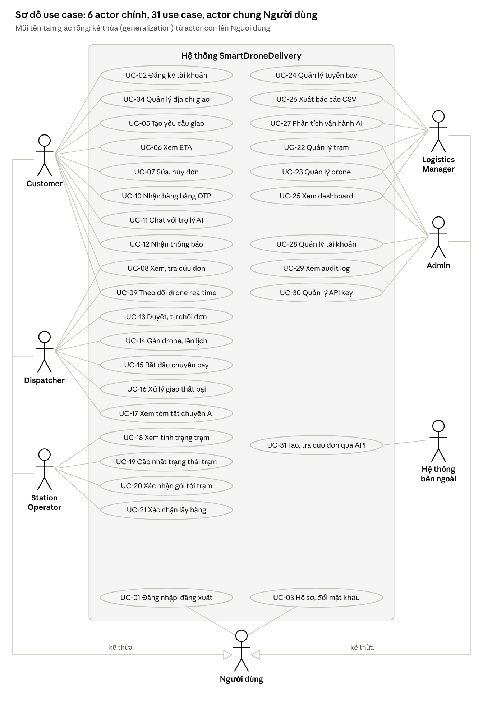

*Hình: use case diagram UML · 7 actor, 31 use case*

Customer, Dispatcher, Station Operator, Manager, Admin đều kế thừa actor chung Người dùng nên cùng dùng được UC-01 và UC-03; Hệ thống bên ngoài không đăng nhập mà xác thực bằng API key nên không kế thừa.

| ID | Use case | Tác nhân | Mô tả |
| --- | --- | --- | --- |
| UC-01 | Đăng nhập, đăng xuất | Tất cả | Xác thực email + mật khẩu, cấp JWT, chuyển tới màn hình theo vai trò |
| UC-02 | Đăng ký tài khoản | Customer | Tạo tài khoản vai trò Customer |
| UC-03 | Hồ sơ, đổi mật khẩu | Tất cả | Xem, sửa thông tin cá nhân |
| UC-04 | Quản lý địa chỉ giao | Customer | Thêm, sửa, xóa, đặt mặc định địa chỉ có tọa độ |
| UC-05 | Tạo yêu cầu giao | Customer | Chọn trạm gửi, trạm nhận, nhập thông tin gói, ảnh gói |
| UC-06 | Xem ETA | Customer | Xem thời gian giao dự kiến trước và sau khi tạo đơn |
| UC-07 | Sửa, hủy đơn | Customer | Chỉ khi đơn còn Pending |
| UC-08 | Xem danh sách, chi tiết đơn | Customer, Dispatcher | Lọc, tìm kiếm, phân trang, xem lịch sử trạng thái |
| UC-09 | Theo dõi drone realtime | Customer, Dispatcher | Xem vị trí drone trên bản đồ khi đơn đang bay |
| UC-10 | Nhận hàng bằng OTP | Customer | Nhận mã OTP khi đơn tới trạm, đưa cho Station Operator |
| UC-11 | Chat với trợ lý AI | Customer | Hỏi về đơn, trạm, thời gian giao |
| UC-12 | Nhận thông báo | Customer | Thông báo khi đơn đổi trạng thái |
| UC-13 | Duyệt, từ chối đơn | Dispatcher | Duyệt đơn Pending; từ chối phải có lý do |
| UC-14 | Gán drone, lên lịch | Dispatcher | Chọn drone rảnh, đủ tải, đủ pin; đặt thời điểm bay |
| UC-15 | Bắt đầu chuyến | Dispatcher | Tạo chuyến bay, đơn sang InTransit |
| UC-16 | Xử lý giao thất bại | Dispatcher | Ghi lý do, lên lịch lại hoặc hủy hoàn trả |
| UC-17 | Xem tóm tắt chuyến | Dispatcher | AI tóm tắt diễn biến của đơn trong 3–5 câu |
| UC-18 | Xem tình trạng trạm | Station Operator | Số gói đang chờ so với sức chứa, drone đang đậu |
| UC-19 | Cập nhật trạng thái trạm | Station Operator | Available, Occupied, Maintenance |
| UC-20 | Xác nhận gói tới trạm | Station Operator | Đơn sang ArrivedAtStation, hệ thống sinh OTP |
| UC-21 | Xác nhận khách lấy hàng | Station Operator | Nhập OTP khách đưa, chụp ảnh bằng chứng, đơn sang Completed |
| UC-22 | Quản lý trạm | Manager, Admin | Thêm, sửa, xóa trạm, sức chứa, tọa độ |
| UC-23 | Quản lý drone | Manager, Admin | Danh mục drone: tải tối đa, tầm bay, vận tốc, trạng thái |
| UC-24 | Quản lý tuyến bay | Manager | Tuyến giữa hai trạm, khoảng cách |
| UC-25 | Xem dashboard | Manager, Admin | Đơn theo trạng thái, ngày, trạm; tỷ lệ thành công |
| UC-26 | Xuất báo cáo CSV | Manager | Xuất số liệu theo khoảng thời gian |
| UC-27 | Xem phân tích vận hành AI | Manager | AI nhận xét xu hướng, điểm nghẽn từ số liệu tổng hợp |
| UC-28 | Quản lý tài khoản | Admin | Tạo, khóa, mở tài khoản, gán vai trò |
| UC-29 | Xem audit log | Admin | Ai làm gì, lúc nào, giá trị cũ và mới |
| UC-30 | Quản lý API key | Admin | Cấp, thu hồi API key cho hệ thống ngoài |
| UC-31 | Tích hợp qua API | Hệ thống ngoài | Tạo và tra cứu đơn bằng API key |

### 3. Yêu cầu chức năng

#### 3.1 Danh sách màn hình

| # | Màn hình | Nền tảng | Vai trò | Use case |
| --- | --- | --- | --- | --- |
| SC-01 | Đăng nhập | Web, App | Tất cả | UC-01 |
| SC-02 | Đăng ký | App | Customer | UC-02 |
| SC-03 | Hồ sơ cá nhân | Web, App | Tất cả | UC-03 |
| SC-04 | Địa chỉ giao | App | Customer | UC-04 |
| SC-05 | Tạo đơn | App | Customer | UC-05, UC-06 |
| SC-06 | Đơn của tôi | App | Customer | UC-07, UC-08 |
| SC-07 | Chi tiết đơn + timeline + bản đồ | App, Web | Customer, Dispatcher | UC-08, UC-09, UC-10, UC-17 |
| SC-08 | Trợ lý AI | App | Customer | UC-11 |
| SC-09 | Bảng điều phối đơn | Web | Dispatcher | UC-08, UC-13 |
| SC-10 | Gán drone, lên lịch | Web | Dispatcher | UC-14, UC-15 |
| SC-11 | Theo dõi chuyến bay | Web | Dispatcher | UC-09, UC-16 |
| SC-12 | Trạm của tôi | Web, App | Station Operator | UC-18 – UC-21 |
| SC-13 | Quản lý trạm, drone, tuyến | Web | Manager, Admin | UC-22 – UC-24 |
| SC-14 | Dashboard, báo cáo | Web | Manager, Admin | UC-25 – UC-27 |
| SC-15 | Quản lý tài khoản | Web | Admin | UC-28 |
| SC-16 | Audit log, API key | Web | Admin | UC-29, UC-30 |

Mỗi chức năng dưới đây có mục "Giao diện" sẽ chèn ảnh màn hình thật ở bản sau \[Cập nhật\].

#### 3.2 Đăng nhập (UC-01)

- Kích hoạt: mở web hoặc app khi chưa đăng nhập.
- Tác nhân: tất cả vai trò.
- Mục đích: xác thực người dùng và xác định vai trò để mở đúng chức năng.
- Xử lý:
  1. Người dùng nhập email, mật khẩu.
  2. Gọi `POST /api/v1/auth/login`; hệ thống kiểm tra tài khoản còn hoạt động và mật khẩu đúng.
  3. Thành công: trả JWT chứa id, email, vai trò; web lưu cookie HttpOnly, app lưu secure storage.
  4. Chuyển tới màn hình chính theo vai trò; sai thông tin hiện MSG-02.
- Business rules: BR-01, BR-02.
- Giao diện: \[Cập nhật\]

#### 3.3 Tạo yêu cầu giao (UC-05, UC-06)

- Kích hoạt: Customer bấm "Tạo đơn" trên app.
- Tác nhân: Customer; hệ thống ngoài qua API key (UC-31).
- Mục đích: tạo đơn giao mới ở trạng thái Pending.
- Xử lý:
  1. Chọn trạm gửi, trạm nhận từ danh sách trạm đang Available; chọn địa chỉ giao (không bắt buộc).
  2. Nhập mô tả gói, khối lượng (kg), dài, rộng, cao (cm), ghi chú; chụp ảnh gói (không bắt buộc), ảnh upload lên MinIO trước và trả về image key.
  3. App gọi API ETA để hiển thị thời gian dự kiến trước khi xác nhận.
  4. Gọi `POST /api/v1/orders`. Hệ thống kiểm tra hai trạm khác nhau và tồn tại, khối lượng và kích thước trong giới hạn của drone lớn nhất.
  5. Tạo bản ghi gói hàng + đơn, sinh mã vận đơn, ghi dòng đầu tiên vào lịch sử trạng thái, báo cho Dispatcher.
- Business rules: BR-03, BR-04, BR-05, BR-06.
- Giao diện: \[Cập nhật\]

#### 3.4 Xem danh sách và chi tiết đơn (UC-08)

- Kích hoạt: mở màn "Đơn của tôi" (app) hoặc "Bảng điều phối" (web).
- Tác nhân: Customer, Dispatcher, Manager, Admin.
- Xử lý:
  1. Gọi `GET /api/v1/orders?status=&page=&pageSize=`; đơn mới nhất xếp trước, phân trang phía server.
  2. Customer chỉ nhận đơn của mình; vai trò nội bộ thấy tất cả.
  3. Mở chi tiết: thông tin đơn, gói, hai trạm, ETA, timeline từ `GET /orders/{id}/history`.
- Business rules: BR-07.

#### 3.5 Hủy đơn (UC-07)

- Kích hoạt: Customer bấm "Hủy đơn" trong chi tiết đơn.
- Xử lý: xác nhận hủy, nhập lý do (không bắt buộc), gọi `POST /orders/{id}/cancel`; đơn sang Cancelled, ghi lịch sử.
- Business rules: BR-08, BR-10.

#### 3.6 Duyệt, từ chối đơn (UC-13)

- Kích hoạt: Dispatcher chọn đơn Pending trên bảng điều phối.
- Tác nhân: Dispatcher (Manager, Admin cũng được).
- Xử lý:
  1. Xem thông tin đơn, gói, ảnh gói, ETA.
  2. Duyệt: `POST /orders/{id}/approve`, đơn sang Approved, lưu người duyệt và thời điểm.
  3. Từ chối: bắt buộc nhập lý do, `POST /orders/{id}/reject`, đơn sang Rejected.
  4. Gửi thông báo cho Customer.
- Business rules: BR-10, BR-11.

#### 3.7 Gán drone và lên lịch (UC-14)

- Kích hoạt: Dispatcher mở đơn Approved, bấm "Gán drone".
- Xử lý:
  1. Hệ thống liệt kê drone Idle tại trạm gửi có tải tối đa ≥ khối lượng gói và tầm bay ≥ khoảng cách tuyến, sắp theo pin giảm dần.
  2. Dispatcher chọn drone và thời điểm bay.
  3. Đơn sang Scheduled, drone sang Assigned, tạo bản ghi chuyến bay trạng thái Scheduled, cập nhật ETA.
- Business rules: BR-12, BR-13.

#### 3.8 Bắt đầu chuyến và theo dõi realtime (UC-15, UC-09)

- Kích hoạt: Dispatcher bấm "Bắt đầu chuyến" với đơn Scheduled.
- Xử lý:
  1. Đơn sang InTransit, chuyến bay sang Flying, drone sang InFlight.
  2. Bộ giả lập phát tọa độ mỗi 2 giây theo đường thẳng giữa hai trạm, ghi flight\_telemetry và đẩy qua SignalR tới group của đơn.
  3. Web và app đang mở đơn vẽ vị trí drone trên bản đồ và cập nhật ETA còn lại.
  4. Mất kết nối SignalR thì client tự kết nối lại, trong lúc đó gọi API lấy vị trí 5 giây/lần.
- Business rules: BR-10, BR-14.

#### 3.9 Xác nhận gói tới trạm (UC-20)

- Kích hoạt: drone giả lập tới trạm nhận; Station Operator xác nhận đã nhận gói.
- Xử lý: chuyến bay sang Landed, drone về Idle tại trạm nhận, đơn sang ArrivedAtStation; hệ thống sinh OTP 6 số, chỉ lưu hash, gửi OTP cho Customer qua thông báo trong app.
- Business rules: BR-15, BR-16.

#### 3.10 Xác nhận khách lấy hàng (UC-21, UC-10)

- Kích hoạt: khách tới trạm, đọc OTP cho Station Operator.
- Xử lý:
  1. Operator nhập OTP, chụp ảnh bằng chứng (lưu MinIO).
  2. Hệ thống so hash, kiểm tra hạn và số lần sai.
  3. Đúng: đơn sang Completed, lưu người xác nhận và thời điểm. Sai: tăng số lần sai, hiện MSG-08.
- Business rules: BR-16, BR-17.

#### 3.11 Xử lý giao thất bại (UC-16)

- Kích hoạt: chuyến bị hủy giữa chừng hoặc khách không tới lấy hàng khi OTP hết hạn.
- Xử lý: Dispatcher chọn "Giao thất bại", bắt buộc nhập lý do; đơn sang Failed. Sau đó chọn lên lịch lại (về Scheduled) hoặc hủy hoàn trả (Cancelled).
- Business rules: BR-18.

#### 3.12 Quản lý trạm (UC-18, UC-19, UC-22)

- Kích hoạt: mở màn "Quản lý trạm" (Manager, Admin) hoặc "Trạm của tôi" (Station Operator).
- Xử lý: danh sách trạm với tọa độ, sức chứa, số gói đang chờ, trạng thái; Manager/Admin thêm, sửa, xóa qua `/api/v1/stations`; Operator chỉ đổi trạng thái trạm mình phụ trách.
- Business rules: BR-19, BR-20.

#### 3.13 Dashboard và báo cáo (UC-25, UC-26, UC-27)

- Xử lý: hiển thị số đơn theo trạng thái, theo ngày, theo trạm; tỷ lệ giao thành công; thời gian giao trung bình; lọc theo khoảng ngày; xuất CSV. Nút "Phân tích AI" gửi số liệu tổng hợp cho LLM và hiển thị nhận xét.
- Business rules: BR-21.

#### 3.14 Trợ lý AI cho khách (UC-11)

- Xử lý:
  1. Khách gửi câu hỏi; hệ thống lưu tin nhắn theo phiên.
  2. LLM được cấp các hàm tra cứu: đơn của chính khách, danh sách trạm, ETA.
  3. Trả lời dựa trên dữ liệu thật; câu hỏi ngoài phạm vi thì từ chối lịch sự; LLM lỗi thì hiện MSG-10.
- Business rules: BR-22, BR-23.

#### 3.15 Quản lý tài khoản (UC-28)

- Xử lý: Admin xem danh sách tài khoản, tạo tài khoản nội bộ, khóa/mở, gán vai trò, gán Station Operator vào trạm.
- Business rules: BR-02, BR-24.

### 4. Yêu cầu phi chức năng

#### 4.1 Giao tiếp bên ngoài

- Giao diện người dùng: web responsive cho màn hình từ 1280 px; app cho điện thoại 5,5–6,7 inch; tiếng Việt.
- Phần cứng: camera điện thoại để chụp ảnh gói và ảnh bằng chứng.
- Phần mềm: RESTful API JSON tại `/api/v1`, mô tả bằng OpenAPI (docs/openapi.yaml) và Swagger; SignalR (WebSocket) cho cập nhật realtime; MinIO (giao thức S3) lưu ảnh; dịch vụ LLM bên ngoài qua HTTPS.
- Truyền thông: HTTPS; ngày giờ ISO 8601 UTC; enum trả về dạng chuỗi; lỗi theo chuẩn ProblemDetails (RFC 7807).

#### 4.2 Thuộc tính chất lượng

| Thuộc tính | Yêu cầu | Cách đáp ứng | Cách kiểm chứng |
| --- | --- | --- | --- |
| Bảo mật | Xác thực an toàn, phân quyền theo vai trò | ASP.NET Identity, mật khẩu băm, JWT hết hạn sau 60 phút, `[Authorize(Roles)]`; OTP và API key chỉ lưu hash | Gọi API sai vai trò trả 403 |
| Hiệu năng | Thao tác thông dụng dưới 3 giây | Index cho cột lọc, phân trang server, truy vấn async, AsNoTracking khi chỉ đọc | k6: p95 < 3 giây |
| Khả năng chịu tải | Nhiều người dùng đồng thời ổn định | API stateless, connection pooling, SignalR theo group đơn và trạm | k6 50 người dùng ảo trong 5 phút, không lỗi 5xx |
| Tích hợp | RESTful API cho hệ thống ngoài | Đúng HTTP verb và status code, version `/api/v1`, API key | Swagger đủ endpoint |
| Triển khai | Chạy bằng Docker | Docker Compose gồm db, minio, api, web | `docker compose up` chạy trên máy sạch |
| Giám sát | Theo dõi sức khỏe hệ thống | Endpoint `/health`, log có cấu trúc | `/health` trả 200 |
| Truy vết | Audit log mọi thao tác ghi | SaveChanges interceptor ghi bảng audit\_logs (giá trị cũ, mới) | Admin xem được lịch sử |
| Sao lưu | Khôi phục được dữ liệu | Script pg\_dump định kỳ; MinIO dùng volume riêng | Khôi phục thử từ bản backup |
| Bảo trì | Kiến trúc module | 4 tầng Api / Services / Domain / Infrastructure theo cấu trúc repo mẫu Clean Architecture của GVHD, mỗi thư mục có README.md | Review cấu trúc repo |
| Khả dụng | Web và app responsive | Tailwind CSS cho web; Flutter layout co giãn | Kiểm tra trên 2 kích thước trình duyệt và 2 điện thoại |

### 5. Phụ lục yêu cầu

#### 5.1 Business rules

| ID | Quy tắc |
| --- | --- |
| BR-01 | Email là duy nhất; mật khẩu tối thiểu 8 ký tự; mật khẩu chỉ lưu dạng băm. |
| BR-02 | Mỗi tài khoản có một vai trò: Customer, Dispatcher, StationOperator, Manager, Admin. Tài khoản bị khóa không đăng nhập được. Token hết hạn sau 60 phút. |
| BR-03 | Trạm gửi khác trạm nhận; cả hai phải tồn tại và không ở trạng thái Maintenance. |
| BR-04 | Khối lượng từ 0,01 đến 20 kg và không vượt tải tối đa của drone lớn nhất; mỗi chiều từ 0,1 đến 100 cm. |
| BR-05 | Ảnh lưu trong MinIO, CSDL chỉ lưu object key; chỉ nhận JPG/PNG, tối đa 5 MB. |
| BR-06 | Đơn mới luôn ở trạng thái Pending; mã vận đơn duy nhất, tối đa 20 ký tự. |
| BR-07 | Customer chỉ xem được đơn của mình; đơn người khác trả 404. |
| BR-08 | Customer chỉ hủy được đơn đang Pending. |
| BR-09 | Customer chỉ sửa được đơn đang Pending: ghi chú, địa chỉ giao, thông tin gói. |
| BR-10 | Mọi thay đổi trạng thái đơn đi qua OrderStateMachine theo bảng chuyển ở mục IV.3; chuyển sai trả 409. Mỗi lần chuyển ghi order\_status\_history và phát sự kiện SignalR. |
| BR-11 | Từ chối đơn hoặc đánh dấu thất bại bắt buộc có lý do. |
| BR-12 | Drone được gán phải Idle, đang ở trạm gửi, tải tối đa ≥ khối lượng gói, tầm bay ≥ khoảng cách tuyến, pin ≥ 30%. |
| BR-13 | Một drone chỉ thực hiện một chuyến tại một thời điểm. |
| BR-14 | Bộ giả lập phát vị trí mỗi 2 giây, nội suy tuyến tính giữa hai trạm theo vận tốc bay của drone. |
| BR-15 | Trạm chuyển Occupied khi số drone đang đậu bằng sức chứa (capacity); trạm Occupied hoặc Maintenance không được chọn làm trạm nhận. |
| BR-16 | OTP gồm 6 chữ số, chỉ lưu hash, hết hạn sau 24 giờ. |
| BR-17 | Nhập sai OTP 5 lần thì khóa xác nhận, Dispatcher xử lý tiếp. |
| BR-18 | Đơn Failed chỉ được chuyển sang Scheduled (giao lại) hoặc Cancelled (hoàn trả). |
| BR-19 | Station Operator chỉ thao tác trên trạm được gán cho mình. |
| BR-20 | Không xóa trạm còn đơn chưa kết thúc hoặc còn drone đang đậu. |
| BR-21 | Dữ liệu lưu giờ UTC; thống kê và hiển thị theo giờ Việt Nam (UTC+7). |
| BR-22 | Trợ lý AI chỉ đọc dữ liệu của chính khách hỏi và không được thay đổi dữ liệu. |
| BR-23 | Gọi LLM tối đa 15 giây; quá hạn hoặc lỗi thì trả nội dung dự phòng. |
| BR-24 | Admin không tự khóa hoặc hạ quyền chính mình; hệ thống luôn còn ít nhất một Admin. |
| BR-25 | Mọi thao tác tạo, sửa, xóa dữ liệu được ghi audit log. |
| BR-26 | Hệ thống ngoài xác thực bằng API key; key chỉ hiện một lần khi tạo, CSDL lưu hash. |

#### 5.2 Yêu cầu chung

- Danh sách có phân trang, mặc định 20 dòng/trang, bản ghi mới nhất trước.
- Thao tác xóa, hủy, từ chối có hộp thoại xác nhận.
- Trường bắt buộc có dấu \*, kiểm tra cả ở client và server.
- Thời gian hiển thị dạng dd/MM/yyyy HH:mm.

#### 5.3 Danh sách thông báo

| ID | Nội dung | Khi nào |
| --- | --- | --- |
| MSG-01 | Vui lòng nhập đầy đủ thông tin bắt buộc. | Thiếu trường bắt buộc |
| MSG-02 | Email hoặc mật khẩu không đúng. | Đăng nhập sai |
| MSG-03 | Tài khoản đã bị khóa. Liên hệ quản trị viên. | Tài khoản bị khóa |
| MSG-04 | Trạm gửi và trạm nhận phải khác nhau. | Vi phạm BR-03 |
| MSG-05 | Kiện hàng vượt quá tải trọng hoặc kích thước cho phép. | Vi phạm BR-04 |
| MSG-06 | Tạo đơn thành công. Mã vận đơn: {mã}. | Tạo đơn xong |
| MSG-07 | Không thể thực hiện thao tác ở trạng thái hiện tại của đơn. | API trả 409 |
| MSG-08 | Mã OTP không đúng. Còn {n} lần thử. | Sai OTP |
| MSG-09 | Phiên đăng nhập đã hết hạn, vui lòng đăng nhập lại. | API trả 401 |
| MSG-10 | Trợ lý AI đang bận, vui lòng thử lại sau. | LLM lỗi hoặc quá hạn |
| MSG-11 | Bạn không có quyền thực hiện thao tác này. | API trả 403 |
| MSG-12 | Đã lưu thay đổi. | Lưu thành công |

## IV. Mô tả thiết kế phần mềm (SDD)

Hệ thống theo mô hình client–server: web và app dùng chung một API, backend chia 4 tầng theo Clean Architecture, cấu trúc thư mục bám repo mẫu Flask-CleanArchitecture của giảng viên hướng dẫn.

### 1. Thiết kế hệ thống

#### 1.1 Kiến trúc hệ thống

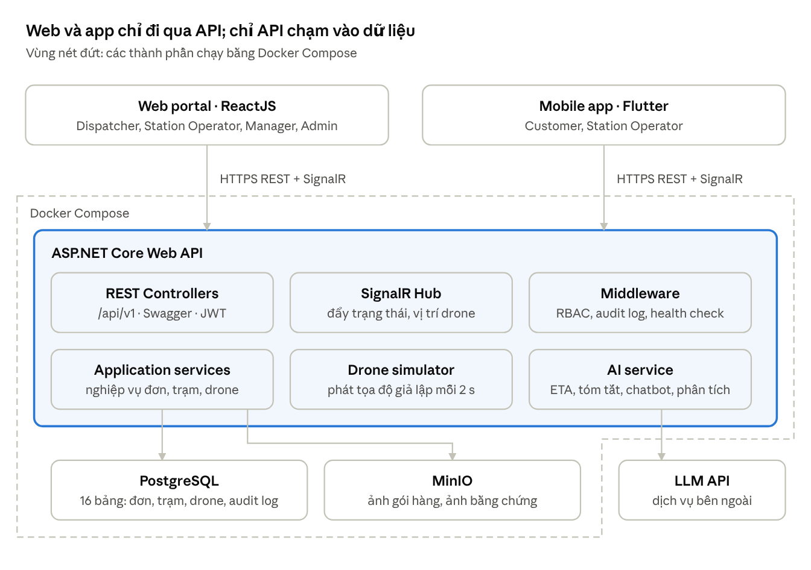

*Hình: kiến trúc hệ thống · 2 client, 1 API, 3 nơi lưu/gọi dữ liệu*

Web và app không truy cập thẳng CSDL hay MinIO. Ảnh được upload qua API rồi lưu vào MinIO, CSDL chỉ giữ object key.

| Thành phần | Công nghệ | Vai trò |
| --- | --- | --- |
| Web portal | ReactJS, Vite, Tailwind CSS | Giao diện cho Dispatcher, Station Operator, Manager, Admin |
| Mobile app | Flutter, Dio | Giao diện cho Customer và Station Operator |
| Web API | ASP.NET Core 8, ASP.NET Identity, JWT | Nghiệp vụ, xác thực, phân quyền, Swagger |
| Realtime | SignalR | Đẩy đổi trạng thái đơn và vị trí drone |
| Cơ sở dữ liệu | PostgreSQL 16, EF Core | Lưu toàn bộ dữ liệu nghiệp vụ |
| Lưu trữ file | MinIO | Ảnh gói hàng, ảnh bằng chứng giao |
| AI | LLM API bên ngoài + công thức Haversine | Tóm tắt, trợ lý, phân tích; ước tính ETA |

#### 1.2 Cấu trúc thư mục backend

Backend là một project ASP.NET Core 8 (`src/SmartDrone.csproj`), chia thư mục theo repo mẫu Flask-CleanArchitecture của giảng viên hướng dẫn: cùng tên tầng, cùng vị trí các file khởi động, chỉ đổi ngôn ngữ. Mỗi thư mục có `README.md` giải thích từng file làm gì, dùng thế nào; file quan trọng có thêm file `.md` cùng tên. Bảng đối chiếu từng file Flask ↔ C# và sequence diagram nằm ở `docs/clean-architecture.md`.

| Tầng | Thư mục | Nội dung | Hiện trạng 02/11 |
| --- | --- | --- | --- |
| Api | `src/Api`: Controllers, Schemas, Middleware, Requests, Responses, Swagger | Controller REST mỏng, schema request/response có validate, log request, Swagger | Auth, Stations, Orders, CustomerAddresses, Ai |
| Services | `src/Services` | Nghiệp vụ, chỉ phụ thuộc interface của Domain | AuthService, StationService, OrderService (tạo, sửa, hủy, xem), CustomerAddressService, AiService |
| Domain | `src/Domain`: Constants, Exceptions, Models | 15 model theo schema v2, interface `I*Repository`, enum trạng thái, Roles, `OrderStateMachine`, exception nghiệp vụ | Đủ model, interface, state machine |
| Infrastructure | `src/Infrastructure`: Databases, Models, Repositories, Services | AppDbContext + seed, cấu hình bảng EF Core, repository, JWT, LLM client | Có; còn thiếu MinIO client, SignalR hub |
| Khởi động | `src/Program.cs`, `CreateApp.cs`, `Config.cs`, `Cors.cs`, `DependencyContainer.cs`, `ErrorHandler.cs`, `AppLogging.cs`, `Migrations/` | Tương ứng `app.py`, `create_app.py`, `config.py`, `cors.py`, `dependency_container.py`, `error_handler.py`, `app_logging.py`, `migrations` của mẫu | Có |

Phụ thuộc một chiều: Api → Services → Domain ← Infrastructure. Domain không phụ thuộc EF Core; Services không gọi DbContext mà gọi interface `I*Repository` do Infrastructure cài đặt; `DependencyContainer.cs` là nơi duy nhất nối interface với class cài đặt. Lỗi nghiệp vụ được ném dạng exception trong `Domain/Exceptions.cs`, `ErrorHandler.cs` đổi thành ProblemDetails. Web và app tổ chức theo màn hình, lớp gọi API tách riêng (`api.dart` trên app, service trên web).

### 2. Thiết kế cơ sở dữ liệu

CSDL PostgreSQL gồm 16 bảng chia 3 cụm; nguồn sự thật là EF Core migration, file docs/schema.sql dùng làm bản vẽ và dựng thử.

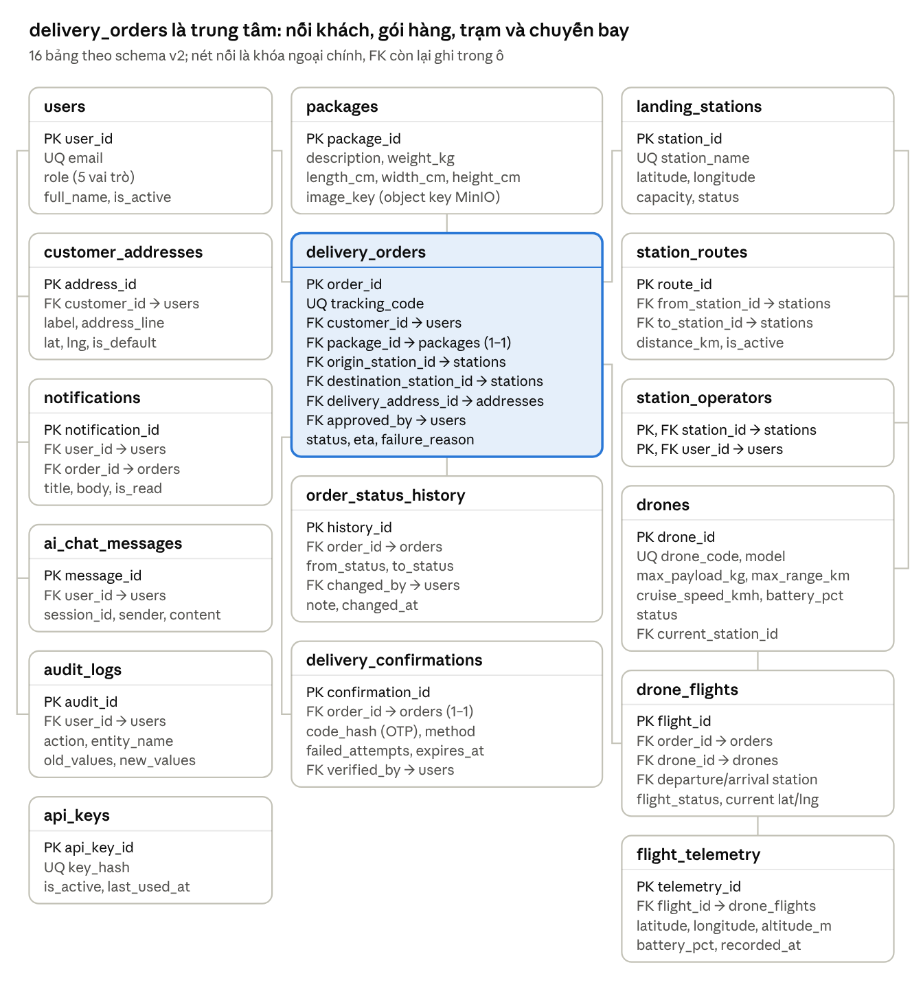

*Hình: ERD logic · 16 bảng, 3 cụm: người dùng, đơn hàng, trạm và đội drone*

Cột trái là cụm người dùng (nối về users), cột giữa là cụm đơn hàng, cột phải là cụm trạm và đội drone. Bản đầy đủ ký hiệu crow's foot (KAN-9), vẽ từ `docs/schema.sql`, kèm khóa chính (PK), khóa ngoại (FK), duy nhất (UK):

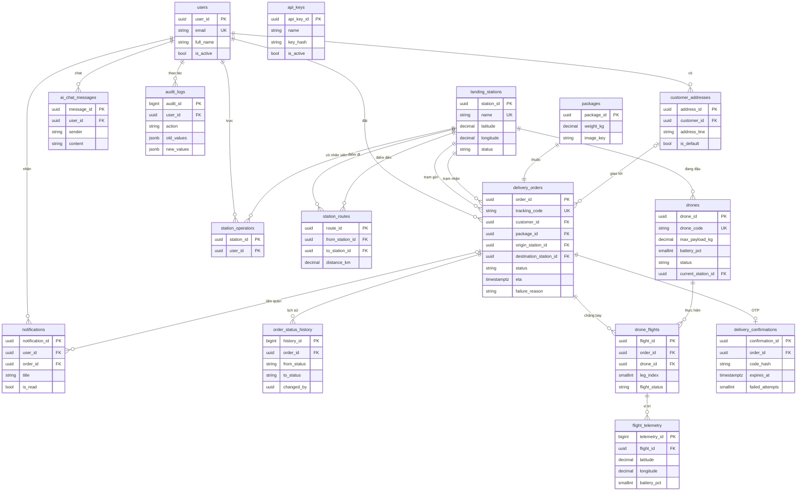

| Bảng | Mục đích | Ràng buộc chính |
| --- | --- | --- |
| users | Tài khoản và vai trò (trong code là AspNetUsers của ASP.NET Identity) | Email duy nhất; role thuộc 5 giá trị |
| customer\_addresses | Địa chỉ giao của khách | Mỗi khách tối đa 1 địa chỉ mặc định; tọa độ hợp lệ |
| landing\_stations | Trạm hạ cánh | Tên duy nhất; status Available, Occupied, Maintenance; capacity > 0 (số drone đậu cùng lúc) |
| station\_routes | Tuyến bay giữa 2 trạm | Cặp trạm duy nhất, hai trạm khác nhau, distance\_km > 0 |
| station\_operators | Gán Station Operator vào trạm | Khóa chính kép (station\_id, user\_id) |
| drones | Danh mục drone | Mã duy nhất; status Idle, Assigned, InFlight, Charging, Maintenance; pin 0–100 |
| packages | Gói hàng | Khối lượng và kích thước > 0; ảnh lưu object key |
| delivery\_orders | Đơn giao | Mã vận đơn duy nhất; 9 trạng thái; hai trạm khác nhau; Failed phải có lý do |
| order\_status\_history | Lịch sử đổi trạng thái, vẽ timeline | Ghi mỗi lần chuyển trạng thái |
| drone\_flights | Chuyến bay của đơn | Duy nhất theo (order\_id, leg\_index); status Scheduled, Flying, Landed, Aborted |
| flight\_telemetry | Vị trí, pin theo thời gian | Ghi mỗi 2 giây từ bộ giả lập |
| delivery\_confirmations | OTP xác nhận nhận hàng | Mỗi đơn một bản ghi; chỉ lưu hash OTP; method OTP hoặc QR |
| notifications | Thông báo cho người dùng | Index theo user, trạng thái đọc |
| audit\_logs | Nhật ký thao tác | Lưu giá trị cũ và mới dạng jsonb |
| ai\_chat\_messages | Lịch sử chat với trợ lý AI | sender là User hoặc Assistant |
| api\_keys | Khóa cho hệ thống ngoài | Chỉ lưu hash, không có khóa ngoại |

Khóa chính dùng uuid (trừ các bảng nhật ký dùng bigint tự tăng); mọi khóa ngoại đều có index; trường updated\_at cập nhật bằng trigger; hàm fn\_haversine\_km tính khoảng cách cho tuyến và ETA.

### 3. Thiết kế chi tiết

Phần lõi của hệ thống là vòng đời đơn: mọi màn hình và API đều đọc hoặc chuyển trạng thái thông qua một lớp OrderStateMachine duy nhất.

#### 3.1 Vòng đời đơn giao

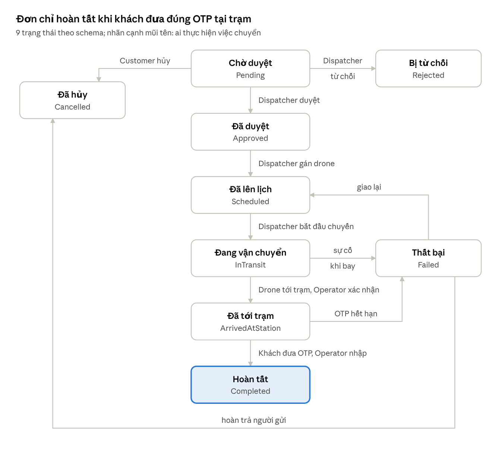

*Hình: state machine đơn giao · 9 trạng thái*

| Từ | Sự kiện | Sang | Người thực hiện | API |
| --- | --- | --- | --- | --- |
| Pending | Duyệt | Approved | Dispatcher | POST /orders/{id}/approve |
| Pending | Từ chối (có lý do) | Rejected | Dispatcher | POST /orders/{id}/reject |
| Pending | Hủy | Cancelled | Customer | POST /orders/{id}/cancel |
| Approved | Gán drone, lên lịch | Scheduled | Dispatcher | POST /orders/{id}/schedule |
| Scheduled | Bắt đầu chuyến | InTransit | Dispatcher | POST /orders/{id}/start |
| InTransit | Drone tới trạm, Operator xác nhận | ArrivedAtStation | Simulator + Station Operator | POST /orders/{id}/arrive |
| ArrivedAtStation | Nhập đúng OTP + ảnh | Completed | Station Operator | POST /orders/{id}/confirm |
| InTransit | Sự cố khi bay | Failed | Dispatcher | POST /orders/{id}/fail |
| ArrivedAtStation | OTP hết hạn, khách không tới | Failed | Dispatcher | POST /orders/{id}/fail |
| Failed | Giao lại | Scheduled | Dispatcher | POST /orders/{id}/schedule |
| Failed | Hoàn trả | Cancelled | Dispatcher | Hoàn trả \[dự kiến\] |

Ngày 05/11 các endpoint schedule, start, arrive, confirm, fail đã có trong docs/openapi.yaml và đã code. Riêng dòng Failed → Cancelled (hoàn trả) chưa có API cho Dispatcher: /cancel hiện chỉ cho Customer hủy đơn Pending. Cặp (trạng thái, sự kiện) nào không có trong bảng thì API trả 409.

Thiết kế lớp:

- `OrderStatus` (enum, Domain): 9 giá trị trùng CHECK trong CSDL.
- `OrderStateMachine` (Domain): bảng chuyển hợp lệ + hàm `CanTransition(from, to)`; dùng chung cho mọi service.
- `OrderService` (Services): kiểm tra quyền, gọi state machine, cập nhật đơn qua `IOrderRepository`, ghi `OrderStatusHistory`, phát sự kiện qua `IOrderNotifier`.
- `OrdersController` (Api): nhận request, trả ProblemDetails khi lỗi.
- `TrackingHub` (Api): SignalR hub, group theo `order:{id}` và `station:{id}`.
- `DroneSimulator` (Infrastructure, BackgroundService): phát vị trí, ghi telemetry, báo tới trạm.

#### 3.2 Luồng giao trọn vẹn

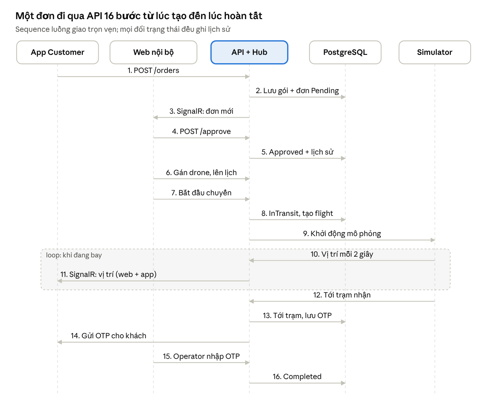

*Hình: sequence luồng giao trọn vẹn · 5 thành phần, 16 bước*

Bước 10–11 lặp lại trong suốt chuyến bay. Web nội bộ đóng vai Dispatcher ở bước 4–7 và Station Operator ở bước 15.

#### 3.3 Các luồng chi tiết còn lại

Các sơ đồ dưới đây vẽ theo code thật trong repo (cấu trúc Clean Architecture), mỗi luồng ghi rõ lớp nào gọi lớp nào. Mọi bước đổi trạng thái đơn đều đi qua `OrderStateMachine`; sai bước trả 409.

**a) Sơ đồ lớp của luồng đơn hàng (4 tầng)**

Controller chỉ gọi Service; Service chỉ biết interface `I*Repository` ở Domain; Infrastructure cài đặt interface bằng EF Core trên `AppDbContext`.

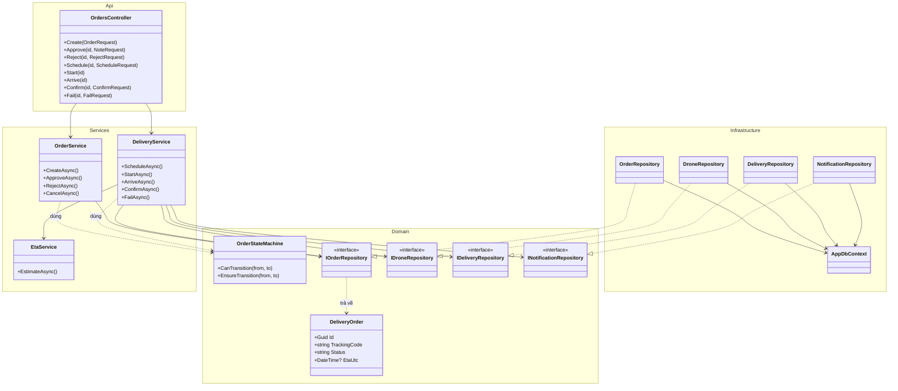

**b) Đăng nhập**

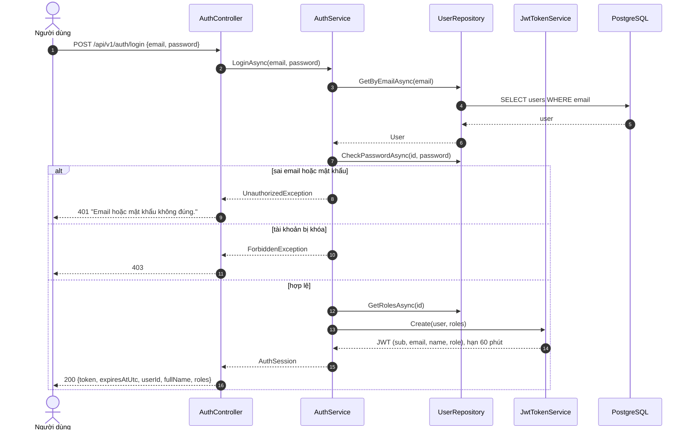

Sai email hoặc sai mật khẩu đều báo chung một câu để không lộ email nào đã đăng ký; token chứa `sub`, `email`, `name`, `role`.

**c) Khách tạo đơn**

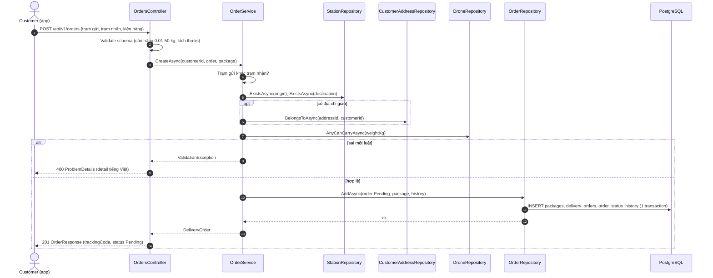

Kiện hàng, đơn và dòng lịch sử đầu tiên được ghi trong một transaction; sai một luật thì không bảng nào bị ghi.

**d) Giao hàng trọn vẹn: duyệt → gán drone → bay → tới trạm → OTP**

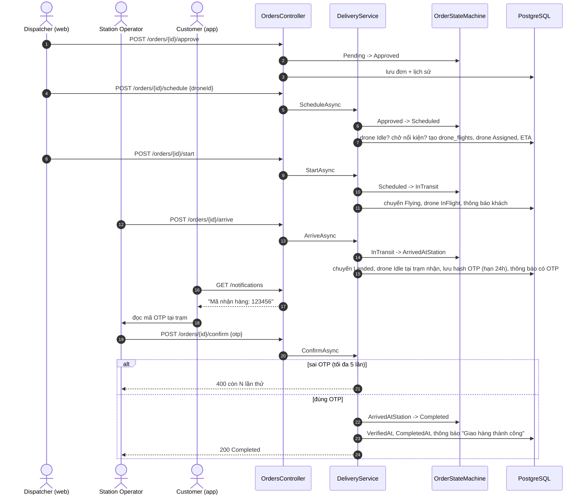

OTP 6 số chỉ lưu dạng SHA-256, hạn 24 giờ, sai tối đa 5 lần; nhân viên trạm không xem được mã, khách đọc mã từ thông báo trên app.

**e) Giao thất bại và giao lại**

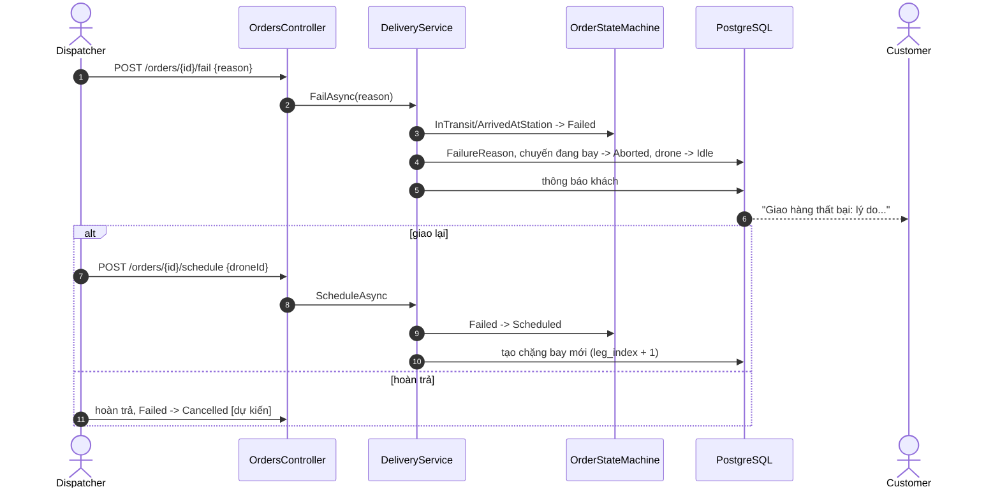

**f) Quy trình nghiệp vụ giao hàng (BPMN rút gọn, KAN-8)**

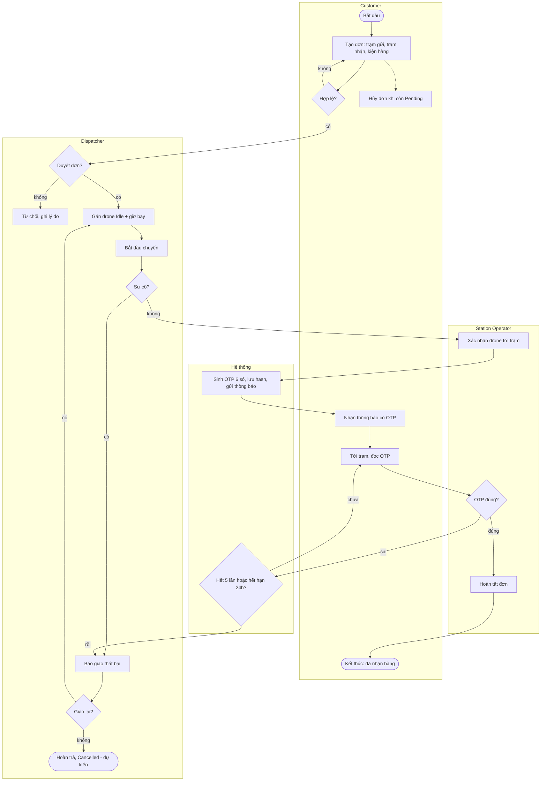

**g) API đã cài đặt (đến 05/11)**

| Chức năng | Endpoint | Vai trò | Trạng thái đơn |
| --- | --- | --- | --- |
| Đăng ký / đăng nhập | `POST /auth/register`, `/auth/login` | Mọi người |  |
| Quản lý trạm | `GET/POST/PUT/DELETE /stations` | Xem: đã đăng nhập; sửa: Admin, Manager |  |
| Quản lý drone | `GET/POST/PUT/DELETE /drones` | Xem: nhân viên vận hành; sửa: Admin, Manager |  |
| Địa chỉ giao | `/customers/me/addresses` | Customer |  |
| Ước tính ETA | `GET /orders/eta` | Đã đăng nhập |  |
| Tạo / sửa / hủy đơn | `POST /orders`, `PUT /orders/{id}`, `POST /orders/{id}/cancel` | Customer | → Pending / Cancelled |
| Duyệt / từ chối | `POST /orders/{id}/approve`, `/reject` | Dispatcher, Manager, Admin | Pending → Approved / Rejected |
| Gán drone | `POST /orders/{id}/schedule` | Dispatcher, Manager, Admin | Approved, Failed → Scheduled |
| Bắt đầu chuyến | `POST /orders/{id}/start` | Dispatcher, Manager, Admin | Scheduled → InTransit |
| Tới trạm + sinh OTP | `POST /orders/{id}/arrive` | Station Operator, Dispatcher, Manager, Admin | InTransit → ArrivedAtStation |
| Xác nhận OTP | `POST /orders/{id}/confirm` | Station Operator, Dispatcher, Manager, Admin | ArrivedAtStation → Completed |
| Giao thất bại | `POST /orders/{id}/fail` | Dispatcher, Manager, Admin | InTransit, ArrivedAtStation → Failed |
| Xem đơn, lịch sử | `GET /orders`, `/orders/{id}`, `/orders/{id}/history` | Khách: đơn của mình; nhân viên: mọi đơn |  |
| Thông báo | `GET /notifications`, `POST /notifications/{id}/read` | Đã đăng nhập |  |
| Thống kê + CSV | `GET /reports/orders`, `/reports/orders.csv` | Admin, Manager |  |
| Quản lý tài khoản | `GET/POST /users`, `PUT /users/{id}/roles`, `/users/{id}/active` | Admin |  |
| Trợ lý AI | `POST /ai/chat`, `/ai/feasibility-test` | Đã đăng nhập |  |

Tiền tố chung `/api/v1`; hợp đồng đầy đủ ở `docs/openapi.yaml`, thử trực tiếp trên Swagger `/swagger`. Chưa có: ảnh bằng chứng giao (MinIO), vị trí drone realtime (SignalR + bộ giả lập, KAN-55), hoàn trả Failed → Cancelled cho Dispatcher.

## V. Tài liệu kiểm thử

Kiểm thử tập trung vào API và vòng đời đơn, vì đây là nơi cả web lẫn app cùng phụ thuộc; giao diện được kiểm thử thủ công theo kịch bản demo.

### 1. Phạm vi kiểm thử

- Trong phạm vi: xác thực và phân quyền; toàn bộ API trong openapi.yaml; chuyển trạng thái đơn theo bảng IV.3; SignalR; OTP; dịch vụ AI (ETA, tóm tắt, trợ lý); dashboard; triển khai Docker; hiệu năng cơ bản.
- Ngoài phạm vi: điều khiển drone thật; kiểm thử bảo mật chuyên sâu (pentest); chất lượng nội dung của LLM; trình duyệt cũ và điện thoại dưới Android 8.
- Ràng buộc: môi trường chạy trên một máy bằng Docker Compose; dữ liệu dùng seed; LLM dùng gói miễn phí nên có giới hạn số lần gọi.

### 2. Chiến lược kiểm thử

| Cấp độ | Đối tượng | Công cụ | Người làm |
| --- | --- | --- | --- |
| Unit test | OrderStateMachine, service nghiệp vụ, tính ETA | xUnit | Người viết code |
| Integration test | API theo openapi.yaml, phân quyền, CSDL thật | Postman/Newman, Swagger | Tài |
| System test | Kịch bản demo trên web + app + Docker | Thủ công | Cả nhóm |
| Hiệu năng | API danh sách đơn, tạo đơn, SignalR | k6 | Tài |
| Acceptance | 7 bước kịch bản demo | Demo với giảng viên | Cả nhóm |

### 3. Kế hoạch kiểm thử

- Nhân sự: Tài phụ trách kế hoạch, test case, báo cáo; mỗi thành viên tự test phần mình trước khi mở PR.
- Môi trường: Windows 10/11 hoặc Ubuntu, Docker Desktop, .NET 8 SDK, Node 20, Flutter 3.x; Chrome bản mới; 1 điện thoại Android thật + emulator.
- Mốc: Postman collection luồng tạo đơn 01/11 (KAN-37); test API toàn luồng 22/11 (KAN-68); test hệ thống + k6 + báo cáo 26/11 (KAN-70).
- Lỗi phát hiện được tạo issue loại Bug trên Jira KAN, gắn mã test case.

### 4. Test case chính

| ID | Use case | Bước thực hiện | Kết quả mong đợi | Kết quả |
| --- | --- | --- | --- | --- |
| TC-01 | UC-01 | Đăng nhập admin@drone.local / Demo@12345 | 200, trả token, vai trò Admin | Chưa chạy |
| TC-02 | UC-01 | Đăng nhập sai mật khẩu | 401, MSG-02 | Chưa chạy |
| TC-03 | UC-22 | Customer gọi POST /stations | 403, MSG-11 | Chưa chạy |
| TC-04 | UC-05 | Customer tạo đơn hợp lệ | 201, đơn Pending, mã vận đơn ≤ 20 ký tự, có 1 dòng lịch sử | Chưa chạy |
| TC-05 | UC-05 | Tạo đơn trạm gửi = trạm nhận | 400, MSG-04 | Chưa chạy |
| TC-06 | UC-05 | Tạo đơn gói 25 kg | 400, MSG-05 | Chưa chạy |
| TC-07 | UC-08 | Customer A xem đơn của Customer B | 404 | Chưa chạy |
| TC-08 | UC-07 | Hủy đơn Pending | 200, Cancelled | Chưa chạy |
| TC-09 | UC-07 | Hủy đơn Approved | 409, MSG-07 | Chưa chạy |
| TC-10 | UC-13 | Dispatcher duyệt đơn Pending | 200, Approved, lưu người duyệt | Chưa chạy |
| TC-11 | UC-13 | Duyệt lại đơn đã Approved | 409 | Chưa chạy |
| TC-12 | UC-13 | Từ chối không nhập lý do | 400, MSG-01 | Chưa chạy |
| TC-13 | UC-14 | Gán drone có tải tối đa nhỏ hơn gói | 400 | Chưa chạy |
| TC-14 | UC-15, UC-09 | Bắt đầu chuyến, mở chi tiết đơn trên app | InTransit; vị trí cập nhật trong ≤ 3 giây | Chưa chạy |
| TC-15 | UC-21 | Nhập đúng OTP + ảnh | Completed, có bản ghi xác nhận | Chưa chạy |
| TC-16 | UC-21 | Nhập sai OTP 5 lần | Lần 5 bị khóa, MSG-08 đếm lùi | Chưa chạy |
| TC-17 | UC-11 | Ngắt kết nối LLM rồi chat | MSG-10, không lỗi 500 | Chưa chạy |
| TC-18 | – | Gọi /health | 200 Healthy | Chưa chạy |
| TC-19 | – | k6: 50 người dùng ảo, 5 phút | p95 < 3 giây, 0 lỗi 5xx | Chưa chạy |

&#91;Cập nhật\] Danh sách test case đầy đủ nằm trong Postman collection; bảng trên là các case bắt buộc phải pass trước demo.

### 5. Báo cáo kiểm thử

&#91;Cập nhật sau 26/11\] Tổng số test case, số pass/fail theo cấp độ, danh sách lỗi còn mở, kết quả k6 (p95, throughput, tỷ lệ lỗi), đánh giá đạt hay chưa đạt mục tiêu chất lượng ở II.1.2.

## VI. Gói bàn giao và hướng dẫn

Hệ thống dựng được trên một máy bằng Docker Compose + .NET 8 SDK; tài khoản demo của 5 vai trò được seed sẵn.

### 1. Gói bàn giao

| Thành phần | Vị trí |
| --- | --- |
| Mã nguồn backend | src/ (SmartDrone.csproj: Api, Services, Domain, Infrastructure, Migrations) |
| Mã nguồn web | web/ |
| Mã nguồn mobile | mobile/ |
| Hợp đồng API | docs/openapi.yaml, Swagger tại /swagger |
| Thiết kế CSDL | docs/schema.sql, EF Core migration |
| Triển khai | docker-compose.yml, .env.example, chay-thu.bat |
| Tài liệu | Báo cáo này (xuất PDF/Word), slide, video demo \[Cập nhật\] |
| File cài app | APK bản demo \[Cập nhật\] |

### 2. Hướng dẫn cài đặt

#### 2.1 Yêu cầu hệ thống

- Windows 10/11, macOS hoặc Linux; RAM tối thiểu 8 GB.
- Docker Desktop (đang chạy), .NET 8 SDK, Node.js 20 (cho web), Flutter SDK 3.x + Android Studio (cho app).
- Cổng trống: 5432 (PostgreSQL), 9000/9001 (MinIO), 5080 (API), 5173 (web).

#### 2.2 Các bước cài đặt

1. Clone repo: `git clone https://github.com/nguyenmauhuynh/CNPM-group`.
2. Chép `.env.example` thành `.env` (giữ hoặc đổi mật khẩu DB, MinIO).
3. Bật CSDL và MinIO: `docker compose up -d db minio` (chỉ cần CSDL thì chạy `scripts/run_postgres.ps1` trên Windows hoặc `scripts/run_postgres.sh`).
4. Chạy API: `dotnet run --project src --launch-profile http`. Migration và dữ liệu mẫu tự chạy khi khởi động; Swagger ở http://localhost:5080/swagger. Trên Windows có thể nhấp đúp `chay-thu.bat` để chạy bước 2–4 và kiểm tra đăng nhập.
5. Chạy web: `cd web`, `npm install`, `npm run dev`, mở http://localhost:5173.
6. Chạy app: `cd mobile`, `flutter pub get`, rồi `flutter run` (emulator) hoặc `flutter run --dart-define=API_URL=http://<IP-máy-tính>:5080/api/v1` (điện thoại thật cùng mạng Wi-Fi).

&#91;Cập nhật\] Khi Docker Compose có đủ service api và web (KAN-58), bước 3–5 gộp thành một lệnh `docker compose up -d`.

#### 2.3 Tài khoản demo

Mật khẩu chung: `Demo@12345`.

| Vai trò | Email |
| --- | --- |
| Admin | admin@drone.local |
| Manager | manager@drone.local |
| Dispatcher | dispatcher@drone.local |
| Station Operator | stationoperator@drone.local |
| Customer | customer@drone.local |

### 3. Hướng dẫn sử dụng

&#91;Cập nhật\] Mỗi bước sẽ kèm ảnh màn hình thật sau khi đóng băng tính năng (22/11).

#### 3.1 Customer (app)

1. Đăng ký hoặc đăng nhập.
2. Vào "Địa chỉ" thêm địa chỉ giao (không bắt buộc).
3. Bấm "Tạo đơn": chọn trạm gửi, trạm nhận, nhập thông tin gói, chụp ảnh, xem ETA, xác nhận.
4. Vào "Đơn của tôi" xem trạng thái; khi đơn đang bay, mở chi tiết để xem drone trên bản đồ.
5. Khi nhận thông báo "Đã tới trạm", mang OTP tới trạm nhận và đọc cho nhân viên.
6. Mở "Trợ lý AI" để hỏi về đơn, trạm, thời gian giao.

#### 3.2 Dispatcher (web)

1. Mở "Bảng điều phối", lọc đơn Pending.
2. Mở đơn, duyệt hoặc từ chối (nhập lý do).
3. Với đơn Approved: bấm "Gán drone", chọn drone gợi ý và giờ bay.
4. Bấm "Bắt đầu chuyến", theo dõi trên màn "Theo dõi chuyến bay".
5. Khi có sự cố: bấm "Giao thất bại", nhập lý do, chọn giao lại hoặc hoàn trả.

#### 3.3 Station Operator (web hoặc app)

1. Mở "Trạm của tôi" xem đơn sắp tới và drone đang đậu.
2. Khi drone tới: bấm "Xác nhận đã nhận gói".
3. Khi khách tới: nhập OTP khách đưa, chụp ảnh bàn giao, bấm "Hoàn tất".
4. Đổi trạng thái trạm sang Maintenance khi cần bảo trì.

#### 3.4 Logistics Manager (web)

1. Mở "Dashboard", chọn khoảng ngày để xem thống kê.
2. Bấm "Xuất CSV" để tải báo cáo; bấm "Phân tích AI" để xem nhận xét.
3. Vào "Quản lý trạm, drone, tuyến" để thêm, sửa danh mục.

#### 3.5 System Administrator (web)

1. Vào "Quản lý tài khoản" tạo tài khoản nội bộ, gán vai trò, gán Station Operator vào trạm, khóa/mở tài khoản.
2. Vào "Audit log" tra cứu thao tác theo người dùng hoặc đối tượng.
3. Vào "API key" cấp key cho hệ thống ngoài; key chỉ hiện một lần.

## Lịch sử phiên bản

| Phiên bản | Ngày | Người cập nhật | Nội dung |
| --- | --- | --- | --- |
| v0.1 | 28/10/2026 | Tiến | Bản đầu đủ 6 phần theo khung SPMP/SRS/SDD/Test/Release; số liệu bám schema v2 và openapi.yaml |
| v0.2 | 29/10/2026 | Tiến | Thêm context diagram (III.1.1) và use case diagram chuẩn UML (III.2) theo yêu cầu giảng viên; UC-08, UC-17 chỉnh lại tác nhân cho khớp sơ đồ |
| v0.3 | 29/10/2026 | Tiến | Thêm mục lục có liên kết tới từng mục; đổi danh sách việc cần bổ sung thành Checklist tiến độ theo tuần W1–W6, khớp Jira KAN |
| v0.4 | 29/10/2026 | Tiến | Điền giảng viên hướng dẫn và email thành viên; giãn kế hoạch thành 7 tuần (kết thúc 29/11), dời mốc MVP sang 08/11 và đóng băng tính năng sang 22/11; cập nhật Checklist tiến độ theo Jira |
| v0.5 | 02/11/2026 | Tiến | Tái cấu trúc backend theo repo mẫu Clean Architecture của GVHD (Api / Services / Domain / Infrastructure), thêm README.md cho từng thư mục, cài OrderStateMachine; cập nhật IV.1.2 và hướng dẫn cài đặt VI.2 |
| v0.6 | 05/11/2026 | Tiến | Thêm ERD crow's foot (IV.2); viết IV.3.3: sơ đồ lớp, 4 sơ đồ tuần tự (đăng nhập, tạo đơn, giao hàng, giao thất bại), lưu đồ BPMN, bảng API; code luồng giao hàng (lên lịch, bay, tới trạm, OTP, thất bại), thông báo, thống kê + CSV, quản lý người dùng, Docker Compose 1 lệnh |

## Checklist tiến độ

Làm xong việc nào thì tick ô đó, đồng thời kéo task tương ứng sang Done trên Jira KAN để hai nơi khớp nhau. Dòng ghi: mã Jira · việc — người làm, hạn. Xóa mục này trước khi nộp bản cuối.

### A. Phần mềm (theo Jira KAN)

#### W1–W2 · 12/10–25/10 · Phân tích, thiết kế, khung dự án

- [x] 20/20 task W1–W2 đã xong: repo + CI, schema v2 + migration, OpenAPI v1, wireframe web và mobile, use case, khung báo cáo, thử LLM, màn đăng nhập/tạo đơn mobile, màn dashboard/duyệt đơn/quản lý trạm web

#### W3 · 26/10–01/11 · Dọn repo, khung web, state machine, xác thực, BPMN/ERD

- [x] KAN-13 · Viết DTO + enum (Role, OrderStatus, StationStatus, DroneStatus) bám schema v2 — Vinh, 27/10
- [x] KAN-51 · Dọn repo: xóa file trùng, gộp 1 project Flutter, dời docs, dựng khung Vite cho web — Tiến, 30/10
- [ ] KAN-52 · Bật branch protection cho main trên GitHub — Huỳnh, 30/10
- [ ] KAN-54 · Chuyển khung báo cáo sang mẫu SPMP/SRS/SDD/Test/Release + chia người viết — Tài, 30/10
- [ ] KAN-15 · Hướng dẫn và kiểm tra cả nhóm chạy docker compose up trên máy mỗi người — Tài, 31/10
- [ ] KAN-20 · Dựng khung React (Vite, TS): routing, layout, menu theo role, lớp service data giả — Huỳnh, 31/10
- [x] KAN-50 · OrderStatus enum + OrderStateMachine + API duyệt/từ chối đơn (F-21) — Tiến, 31/10
- [x] KAN-8 · Vẽ BPMN quy trình giao hàng (có nhánh giao thất bại, hủy đơn) — Tiến, 01/11
- [x] KAN-9 · Vẽ ERD từ schema.sql (dbdiagram.io) + sơ đồ kiến trúc tổng thể — Tiến, 01/11
- [ ] KAN-29 · Auth JWT 5 role chạy thật + API Admin gán role cho user — Tiến, 01/11 (code xong 05/11, chờ merge PR feature/delivery-flow)
- [ ] KAN-31 · Điều phối W3: review PR, họp T2/T4/T6, demo nội bộ Chủ nhật 01/11 — Tiến, 01/11
- [ ] KAN-37 · Test plan + Postman collection cho luồng Customer tạo đơn — Tài, 01/11
- [x] KAN-46 · Danh sách đơn của tôi + chi tiết đơn (timeline trạng thái cơ bản) — Đức, 01/11

#### W4 · 02/11–08/11 · Lõi đơn hàng chạy thật trên web và app (mốc MVP 08/11)

- [x] KAN-32 · API Customer + địa chỉ giao hàng (CRUD) — Vinh, 04/11
- [ ] KAN-34 · API Delivery Order: tạo, sửa, hủy, xem danh sách/chi tiết, validate tải trọng — Vinh, 04/11
- [ ] KAN-40 · Nối đăng nhập thật, lưu JWT, route guard theo role — Huỳnh, 04/11
- [ ] KAN-33 · API Package + upload ảnh kiện lên MinIO (DB lưu object key) — Vinh, 05/11
- [x] KAN-35 · API Drone + Station (CRUD, trạng thái sẵn sàng) — Tiến, 05/11
- [x] KAN-38 · Thiết kế prompt + function calling cho chatbot (tra đơn, tra trạm, ETA) — Tài, 05/11
- [x] KAN-53 · API ước tính ETA bằng khoảng cách Haversine (F-52) — Tài, 06/11
- [ ] KAN-41 · Danh sách đơn gọi API thật: lọc, sort, phân trang — Huỳnh, 07/11
- [ ] KAN-42 · Quản lý trạm gọi API thật (thêm/sửa/xóa) — Huỳnh, 07/11
- [ ] KAN-45 · Danh sách trạm từ API + Tạo đơn thật (kèm ảnh kiện) — Đức, 07/11
- [ ] KAN-36 · Seed data mẫu đầy đủ + rà Swagger/contract khớp code — Vinh, 08/11
- [ ] KAN-63 · Điều phối W4: review PR, họp T2/T4/T6, demo nội bộ Chủ nhật 08/11 — Tiến, 08/11

#### W5 · 09/11–15/11 · Thực thi chuyến, tracking, xác nhận giao (mốc 15/11)

- [ ] KAN-56 · API thực thi chuyến: gán drone, bắt đầu chuyến, tới trạm (F-22, F-23, F-32) — Vinh, 11/11 (Tiến làm trước 05/11, chờ merge; Vinh làm tiếp phần giả lập drone KAN-55)
- [ ] KAN-47 · Màn quản lý địa chỉ giao hàng — Đức, 12/11
- [ ] KAN-55 · SignalR Hub + bộ giả lập drone phát tọa độ (F-41) — Vinh, 12/11
- [ ] KAN-30 · Audit log tự động (SaveChanges interceptor): ai làm gì, giá trị cũ/mới — Tiến, 13/11
- [ ] KAN-39 · Thiết kế Analytics: danh sách chỉ số + câu SQL mẫu trên seed — Tài, 13/11
- [ ] KAN-57 · Xác nhận giao: OTP + ảnh bằng chứng, xử lý giao thất bại (F-24, F-33, F-42) — Tiến, 14/11 (OTP + giao thất bại xong 05/11, chờ merge; còn ảnh bằng chứng)
- [ ] KAN-59 · Web Dispatcher: gán drone + theo dõi chuyến realtime trên bản đồ (F-22, F-41) — Huỳnh, 14/11
- [ ] KAN-61 · Mobile: theo dõi đơn realtime qua SignalR (F-41) — Đức, 14/11
- [ ] KAN-58 · Docker Compose thêm service api + web, dựng cả hệ thống 1 lệnh — Tiến, 15/11 (xong 05/11, chờ merge)
- [ ] KAN-60 · Web Station Operator: tình trạng trạm, xác nhận gói tới, xác nhận lấy hàng (F-31, F-32, F-33) — Huỳnh, 15/11
- [ ] KAN-62 · Tóm tắt chuyến giao bằng LLM (F-53) — Tài, 15/11

#### W6 · 16/11–22/11 · Dashboard, AI, đóng băng tính năng 22/11

- [ ] KAN-64 · API thống kê + xuất CSV (F-50, F-51) — Tiến, 19/11 (xong 05/11, chờ merge)
- [ ] KAN-66 · API trợ lý AI cho khách hàng - chatbot (F-54) — Tài, 20/11
- [ ] KAN-65 · Web: dashboard Logistics Manager + màn Admin gọi API thật (F-04, F-50) — Huỳnh, 21/11
- [ ] KAN-67 · Mobile: màn chat AI + màn Station Operator nhập OTP (F-33, F-54) — Đức, 21/11
- [ ] KAN-68 · Test API toàn luồng bằng Postman/Newman — Tài, 22/11
- [ ] KAN-69 · Ghép kịch bản demo end-to-end + đóng băng tính năng 22/11 — Tiến, 22/11

#### W7 · 23/11–29/11 · Kiểm thử, triển khai, báo cáo, demo

- [ ] KAN-70 · Kiểm thử hệ thống + test tải k6 + báo cáo kiểm thử — Tài, 26/11
- [ ] KAN-71 · Hoàn thiện triển khai: script backup pg\_dump, health check, README cài đặt — Tiến, 26/11
- [ ] KAN-72 · Ghép báo cáo cuối kỳ theo mẫu (mỗi người nộp phần mình trước 26/11) — Tiến, 28/11
- [ ] KAN-73 · Slide + video demo dự phòng + tập dượt demo 2 lần — Tiến, 28/11

### B. Báo cáo

- [x] Context diagram (III.1.1) và use case diagram UML (III.2) — Tiến, v0.2
- [x] Mục lục — Tiến, v0.3
- [x] Điền giảng viên hướng dẫn và email thành viên — Tiến, v0.4
- [ ] Điền ngày bảo vệ chính thức (Thông tin chung) — Tiến
- [ ] Chèn 7 ảnh sơ đồ vào các trang III và IV trên Confluence (thay khung "Sơ đồ: …") — Tiến
- [x] Chèn BPMN quy trình giao hàng vào phần III (KAN-8) — Tiến, 01/11
- [x] Chèn ERD crow's foot xuất từ dbdiagram.io vào IV.2 (KAN-9) — Tiến, 01/11
- [x] Bổ sung endpoint schedule, start, arrive, confirm, fail vào openapi.yaml, bỏ nhãn \[dự kiến\] ở bảng IV.3.1 (KAN-50, KAN-56, KAN-57) — Tiến, Vinh, 14/11
- [ ] Cập nhật cột "Hiện trạng" ở IV.1.2 theo code, mỗi Chủ nhật — Tiến
- [ ] Class diagram + sequence cho 10 luồng chi tiết (IV.3.3) — Tiến, Vinh, 22/11 (05/11 đã có class + 4 sequence + BPMN vẽ từ code thật; còn chatbot, thông báo, báo cáo, quản lý user)
- [ ] Ảnh màn hình thật cho III.3 và VI.3 sau đóng băng 22/11 — Huỳnh, Đức, 24/11
- [ ] Link Postman collection vào V.4 (KAN-37) — Tài, 01/11
- [ ] Điền cột "Kết quả" 19 test case (V.4) và báo cáo kiểm thử + k6 (V.5) (KAN-68, KAN-70) — Tài, 26/11
- [ ] Gộp bước 3–5 ở VI.2.2 thành `docker compose up -d` khi KAN-58 xong — Tiến, 15/11
- [ ] Viết kịch bản demo 7 bước vào phần V (II.2.2 và V.2 đang nhắc tới nhưng chưa có) (KAN-69) — Tiến, 22/11
- [ ] Thêm link APK, slide, video demo vào VI.1 (KAN-73) — Tiến, Đức, 28/11
- [ ] Thêm trang bìa theo mẫu trường, xuất Word/PDF bản nộp (KAN-72) — Tiến, 28/11

## Nguồn tham khảo

- [Zipline surpasses 2 million deliveries, raises more than $600M](https://www.zipline.com/newsroom/zipline-surpasses-2-million-deliveries-raises-more-than-600m-to-power-next-phase-of-growth-and-expands-operations-to-houston-and-phoenix) — Zipline, 21/01/2026
- [Walmart expands drone delivery with Wing to 150 more stores](https://www.axios.com/2026/01/11/walmart-drone-delivery-wing-los-angeles-miami) — Axios, 01/2026
- [Matternet Station drone delivery hub](https://newatlas.com/drones/matternet-station-drone-delivery-hub-medical) — New Atlas, 11/03/2020
- Đề tài "AI-powered Drone Delivery Management Platform" và mã nguồn, tài liệu trong repo CNPM-group (docs/schema.sql, docs/openapi.yaml, docs/CONVENTIONS.md)
