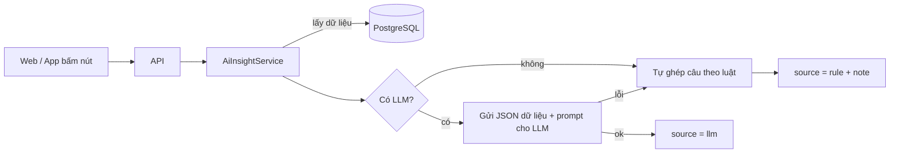
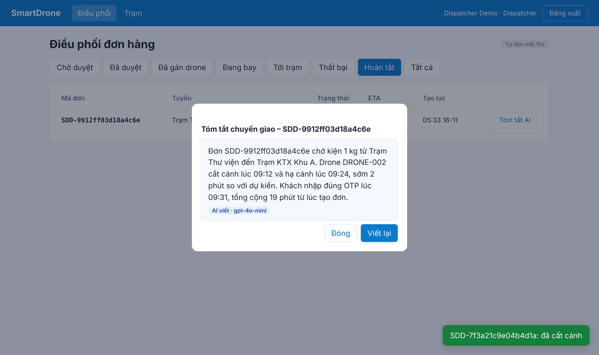
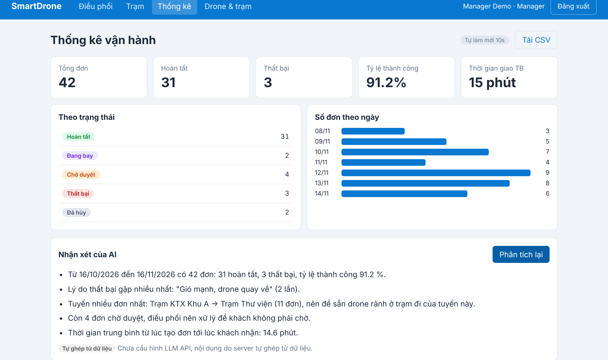

# Báo cáo v0.10 – AI tóm tắt chuyến giao và nhận xét vận hành

Đồ án: AI-powered Drone Delivery Management Platform (SmartDroneDelivery) · Nhóm Mậu Huỳnh · GVHD: Nguyễn Văn Chiến
Ngày: 16/11/2026 · Nối tiếp [báo cáo v0.9](BaoCao_v0.9.md) (trước đó: [v0.8](BaoCao_v0.8.md), [v0.7](BaoCao_v0.7_Web_Mobile.md))

## 1. Vì sao có bản này

Tên đề tài là "**AI-powered**" nhưng tới v0.9 phần AI mới có chatbot. Bảng "Phạm vi AI thực tế" trong README còn 2 dòng **Chưa làm**: tóm tắt chuyến giao bằng LLM (KAN-62) và phân tích vận hành. v0.10 làm xong cả hai, gắn vào cả web lẫn app.

| Phần | Nội dung | Trạng thái |
|---|---|---|
| Backend | `POST /orders/{id}/ai-summary`: AI viết 3–4 câu tóm tắt chuyến giao (KAN-62) | Xong |
| Backend | `GET /reports/ai-insights`: AI đọc số liệu 30 ngày, viết 3–5 nhận xét + việc nên làm | Xong |
| Backend | Không có API key / LLM lỗi → server tự ghép câu từ dữ liệu, ghi rõ nguồn | Xong |
| Web | Nút **Tóm tắt AI** ở mỗi dòng trang Điều phối, thêm tab **Hoàn tất** | Xong |
| Web | Khung **Nhận xét của AI** ở trang Thống kê | Xong |
| Mobile | Thẻ **Tóm tắt chuyến giao** ở chi tiết đơn đã kết thúc | Xong |
| Tài liệu | `AiInsightService.md`, `docs/ai/ai-summary-insights.md` (prompt + luật), md cho mọi file mới, `openapi.yaml` thêm nhóm AI | Xong |
| Kiểm thử | Postman thêm 4 request (47), test giao diện web thêm 3 luồng AI, `flutter test` cho `AiSummary` | Xong, Postman **chưa chạy trên backend thật** |

## 2. AI trong hệ thống, sau v0.10

| Tính năng | Ai dùng | Ở đâu | Cách làm |
|---|---|---|---|
| Chatbot hỗ trợ | Khách | App: màn Trợ lý AI | LLM tự gọi 4 tool tra đơn, trạm, ETA (có từ trước) |
| **Tóm tắt chuyến giao** | Điều phối, khách | Web Điều phối, app Chi tiết đơn | Server gom dữ liệu → LLM viết câu |
| **Nhận xét vận hành** | Quản lý, Admin | Web Thống kê | Server tính số liệu → LLM rút nhận xét + đề xuất |
| Ước tính ETA | Mọi người | Tạo đơn | Công thức (không phải AI) |

## 3. Cách làm

Quyết định thiết kế:

1. **Server lấy dữ liệu trước, LLM chỉ viết câu.** Khác chatbot (LLM tự gọi tool). Với tóm tắt và nhận xét thì dữ liệu cần dùng đã rõ, nên đưa sẵn cho LLM: ít lượt gọi hơn, LLM không thể tra nhầm đơn người khác, con số trong câu luôn từ DB. Prompt dặn "chỉ dùng dữ liệu trong JSON, không có thì không nhắc".
2. **Không gửi dữ liệu nhạy cảm cho LLM:** không OTP, không id/email/số điện thoại khách.
3. **Giờ đổi sang giờ Việt Nam trước khi gửi**, để LLM khỏi tự cộng 7 tiếng (dễ sai).
4. **Không có API key vẫn chạy:** server tự ghép câu theo luật từ cùng dữ liệu (ví dụ "Drone DRONE-002 cất cánh lúc 09:12, tới trạm lúc 09:24 (dự kiến 09:26), sớm 2 phút."). Demo không chết khi chưa có key hoặc hết hạn mức.
5. **Không giả là AI:** API trả `source` (`llm` / `rule`) và `note`; web, app luôn hiện nhãn "AI viết · model" hoặc "Tự ghép từ dữ liệu".
6. **Không tự gọi khi mở trang**, phải bấm nút, vì mỗi lần là 1 lần gọi LLM (tốn phí). API tóm tắt dùng POST cho đúng ý "tạo nội dung mới".
7. Khách chỉ tóm tắt được đơn của mình (đơn người khác → 404), nhận xét vận hành chỉ Manager/Admin (khách → 403).

Chi tiết: [AiInsightService.md](../../src/Services/AiInsightService.md), prompt đầy đủ: [docs/ai/ai-summary-insights.md](../ai/ai-summary-insights.md).

## 4. Giao diện

Ảnh chụp từ test giao diện tự động với **API giả lập** (nội dung trong ảnh là dữ liệu mẫu, nhãn "AI viết · gpt-4o-mini" ở ảnh 1 cũng là dữ liệu mẫu). Ảnh 2 là trường hợp chưa có API key: nhãn "Tự ghép từ dữ liệu".

App: chi tiết đơn Hoàn tất / Thất bại / Đã hủy / Bị từ chối có thẻ "Tóm tắt chuyến giao", bấm "Nhờ AI tóm tắt", có nút "Viết lại".

## 5. Kiểm thử

Test case bổ sung: [KiemThu_v0.10.md](KiemThu_v0.10.md) (TC80–TC91, tổng sau v0.10: 68).

| Cách kiểm | Thêm ở v0.10 | Trạng thái |
|---|---|---|
| Postman (47 request, trước là 43) | Nhóm 9: tóm tắt đơn (điều phối, khách), khách gọi nhận xét → 403, quản lý gọi nhận xét. Kiểm được cả khi có key (`llm`) lẫn không key (`rule`) | Viết xong, kiểm cú pháp 47 script; **chưa chạy trên backend thật** |
| Test giao diện web (Playwright, API giả lập) | Tab Hoàn tất → Tóm tắt AI (nhãn AI viết); đơn Thất bại → Tóm tắt AI (nhãn Tự ghép + lý do); Thống kê → Phân tích bằng AI ra 5 nhận xét | Đạt, không lỗi JavaScript |
| `flutter test` | `AiSummary.fromJson`, `byLlm` | Viết xong, chạy trong CI |

**Phải kiểm tay khi có API key** (không tự động được vì câu LLM viết mỗi lần một khác): đối chiếu từng con số trong câu tóm tắt với trang chi tiết đơn (giờ, mã drone, số phút trễ). LLM sai số liệu dù đã dặn là rủi ro có thật, ghi kết quả vào TC81.

Như các bản trước: máy làm bản này không có .NET, Flutter, Docker, nên **backend và mobile chưa biên dịch thử**. Mở PR để CI build trước.

## 6. Kịch bản demo (bổ sung)

Chạy kịch bản của [v0.8](BaoCao_v0.8.md#6-kịch-bản-demo-đầy-đủ) và [v0.9](BaoCao_v0.9.md#7-kịch-bản-demo-bổ-sung-so-với-v08), thêm:

| Bước | Ai | Thao tác | Thấy gì |
|---|---|---|---|
| 9 | Điều phối (web) | Tab Hoàn tất → Tóm tắt AI ở đơn vừa giao | 3–4 câu tóm tắt, có giờ cất cánh/hạ cánh, sớm/trễ |
| 10 | Khách (app) | Mở đơn vừa nhận → Nhờ AI tóm tắt | Cùng nội dung trên điện thoại |
| 11 | Quản lý (web) | Thống kê → Phân tích bằng AI | 3–5 nhận xét kèm việc nên làm |

Nên demo **có** `LLM_API_KEY` để thầy thấy nhãn "AI viết". Không có key vẫn demo được, nhưng phải nói rõ đó là bản tự ghép.

## 7. Sửa lỗi kèm theo

Xóa trạm đã có đơn, hoặc xóa drone đã từng bay, trước đây trả **lỗi 500** vì PostgreSQL chặn bằng khóa ngoại (lịch sử đơn và chuyến bay phải giữ lại). Giờ repository bắt lỗi này và trả **409** với câu hướng dẫn "chuyển sang Bảo trì thay vì xóa"; trang Drone & trạm hiện đúng câu đó. Test case TC90, TC91.

## 8. Hạn chế

- Chưa biên dịch và chạy thử backend, mobile trên máy thật.
- Câu LLM viết không kiểm tự động được, chỉ kiểm tay (mục 5).
- Nhận xét vận hành chỉ dựa trên số liệu tổng hợp (không có dữ liệu thời tiết, pin theo chuyến), nên đề xuất còn chung.
- Chưa lưu lại bản tóm tắt: mỗi lần bấm là gọi LLM lại (đơn giản, nhưng tốn phí nếu bấm nhiều).
- Các hạn chế cũ: đường bay thẳng, chưa có nền bản đồ thật, chatbot cần API key.
