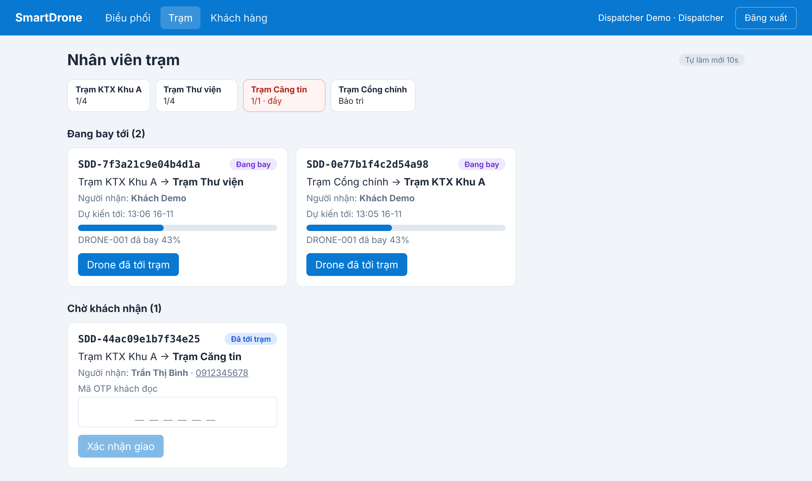
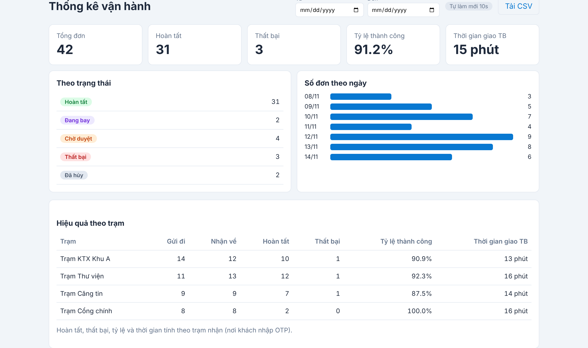
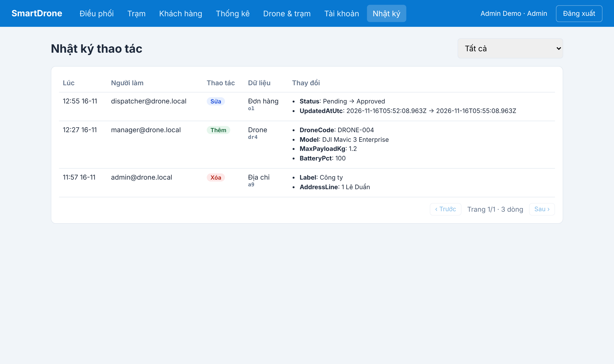
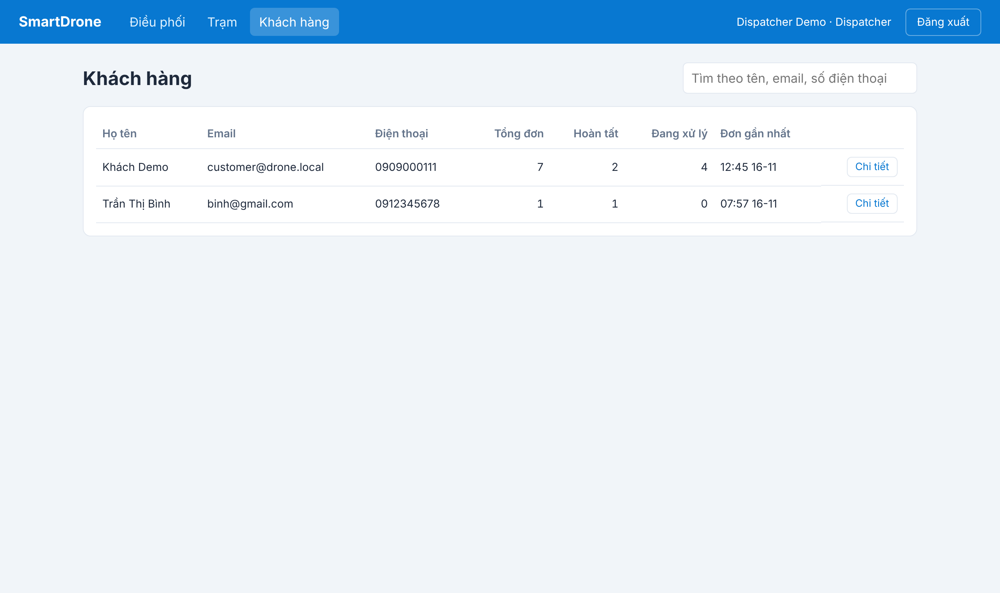
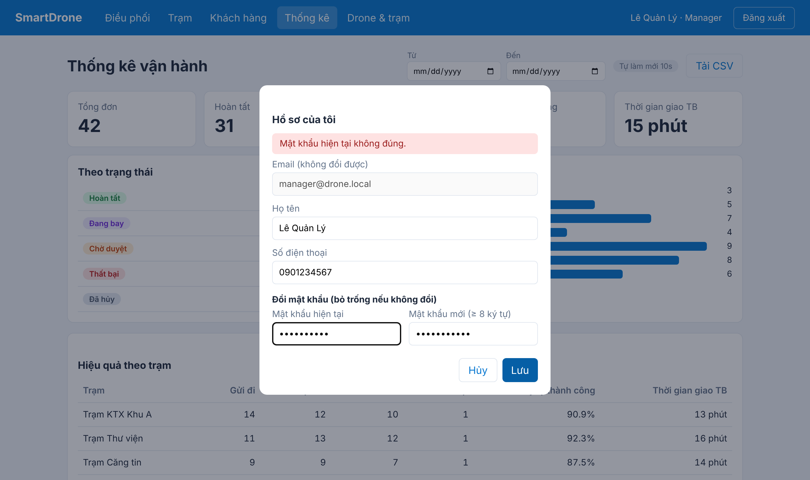

# Báo cáo v0.11 – Lấp yêu cầu đề, nhật ký thao tác, báo cáo chính v1.0

Đồ án: AI-powered Drone Delivery Management Platform (SmartDroneDelivery) · Nhóm Mậu Huỳnh · GVHD: Nguyễn Văn Chiến
Ngày: 16/11/2026 · Nối tiếp [báo cáo v0.10](BaoCao_v0.10.md) (trước đó: [v0.9](BaoCao_v0.9.md), [v0.8](BaoCao_v0.8.md), [v0.7](BaoCao_v0.7_Web_Mobile.md))

## 1. Vì sao có bản này

Đối chiếu từng dòng FR01–FR12 và 7 quy tắc nghiệp vụ trong đề (`project-overview/03-phan-tich-yeu-cau-he-thong.md`) với code v0.10 thì còn hụt mấy chỗ: chưa sửa được thông tin cá nhân, chưa có màn quản lý khách hàng, đơn chưa có người nhận, chưa tìm được đơn, trạm chưa có sức chứa, báo cáo chưa có theo trạm và chưa lọc ngày. Ngoài ra báo cáo chính vẫn ở v0.6 và ghi nhiều thứ không còn đúng (Tailwind, bản đồ, ảnh bằng chứng, API key...). v0.11 lấp hết các chỗ hụt và đưa báo cáo chính lên **v1.0 khớp code**.

| Yêu cầu đề | Trước v0.11 | Sau v0.11 |
|---|---|---|
| FR01 Cập nhật thông tin cá nhân | Không có | Hồ sơ + đổi mật khẩu trên web và app |
| FR03 Quản lý khách hàng, tra lịch sử đơn | Không có màn nào | Trang **Khách hàng** (xem, tìm, sửa) |
| Quy tắc 2: đơn có thông tin người nhận | Không có | Tên, số người nhận (mặc định là khách) |
| FR05 Chỉnh sửa, tìm kiếm đơn | Có API sửa, chưa có màn; không tìm được | App **Sửa đơn**; tìm theo mã trên web và app |
| FR07 Khả năng tiếp nhận, số đơn tại trạm | Không có | Sức chứa + tải trạm, chặn gán khi trạm đầy |
| FR11 Hiệu quả theo trạm, lọc thời gian | Không có | Bảng theo trạm + chọn khoảng ngày |
| BR-25 Audit log (SRS nhóm tự đặt) | Có bảng, không ghi | Tự ghi mọi thao tác, trang **Nhật ký** |
| BR-12 Pin ≥ 30 %, đủ tầm bay | Chỉ kiểm tải | Kiểm đủ cả 3 |

## 2. Phần làm thêm

| Phần | Nội dung | Trạng thái |
|---|---|---|
| Backend | `GET/PUT /auth/me`, `POST /auth/me/password` | Xong |
| Backend | `/customers`, `/customers/{id}` (xem: Điều phối, Quản lý, Admin; sửa: Quản lý, Admin) | Xong |
| Backend | Cột `recipient_name`, `recipient_phone` + migration viết tay | Xong, **phải sinh lại bằng `dotnet ef`** |
| Backend | `GET /orders?q=`; `capacity` cho trạm; `GET /stations/load`; `GET /reports/stations` | Xong |
| Backend | `AuditInterceptor` + `GET /audit-logs` | Xong |
| Backend | Luật gán drone: pin, tầm bay, trạm nhận bảo trì/đầy | Xong |
| Web | Hộp thoại Hồ sơ, trang Khách hàng, trang Nhật ký, ô tìm ở Điều phối, thanh tải ở Trạm, cột tải + sức chứa ở Drone & trạm, lọc ngày + bảng theo trạm ở Thống kê | Xong, test giao diện đạt |
| Mobile | Ô người nhận khi tạo đơn, nút Sửa đơn, ô tìm đơn, màn Hồ sơ của tôi | Xong, **chưa build** |
| Vận hành | `scripts/backup.sh`, `backup.bat`, `restore.sh` | Xong |
| Kiểm thử | xUnit 17 hàm, Postman +19 request (66), 20 test case mới | Xong, **chưa chạy trên backend thật** |
| Tài liệu | Báo cáo chính v1.0; `openapi.yaml` đủ 56 endpoint; project-overview 07–09; md cho mọi file mới | Xong |

## 3. Cách làm

### 3.1 Người nhận

Khách thường gửi cho người khác, nên đơn phải có người nhận (quy tắc 2 của đề). Bỏ trống thì server lấy tên, số điện thoại của chính khách, nên app cũ không gửi trường này vẫn chạy. Số điện thoại kiểm bằng cùng một luật với hồ sơ (`ProfileRules.Phone`: 8–15 ký tự số, cho phép `+`, dấu cách, dấu chấm). Nhân viên trạm thấy người nhận trên thẻ đơn để gọi khi khách chưa tới.

### 3.2 Sức chứa trạm

`capacity` là số kiện trạm giữ được cùng lúc. Tải trạm = đơn đang bay tới (Scheduled, InTransit) + kiện đã tới chờ khách (ArrivedAtStation). Khi gán drone, nếu tải ≥ sức chứa thì trả 409 và hướng dẫn "đợi khách nhận bớt". Trạm Bảo trì: tạo đơn tới đó bị 400, gán drone tới đó bị 409.

### 3.3 Báo cáo theo trạm, lọc ngày

`/reports/stations` dùng lại đúng dữ liệu của file CSV, nên số liệu hai nơi khớp nhau. "Gửi đi" đếm theo trạm gửi; "Nhận về", hoàn tất, thất bại, tỷ lệ, thời gian TB đếm theo trạm nhận (nơi khách nhập OTP). Khoảng ngày chọn ở trên áp cho mọi ô số, bảng, CSV và nhận xét AI.

### 3.4 Nhật ký thao tác

Không chèn code ghi log vào từng service, mà dùng một **SaveChanges interceptor** của EF Core: trước khi lưu, nó duyệt các bản ghi thêm/sửa/xóa, ghi tên bảng, khóa, giá trị cũ và mới (JSON), người làm (lấy từ token), IP. Bỏ qua bảng vốn đã là nhật ký (telemetry, thông báo, lịch sử trạng thái) và xóa các cột băm (`PasswordHash`, `CodeHash`...) khỏi giá trị. Chỉ ghi khi có người đăng nhập, nên seed lúc khởi động không làm đầy nhật ký.

### 3.5 Khách hàng và hồ sơ

## 4. Báo cáo chính lên v1.0

Rà từng mục của `BaoCao_SmartDroneDelivery.md` với code, sửa hơn 120 chỗ. Những nhóm sửa chính:

| Loại | Ví dụ |
|---|---|
| Ghi sai công nghệ | Tailwind → CSS thuần; JWT lưu cookie → `localStorage`; vị trí 2 giây → 3 giây; dự phòng 5 giây → 10 giây |
| Ghi có mà chưa làm | Ảnh bằng chứng, API key, quản lý tuyến bay, gán Operator vào trạm, lưu lịch sử chat, k6 → ghi rõ **chưa làm** ngay tại chỗ |
| Ghi "dự kiến" mà đã làm | Hoàn trả đơn thất bại, SignalR, giả lập drone, audit log, sao lưu |
| Số liệu cũ | Giới hạn kiện 20 kg → 50 kg; bảng API 17 dòng → đủ 56 endpoint; tên lớp `IOrderNotifier`, `TrackingHub` → `IOrderEvents`, `DeliveryHub` |
| Chỗ trống `[Cập nhật]` | Kết quả kiểm thử, gói bàn giao, hướng dẫn cài đặt (1 lệnh Docker), hướng dẫn sử dụng theo nút thật trên màn hình |
| Checklist tiến độ | Thay bằng bảng **Tình trạng theo yêu cầu đề** FR01–FR12 + việc còn lại trước khi nộp |

Kèm theo: viết 3 phần còn thiếu của bộ tài liệu tổng quan đề tài (07 Kiểm thử và đánh giá, 08 Kết quả đạt được, 09 Kết luận và hướng phát triển).

## 5. Kiểm thử

- Test giao diện web: thêm 4 luồng (khách hàng, hồ sơ, thống kê theo trạm, nhật ký), cả 20 ảnh chụp đạt.
- Postman thư mục 10: 19 request (hồ sơ, số điện thoại sai, mật khẩu sai, đơn có người nhận, tìm theo mã, khách hàng 403/200, quản lý sửa khách, tải trạm, báo cáo theo trạm, xóa trạm 409, nhật ký 403/200, nhật ký không lộ mã băm).
- xUnit: 17 hàm ở `tests/SmartDrone.Tests`, CI chạy `dotnet test`.
- Test case: [KiemThu_v0.11.md](KiemThu_v0.11.md) (TC92–TC111), tổng 88.

## 6. Kịch bản demo (bổ sung)

Chạy kịch bản của v0.8, v0.9, v0.10, thêm:

| Bước | Ai | Thao tác | Thấy gì |
|---|---|---|---|
| 12 | Khách (app) | Tạo đơn, nhập người nhận khác mình | Chi tiết đơn có dòng người nhận |
| 13 | Khách (app) | Đơn còn Chờ duyệt → Sửa đơn | Sửa được; đơn đã duyệt không còn nút |
| 14 | Điều phối (web) | Gõ mã đơn vào ô tìm | Chỉ còn đúng đơn đó |
| 15 | Quản lý (web) | Drone & trạm: đặt sức chứa 1 cho trạm nhận; Điều phối gán thêm đơn tới trạm đó | Báo trạm đã đủ sức chứa |
| 16 | Quản lý (web) | Thống kê: chọn khoảng ngày | Số liệu và bảng theo trạm đổi theo |
| 17 | Admin (web) | Nhật ký | Thấy đúng thao tác bước 15 với giá trị cũ → mới |

## 7. Hạn chế

- Như các bản trước: máy soạn không có .NET, Flutter, Docker nên **backend và mobile chưa biên dịch thử**; CI sẽ build khi mở PR.
- Migration `AddOrderRecipient` viết tay (không có file Designer). Phải chạy `dotnet ef migrations remove` rồi `dotnet ef migrations add AddOrderRecipient` để sinh lại chuẩn (`src/Migrations/README.md`).
- Trạm cũ trong CSDL đã tạo trước v0.11 giữ sức chứa 2; seed mới mới là 4.
- Nhật ký chỉ ghi thao tác đi qua EF Core; sửa tay trong CSDL không được ghi.
- Vẫn chưa làm: API key, gán Operator vào trạm, quản lý tuyến bay, ảnh bằng chứng, lưu lịch sử chat, test tải.
