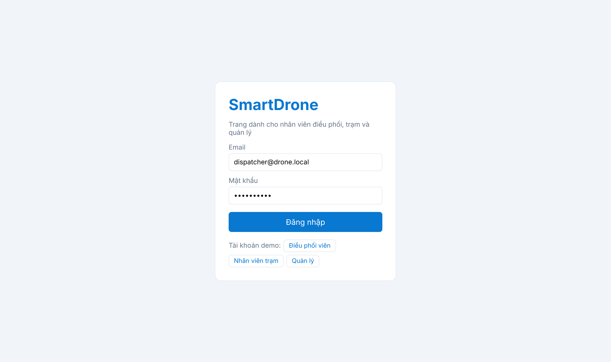
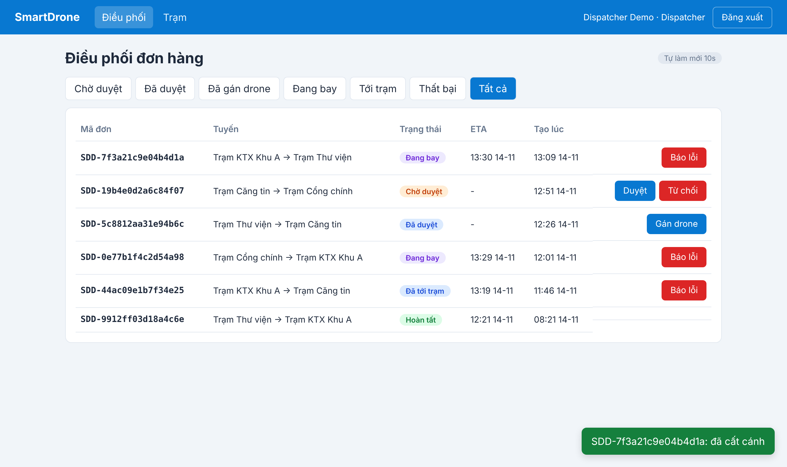
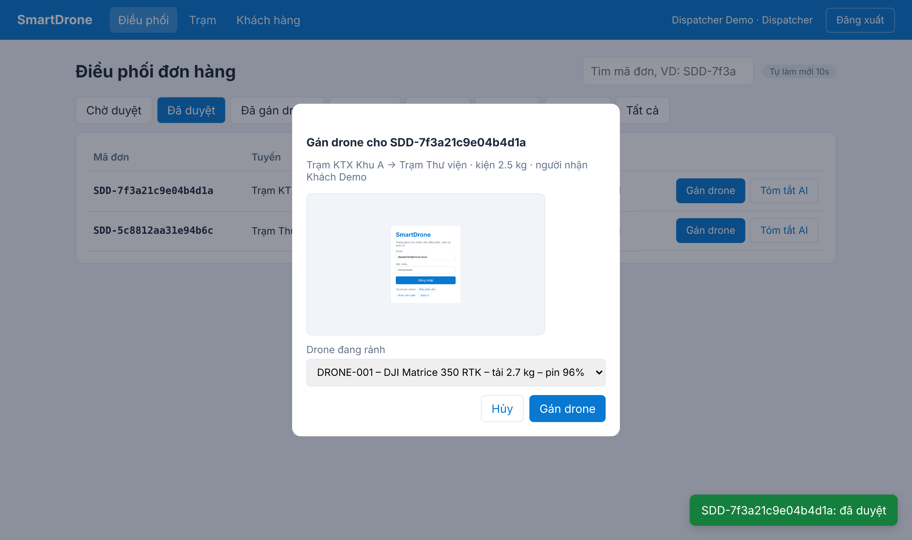
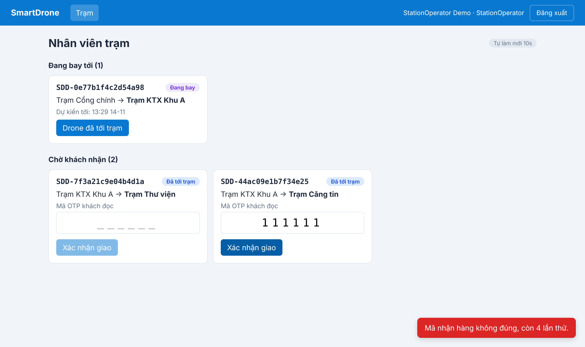
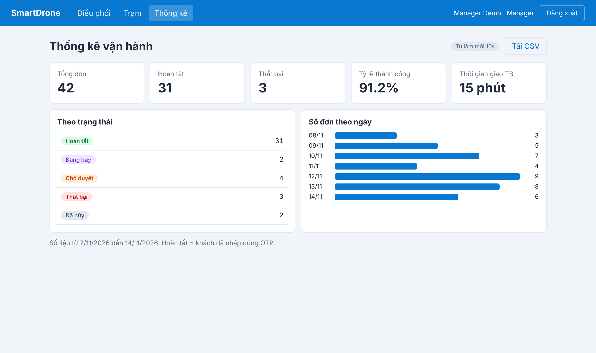
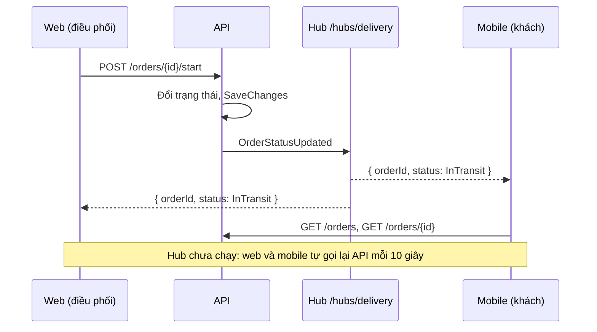

# Báo cáo v0.7 – Web nhân viên (ReactJS) và mobile khách hàng

Đồ án: AI-powered Drone Delivery Management Platform (SmartDroneDelivery) · Nhóm Mậu Huỳnh · GVHD: Nguyễn Văn Chiến
Ngày: 14/11/2026 · Phụ trách đợt này: Nguyễn Ngọc Trần Hoàng Tiến (web), Lê Công Anh Đức (mobile) · Bản tiếp theo: [v0.8](BaoCao_v0.8.md), [v0.9](BaoCao_v0.9.md), [v0.10](BaoCao_v0.10.md)

## 1. Mục tiêu

Ở bản v0.6 (05/11/2026) backend đã chạy được trọn vòng đời đơn hàng, nhưng phía người dùng còn thiếu:

- Web là HTML thuần, chỉ trang đăng nhập/đăng ký gọi API thật, các trang đơn hàng dùng dữ liệu mẫu. Đề yêu cầu **ReactJS**.
- Chưa có màn cho điều phối viên, nhân viên trạm, quản lý.
- App mobile chưa có màn thông báo, nên khách **không xem được mã OTP** nhận hàng. Bước này nằm giữa luồng giao hàng.
- Code SignalR của mobile đã có nhưng chưa được gọi ở đâu.

Mục tiêu v0.7: chạy được **một luồng demo trọn vẹn** giữa khách (mobile) và nhân viên (web), dùng đúng công nghệ trong đề.

## 2. Kết quả

| Hạng mục | Trạng thái | Jira |
|---|---|---|
| Web React: đăng nhập, phân quyền theo role | Xong | KAN-41 |
| Web: màn Điều phối (duyệt, từ chối, gán drone, cất cánh, báo lỗi, giao lại) | Xong | KAN-42 |
| Web: màn Trạm (tới trạm, nhập OTP) | Xong | KAN-60 |
| Web: màn Thống kê + tải CSV | Xong | KAN-65 |
| Web: Docker build React + nginx | Xong | KAN-58 |
| Mobile: màn Thông báo + hiện OTP | Xong | KAN-47 |
| Mobile: nối SignalR, tự cập nhật trạng thái | Xong, chờ hub backend | KAN-61 |
| Backend: chi tiết đơn đúng spec, quyền xem đơn của nhân viên trạm | Sửa lỗi | – |
| SignalR hub phía backend | Chưa (Vinh) | KAN-55 |
| Upload ảnh MinIO phía backend | Chưa (Vinh) | KAN-33 |

## 3. Web nhân viên

### 3.1. Công nghệ và cấu trúc

React 18, Vite 5, React Router 6, `@microsoft/signalr` 8. Không dùng thư viện giao diện, CSS tự viết (giữ màu `#0878d1` của bản cũ).

```
web/src
├── main.jsx            điểm vào
├── App.jsx             đường dẫn + chặn theo role
├── api.js              mọi lời gọi API, token, đổi lỗi sang tiếng Việt
├── auth.jsx            trạng thái đăng nhập, role → trang
├── orderEvents.js      SignalR + làm mới dự phòng
├── format.js, styles.css
├── components/         Layout, Dialog, Toast, StatusBadge, LiveDot
└── pages/              Login, Dispatcher, Station, Dashboard
```

Mỗi file có file `.md` cùng tên hoặc README trong thư mục giải thích chi tiết.

### 3.2. Phân quyền

| Trang | Role được mở | Khớp với API |
|---|---|---|
| Điều phối `/dispatch` | Dispatcher, Manager, Admin | `[Authorize(Roles = DispatchStaff)]` của approve/reject/schedule/start/fail |
| Trạm `/station` | StationOperator, Dispatcher, Manager, Admin | `OperationsStaff` của arrive/confirm |
| Thống kê `/dashboard` | Manager, Admin | `AdminOrManager` của `/reports` |

Web chỉ ẩn trang. Chặn thật vẫn do server (sai role → 403). Tài khoản Customer đăng nhập web bị báo dùng app mobile.

### 3.3. Các màn hình

Ảnh chụp từ bản build thật của web, chạy với API giả lập (dữ liệu mẫu) trong lúc kiểm thử, xem mục 6.

**Đăng nhập** – có nút điền nhanh tài khoản demo.



**Điều phối** – tab lọc theo trạng thái, mỗi dòng chỉ hiện nút hợp lệ với trạng thái đó.



**Gán drone** – chỉ liệt kê drone đang rảnh (`Idle`) và chở được cân nặng kiện. Ví dụ dưới: kiện 2,5 kg nên DRONE-003 (đang bay) bị ẩn.



**Trạm** – thẻ "Đang bay tới" có nút xác nhận tới trạm; thẻ "Chờ khách nhận" có ô nhập OTP, đủ 6 số mới bấm được. Nhập sai thì hiện câu lỗi server trả về.



**Thống kê** – số liệu 30 ngày gần nhất từ `GET /reports/orders`, nút tải CSV.



## 4. Mobile khách hàng

- **Màn Thông báo** (`notifications_page.dart`): danh sách `GET /notifications`, chưa đọc in đậm. Thông báo "Hàng đã tới trạm" có mã 6 số được tách ra, hiện chữ to giữa màn để khách đọc cho nhân viên trạm. Bấm vào thì đánh dấu đã đọc và mở chi tiết đơn.
- **Chuông** trên trang "Đơn của tôi" có số thông báo chưa đọc.
- **Tự cập nhật**: danh sách đơn, chi tiết đơn, thông báo đều nghe `SignalRService.updates`; có event thì tải lại, trang danh sách hiện SnackBar "Đơn SDD-...: Đang giao".
- **Tạo đơn kèm ảnh**: backend chưa có API upload nên trước đây chọn ảnh là không tạo được đơn. Giờ upload lỗi thì vẫn tạo đơn không kèm ảnh và báo cho khách.

## 5. Cập nhật realtime

Contract chung cho backend, web, mobile: hub `/hubs/delivery`, event `OrderStatusUpdated`, payload `{ orderId, trackingCode, status, updatedAt }`.



Vì hub phía backend chưa xong, web và mobile đều có **chế độ dự phòng**: không nối được hub thì 10 giây tải lại một lần, nối được thì tự tắt. Web hiện nhãn "Realtime" hoặc "Tự làm mới 10s" để biết đang ở chế độ nào. Nhờ vậy buổi demo không phụ thuộc vào việc hub đã xong hay chưa.

## 6. Kiểm thử

| Phần | Cách kiểm | Kết quả |
|---|---|---|
| Web – cú pháp | Biên dịch toàn bộ `.js/.jsx` bằng TypeScript compiler | Không lỗi |
| Web – giao diện và luồng | Build bằng esbuild, chạy trên Chromium bằng Playwright, API giả lập trả dữ liệu đúng định dạng backend | Đạt, chi tiết bên dưới |
| Mobile | Rà code thủ công theo API của `signalr_netcore` và Flutter | **Chưa build** – máy kiểm thử không có Flutter SDK, cần chạy `flutter analyze` và `flutter run` |
| Backend (phần sửa) | Rà code; CI GitHub tự build khi push | **Chưa build tại máy** – không có .NET SDK, chờ CI |

Kịch bản kiểm thử web tự động (đều đạt):

1. Đăng nhập điều phối viên bằng nút demo → vào `/dispatch`, tab Chờ duyệt có 2 đơn.
2. Duyệt 1 đơn → thông báo xanh, đơn rời tab Chờ duyệt.
3. Tab Đã duyệt → Gán drone: hộp thoại chỉ liệt kê DRONE-001, DRONE-002 (DRONE-003 đang bay bị ẩn) → gán → cất cánh.
4. Đăng xuất, đăng nhập nhân viên trạm → menu chỉ có "Trạm".
5. Xác nhận tới trạm 1 đơn. Nhập OTP sai → thông báo đỏ "Mã nhận hàng không đúng, còn 4 lần thử."
6. Dán OTP có dấu cách "482 913" → ô tự thành `482913` → xác nhận → đơn Hoàn tất.
7. Nhân viên trạm gõ thẳng `/dashboard` → bị đưa về `/station`.
8. Đăng nhập quản lý → Thống kê hiện đủ 5 chỉ số, bảng trạng thái, biểu đồ ngày.
9. Đăng nhập bằng tài khoản Customer → báo "Tài khoản khách hàng dùng app mobile".

Trạng thái cuối của 6 đơn mẫu khớp đúng các thao tác. Không có lỗi JavaScript; lỗi duy nhất trong console là response 400 cố ý ở bước 5.

**Chưa kiểm** với backend thật: cần chạy lại toàn bộ kịch bản ở mục 8 trên `docker compose` trước buổi báo cáo.

## 7. Lỗi backend phát hiện khi ghép web/mobile

| Lỗi | Hậu quả | Đã sửa |
|---|---|---|
| `GET /orders/{id}` trả bản rút gọn (chỉ id trạm), khác `openapi.yaml` | App mobile mở chi tiết đơn bị lỗi; web không biết cân nặng kiện để lọc drone | Thêm `OrderDetailResponse` đúng spec |
| `Roles.Staff` thiếu `StationOperator` | Nhân viên trạm gọi `GET /orders` luôn nhận danh sách rỗng, màn Trạm trống | Thêm role vào `Roles.Staff` |
| Mobile đọc response tạo đơn như chi tiết đầy đủ | Đơn tạo thành công nhưng app báo "Có lỗi xảy ra" | `createOrder` chỉ lấy `id` |

Hai lỗi đầu chỉ lộ ra khi có giao diện gọi API, vì Swagger không kiểm tra response có khớp spec hay không.

## 8. Kịch bản demo

| Bước | Ai | Thao tác | Thấy gì |
|---|---|---|---|
| 1 | Khách (mobile) | `customer@drone.local` tạo đơn Trạm KTX Khu A → Trạm Thư viện, 1,5 kg | Đơn "Chờ duyệt" |
| 2 | Điều phối (web) | `dispatcher@drone.local` duyệt → gán DRONE-001 → cất cánh | Mobile tự chuyển "Đang giao", có SnackBar |
| 3 | Trạm (web) | `stationoperator@drone.local` bấm Drone đã tới trạm | Mobile: chuông có thông báo, mở ra thấy mã OTP |
| 4 | Khách + Trạm | Khách đọc mã, nhân viên nhập | Đơn "Hoàn tất" trên cả web và mobile |
| 5 | Quản lý (web) | `manager@drone.local` mở Thống kê | Số đơn hoàn tất tăng 1 |

Mật khẩu chung `Demo@12345`.

## 9. Hạn chế và việc tiếp theo

- SignalR hub (KAN-55) và upload ảnh MinIO (KAN-33) phía backend chưa có; web và mobile đã chạy được mà không cần 2 phần này.
- Mobile chưa build trên máy thật trong đợt này.
- Web chưa có màn quản lý drone, trạm, tài khoản (API đã có).
- Hoàn trả đơn thất bại → hủy (KAN-57) chưa làm.
- Bảng đơn trên web xem tốt trên máy tính; trên điện thoại phải kéo ngang.
