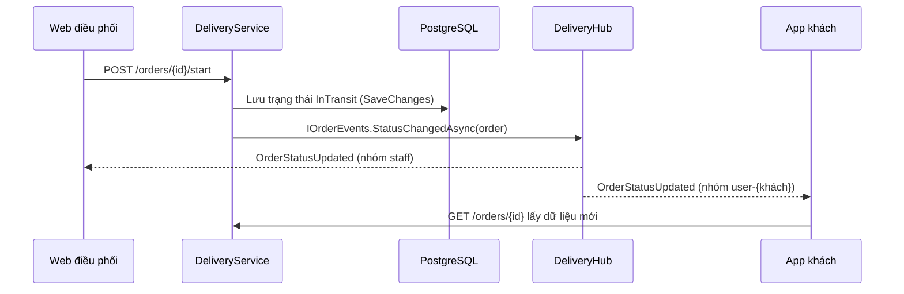
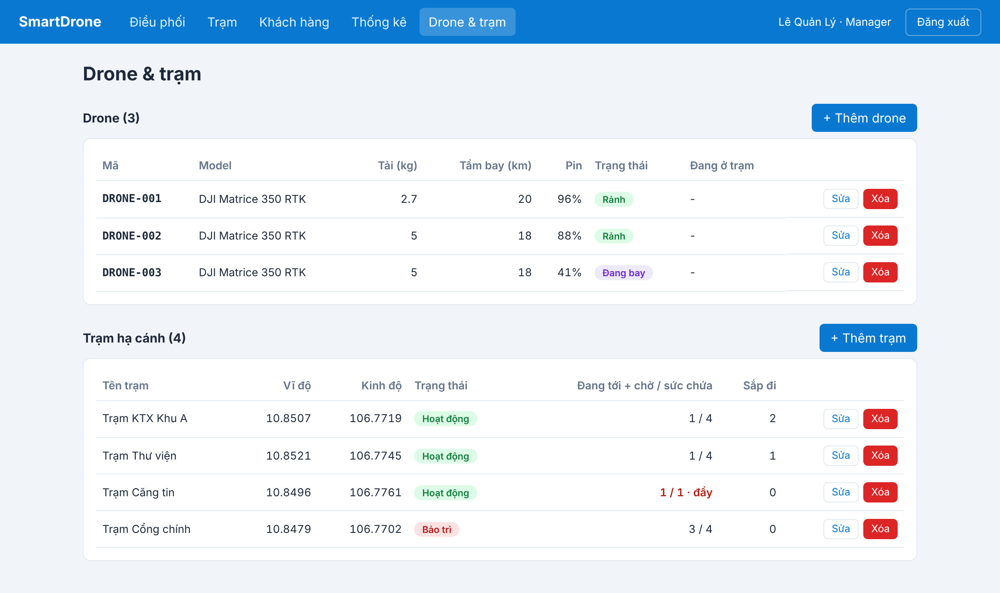

# Báo cáo v0.8 – Hoàn thiện công nghệ theo đề

Đồ án: AI-powered Drone Delivery Management Platform (SmartDroneDelivery) · Nhóm Mậu Huỳnh · GVHD: Nguyễn Văn Chiến
Ngày: 15/11/2026 · Nối tiếp [báo cáo v0.7](BaoCao_v0.7_Web_Mobile.md) · Bản tiếp theo: [v0.9](BaoCao_v0.9.md), [v0.10](BaoCao_v0.10.md)

## 1. Kết quả

Sau v0.8, hệ thống dùng **đủ toàn bộ công nghệ đề yêu cầu**, và mọi task còn mở của luồng giao hàng đã xong.

| Công nghệ theo đề | Dùng ở đâu |
|---|---|
| ASP.NET Core Web API | `src/` – Clean Architecture 4 tầng |
| PostgreSQL | EF Core + Npgsql, migration |
| ReactJS | Web nhân viên `web/` (từ v0.7) |
| Flutter | App khách hàng `mobile/` |
| **SignalR** | Hub `/hubs/delivery`, cập nhật trạng thái realtime (**mới v0.8**) |
| **MinIO** | Lưu ảnh kiện hàng (**mới v0.8**) |
| Docker | `docker compose up -d --build` dựng 4 service |
| AI | Chatbot tra đơn, trạm, ETA (gọi tool, không bịa); màn chat trên mobile **mới v0.8** |

| Task | Nội dung | Trạng thái |
|---|---|---|
| KAN-55 | SignalR hub + event đổi trạng thái | Xong |
| KAN-33 | Upload / xem ảnh kiện qua MinIO | Xong |
| KAN-57 | Hủy và hoàn đơn giao thất bại | Xong |
| KAN-59 | Web quản lý drone và trạm | Xong |
| KAN-67 | Mobile: trợ lý AI, sổ địa chỉ | Xong |
| KAN-37, 68 | Postman collection + test toàn luồng | Collection xong, **chưa chạy trên backend thật** |

## 2. Cập nhật realtime bằng SignalR

Ba quyết định thiết kế:

1. **Gửi sau khi lưu.** Event chỉ đi khi `SaveChanges` đã thành công, client tải lại luôn thấy đúng dữ liệu. Gửi lỗi chỉ ghi log, không làm hỏng thao tác của người bấm.
2. **Chia nhóm theo người.** Lúc kết nối, nhân viên vào nhóm `staff`, mọi người vào nhóm `user-{id}`. Event của 1 đơn chỉ gửi tới `staff` và đúng khách chủ đơn.
3. **Event chỉ báo, không chở dữ liệu.** Payload chỉ có id, mã đơn, trạng thái; client gọi lại API (đã kiểm quyền) để lấy chi tiết.

Theo Clean Architecture: interface `IOrderEvents` nằm ở `Domain`, hub và class cài đặt nằm ở `Infrastructure/Realtime`. Tầng `Services` không biết gì về SignalR.

Web và mobile vẫn giữ chế độ dự phòng: mất kết nối hub thì tự hỏi lại API mỗi 10 giây.

## 3. Ảnh kiện hàng trên MinIO

| Bước | Ai | API |
|---|---|---|
| 1. Chọn ảnh khi tạo đơn | App khách | `POST /packages/images` → `{ imageKey }` |
| 2. Gửi đơn kèm `package.imageKey` | App khách | `POST /orders` |
| 3. Xem ảnh khi gán drone | Web điều phối | `GET /orders/{id}/package-image` |
| 4. Xem ảnh ở chi tiết đơn | App khách | `GET /orders/{id}/package-image` |

- **DB chỉ lưu key** (`packages/2026/11/<guid>.jpg`), file nằm trong bucket `smartdrone` của MinIO.
- **Kiểm loại ảnh bằng byte đầu file** (JPEG `FF D8 FF`, PNG `89 50 4E 47...`, WEBP `RIFF..WEBP`), không tin đuôi file, giới hạn 5 MB.
- **Ảnh đi qua API** chứ không đưa link MinIO trực tiếp: kiểm được quyền (khách chỉ xem ảnh đơn mình), và địa chỉ `minio:9000` trong Docker không truy cập được từ điện thoại.

## 4. Các chức năng khác

**Hủy và hoàn đơn thất bại (KAN-57).** Trước đây đơn `Failed` chỉ có đường giao lại. Giờ điều phối viên có thêm nút **Hủy & hoàn**: nhập lý do → `POST /orders/{id}/return` → đơn `Cancelled`, khách nhận thông báo "hàng được hoàn lại trạm gửi". Đơn ở trạng thái khác bị chặn (409).

**Quản lý drone & trạm (web).** Trang `/fleet` cho Manager, Admin: bảng drone (tải, tầm bay, pin, trạng thái, trạm đang đậu) và bảng trạm (tọa độ, trạng thái), thêm/sửa/xóa qua hộp thoại. Xóa drone đang bay bị server chặn.

**Trợ lý AI (mobile).** Màn chat gọi `POST /ai/chat`, có 3 câu hỏi gợi ý. Chatbot tự tra đơn của chính khách đang đăng nhập.

**Ước tính thời gian bay (mobile).** Ở màn tạo đơn, chọn đủ trạm đi, trạm đến và cân nặng là app gọi `GET /orders/eta`, hiện ngay "bay khoảng X phút · Y km" (công thức Haversine + tốc độ drone), khách biết trước khi đặt.

**Sổ địa chỉ (mobile).** Thêm, sửa, xóa, đặt mặc định; màn tạo đơn có ô chọn địa chỉ nhận, tự chọn sẵn địa chỉ mặc định. Sửa luôn lỗi backend: đặt địa chỉ mặc định mới bị báo 409, giờ tự bỏ mặc định ở địa chỉ cũ.

## 5. Kiểm thử

Bảng đầy đủ 38 test case: [KiemThu_v0.8.md](KiemThu_v0.8.md).

| Cách kiểm | Phạm vi | Trạng thái |
|---|---|---|
| Postman collection (33 request, có assert) | Toàn luồng backend: 4 role, phân quyền 401/403, luồng giao trọn vẹn, OTP sai/đúng, thất bại → hủy và hoàn, báo cáo, CSV | Viết xong, kiểm cú pháp script; **chưa chạy trên backend thật** |
| Test giao diện web tự động (Playwright, API giả lập) | Đăng nhập theo role, điều phối, gán drone có ảnh, trạm + OTP, thống kê, drone & trạm, hủy và hoàn | Đạt, không lỗi JavaScript |
| CI GitHub Actions | Build backend, build web, `flutter analyze` + `flutter test` | Đã cấu hình, chạy khi mở PR |
| Bằng tay | App mobile, realtime giữa 2 máy, chatbot | Chưa chạy |

Máy làm bản v0.8 không có .NET, Flutter và Docker, nên **phần backend và mobile chưa được biên dịch thử**. CI là bước kiểm đầu tiên: mở PR lên GitHub, cả 3 job xanh thì code biên dịch được. Sau đó chạy Postman collection và kịch bản demo trên máy có Docker.

## 6. Kịch bản demo đầy đủ

| Bước | Ai | Thao tác | Thấy gì |
|---|---|---|---|
| 1 | Khách (app) | Tạo đơn kèm ảnh kiện, chọn địa chỉ nhận | Đơn "Chờ duyệt" |
| 2 | Điều phối (web) | Duyệt → gán drone (thấy ảnh kiện) → cất cánh | App tự đổi "Đang giao" ngay, có SnackBar |
| 3 | Trạm (web) | Drone đã tới trạm | App: chuông báo, mở ra thấy OTP chữ to |
| 4 | Khách + Trạm | Khách đọc OTP, trạm nhập | Hoàn tất trên cả web và app |
| 5 | Khách (app) | Hỏi trợ lý AI "đơn gần nhất của tôi tới đâu rồi" | AI trả lời đơn vừa hoàn tất |
| 6 | Điều phối (web) | Đơn thứ 2: cất cánh → báo lỗi → Hủy & hoàn | Khách nhận thông báo hủy |
| 7 | Quản lý (web) | Mở Thống kê, Drone & trạm | Số liệu cập nhật, thêm được drone mới |

Mật khẩu demo chung `Demo@12345`. Bước 5 cần `LLM_API_KEY` trong file `.env`.

## 7. Hạn chế

- Chưa biên dịch và chạy thử backend, mobile trên máy thật (xem mục 5).
- Chưa có bộ giả lập drone phát tọa độ và bản đồ theo dõi drone trên app. → *đã làm ở v0.9*
- Sổ địa chỉ chưa chọn tọa độ trên bản đồ.
- Chatbot phụ thuộc nhà cung cấp LLM bên ngoài và cần API key.
