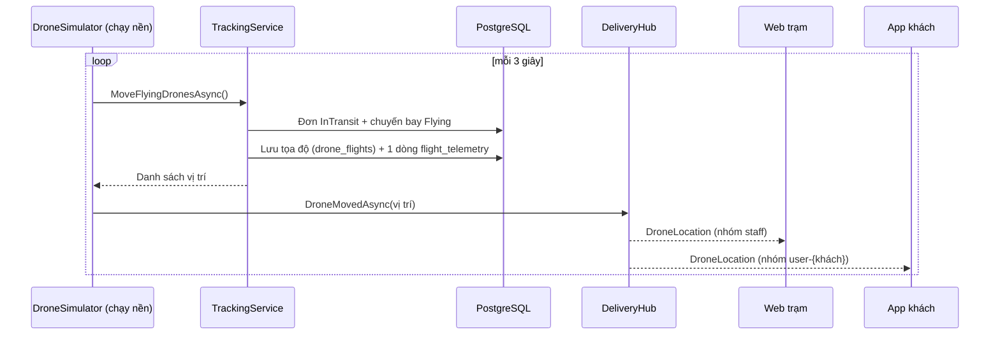
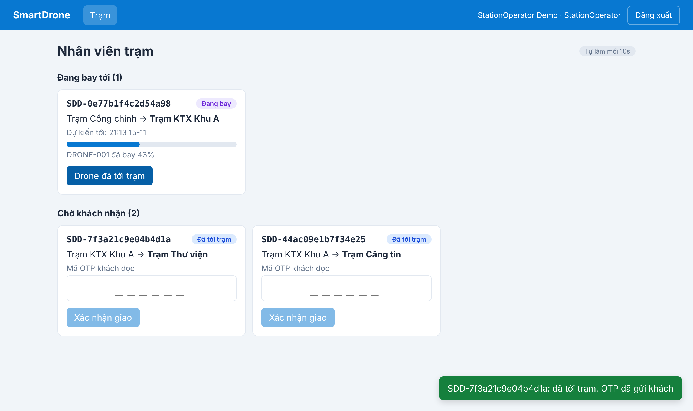
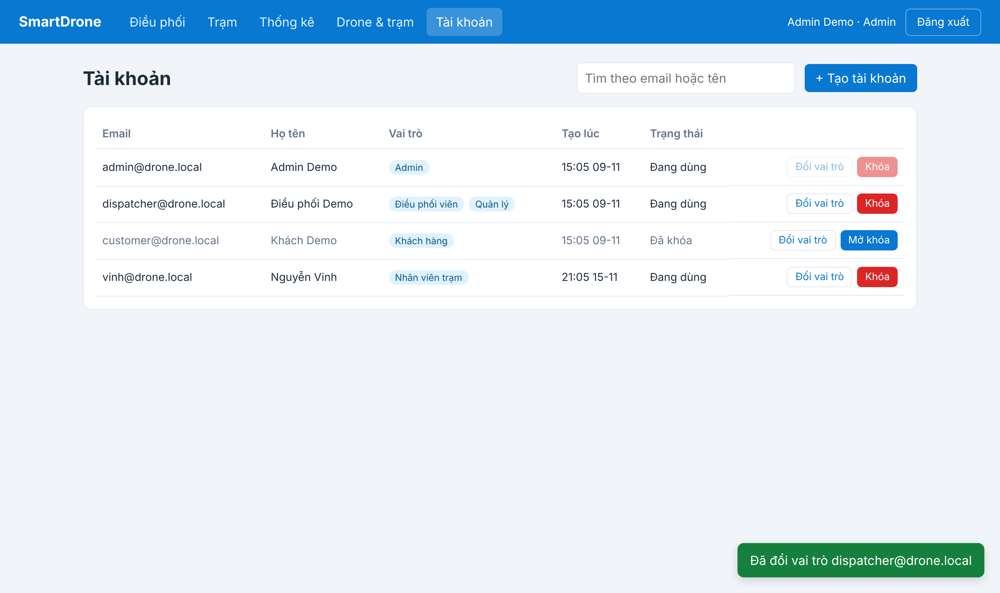

# Báo cáo v0.9 – Theo dõi drone realtime, quản lý tài khoản

Đồ án: AI-powered Drone Delivery Management Platform (SmartDroneDelivery) · Nhóm Mậu Huỳnh · GVHD: Nguyễn Văn Chiến
Ngày: 15/11/2026 · Nối tiếp [báo cáo v0.8](BaoCao_v0.8.md) (trước đó: [v0.7](BaoCao_v0.7_Web_Mobile.md)) · Bản tiếp theo: [v0.10](BaoCao_v0.10.md)

## 1. Kết quả

v0.8 còn 2 chỗ trống ở mục Hạn chế: **chưa có bộ giả lập drone** và **chưa có bản đồ theo dõi trên app**. v0.9 làm xong cả hai, thêm trang **quản lý tài khoản** cho Admin (API đã có từ trước nhưng web chưa có màn hình).

| Phần | Nội dung | Trạng thái |
|---|---|---|
| Backend | Bộ giả lập drone chạy nền, lưu tọa độ vào `drone_flights` + `flight_telemetry`, gửi event SignalR `DroneLocation` | Xong |
| Backend | `GET /orders/{id}/tracking`: vị trí drone, % đã bay, 2 trạm | Xong |
| Web | Trang Trạm hiện thanh tiến độ "DRONE-001 đã bay 43%" cho đơn đang bay, tự chạy theo event | Xong |
| Web | Trang **Tài khoản** (Admin): xem, tìm, tạo, đổi vai trò, khóa/mở | Xong |
| Mobile | Chi tiết đơn đang bay có thẻ **Theo dõi drone**: sơ đồ 2 trạm + chấm drone di chuyển, thanh % | Xong |
| Tài liệu | File `.md` cho **mọi file code** (152 file, chỉ chừa migration tự sinh) | Xong |
| Kiểm thử | Postman thêm 10 request (tracking, tài khoản), test giao diện web thêm tracking + tài khoản, test Flutter cho `TrackingInfo` | Xong, Postman **chưa chạy trên backend thật** |

## 2. Bộ giả lập drone

Đề tài không có drone thật, nên vị trí drone được **tính** từ giờ cất cánh và ETA, không bịa số ngẫu nhiên.

```
% đã bay = (bây giờ − giờ cất cánh) × TimeScale ÷ (ETA − giờ cất cánh)    kẹp trong 0–100 %
vị trí   = trạm đi + (trạm đến − trạm đi) × % đã bay                       nội suy thẳng
```



Quyết định thiết kế:

1. **`BackgroundService` của ASP.NET Core**, không thêm thư viện. Mỗi lượt tự tạo scope DI mới, vì dịch vụ chạy nền sống suốt đời app mà `DbContext` chỉ nên sống trong 1 lượt.
2. **Lỗi 1 lượt không làm chết bộ giả lập**: ghi log, lượt sau chạy tiếp.
3. **Tới 100 % thì đứng chờ**, không tự chuyển trạng thái. Đơn vẫn phải do nhân viên trạm bấm "Drone đã tới trạm" (luật của `OrderStateMachine` giữ nguyên).
4. **Cấu hình được** ở section `Simulator`: `Enabled` (tắt khi không cần), `IntervalSeconds` (mặc định 3), `TimeScale` (để 10 thì chuyến 10 phút bay xong trong 1 phút, tiện demo).
5. **Dùng lại bảng có sẵn**: `drone_flights.current_latitude/longitude` và `flight_telemetry` đã có từ migration đầu, giờ mới được ghi dữ liệu. Không cần migration mới.

Theo Clean Architecture: `TrackingSnapshot` và `IOrderEvents.DroneMovedAsync` ở `Domain`, công thức ở `Services/TrackingService.cs`, gửi SignalR ở `Infrastructure/Realtime`. Chi tiết: [TrackingService.md](../../src/Services/TrackingService.md), [DroneSimulator.md](../../src/Services/DroneSimulator.md).

## 3. Theo dõi trên web và app

| Ở đâu | Thấy gì | Lấy dữ liệu thế nào |
|---|---|---|
| Web – trang Trạm | Đơn đang bay có thanh tiến độ và chữ "DRONE-001 đã bay 43%" | Mở trang gọi `/tracking` từng đơn đang bay, sau đó cập nhật theo event `DroneLocation` |
| App – chi tiết đơn | Thẻ "Theo dõi drone": 2 chấm trạm, đường bay (đoạn đã bay tô đậm), chấm drone, thanh % | Như trên, chỉ hiện khi đơn `InTransit` hoặc `ArrivedAtStation` |



Sơ đồ trên app vẽ bằng `CustomPaint` của Flutter (`mobile/lib/tracking_map.dart`), không dùng Google Maps: không cần API key, không cần mạng để tải bản đồ, chạy được trên máy ảo. Tỷ lệ 2 trục bằng nhau nên hướng bay đúng thực tế.

Mất kết nối hub: web tự tải lại vị trí mỗi 10 giây (chế độ dự phòng có từ v0.8); app kéo xuống để tải lại.

## 4. Quản lý tài khoản (web, Admin)

Trang `/users` (menu "Tài khoản"), chỉ Admin thấy:

- Bảng tài khoản: email, họ tên, vai trò (dạng chip), trạng thái; ô tìm theo email/tên.
- **Tạo tài khoản** cho nhân viên mới (chọn 1 vai trò ban đầu).
- **Đổi vai trò** bằng ô tích, 1 người có thể nhiều vai trò (ví dụ vừa điều phối vừa trực trạm).
- **Khóa / mở khóa**: tài khoản bị khóa đăng nhập bị từ chối.
- Hàng của chính Admin đang đăng nhập bị **vô hiệu nút khóa và gỡ quyền Admin**; server cũng chặn (409), nên không ai tự khóa mình ra khỏi hệ thống.



Trang đăng nhập thêm nút demo `admin@drone.local`.

## 5. Tài liệu từng file

Từ v0.9, **mỗi file code đều có file `.md` đi kèm** (cùng tên, ví dụ `TrackingService.cs` → `TrackingService.md`) hoặc một dòng trong `README.md` của thư mục. Đã kiểm bằng script: 152 file `.cs`, `.jsx`, `.js`, `.dart`, `.py` đều có tài liệu, chỉ chừa thư mục `Migrations/` (EF Core tự sinh, có `README.md` chung). Mục lục app mobile: [mobile/lib/README.md](../../mobile/lib/README.md).

Mỗi file `.md` ghi: file làm gì, ai gọi nó, các hàm chính, lý do chọn cách làm. Thành viên đọc là giải thích được phần mình khi thầy hỏi.

## 6. Kiểm thử

Bảng test case v0.9 (nối tiếp 38 case của v0.8): [KiemThu_v0.9.md](KiemThu_v0.9.md).

| Cách kiểm | Thêm ở v0.9 | Trạng thái |
|---|---|---|
| Postman (43 request, trước là 33) | Tracking lúc đang bay và sau hoàn tất (100 %, đúng tọa độ trạm đến); nhóm 8 quản lý tài khoản: 403 cho Manager, tạo, đổi vai trò, khóa, tài khoản khóa không đăng nhập được, Admin tự khóa → 409 | Viết xong, kiểm cú pháp 43 script; **chưa chạy trên backend thật** |
| Test giao diện web (Playwright, API giả lập) | Thanh tiến độ trang Trạm, trang Tài khoản (tạo, khóa, đổi vai trò, nút của Admin bị khóa) | Đạt, không lỗi JavaScript |
| `flutter test` | `TrackingInfo.fromJson` và `moved()` | Viết xong, chạy trong CI |

Lỗi tìm ra khi viết test: ở 100 % tọa độ drone tính bằng `double` có thể lệch chữ số cuối so với tọa độ trạm đến (`a + (b − a) × 1 ≠ b`). Đã sửa: 0 % và 100 % trả đúng tọa độ trạm.

Như v0.8: máy làm bản này không có .NET, Flutter, Docker, nên **backend và mobile chưa biên dịch thử**. Mở PR để CI build, sau đó chạy Postman và kịch bản demo trên máy có Docker.

## 7. Kịch bản demo (bổ sung so với v0.8)

Chạy kịch bản 7 bước của [v0.8](BaoCao_v0.8.md#6-kịch-bản-demo-đầy-đủ), thêm:

| Bước | Ai | Thao tác | Thấy gì |
|---|---|---|---|
| 2b | Khách (app) | Sau khi điều phối bấm cất cánh, mở chi tiết đơn | Thẻ "Theo dõi drone", chấm drone chạy dần sang trạm đến |
| 2c | Trạm (web) | Mở trang Trạm cùng lúc | Thanh "đã bay N%" tăng theo app |
| 8 | Admin (web) | Đăng nhập admin → Tài khoản → tạo nhân viên trạm mới → khóa | Tài khoản mới đăng nhập bị từ chối |

Mẹo demo: đặt `Simulator__TimeScale=10` trong `docker-compose.yml` (service `api`) để drone bay xong trong khoảng 1 phút thay vì chờ đúng ETA.

## 8. Hạn chế

- Chưa biên dịch và chạy thử backend, mobile trên máy thật (mục 6).
- Đường bay là đường thẳng giữa 2 trạm, không tránh vật cản, không tính gió; pin drone không giảm theo quãng bay.
- Sơ đồ trên app không có nền bản đồ thật (chủ động bỏ để khỏi cần API key).
- Sổ địa chỉ chưa chọn tọa độ trên bản đồ.
- Chatbot phụ thuộc nhà cung cấp LLM bên ngoài và cần API key.
- AI mới có chatbot; tóm tắt chuyến giao (KAN-62) và phân tích vận hành chưa làm. → *đã làm ở v0.10*
